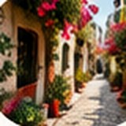
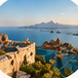
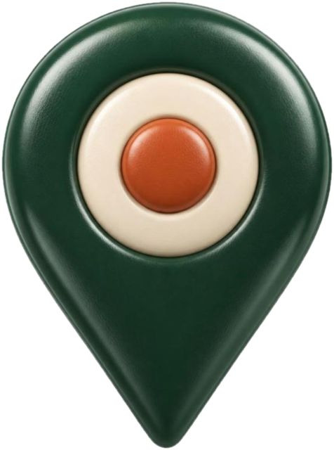
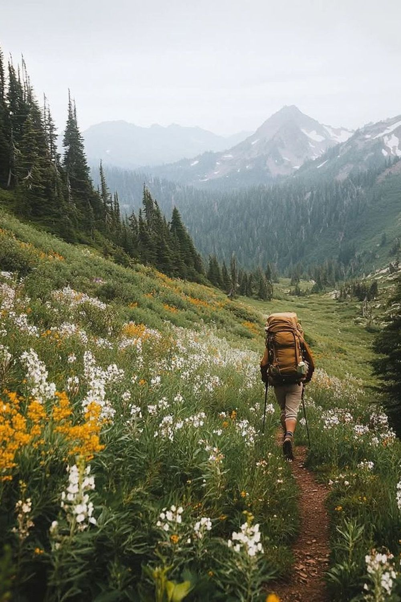
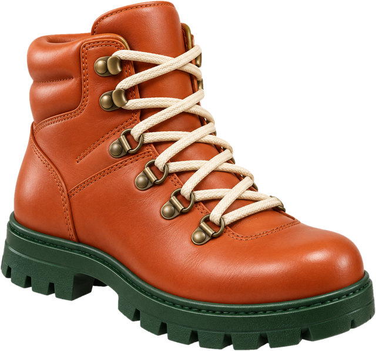

```html
<!DOCTYPE html>
<html lang="en" dir="ltr" data-theme="day" data-device="phone" data-active-screen="plan">
<head>
<meta charset="UTF-8" />
<meta name="viewport" content="width=device-width, initial-scale=1.0" />
<title>Traike — AI Walking Companion (Round 6 App Interface)</title>
<link rel="preconnect" href="https://fonts.googleapis.com" />
<link rel="preconnect" href="https://fonts.gstatic.com" crossorigin />
<link href="https://fonts.googleapis.com/css2?family=Figtree:wght@400;500;600;700&family=Frank+Ruhl+Libre:wght@600;700;800&family=Fraunces:opsz,wght@9..144,600;9..144,700&family=Heebo:wght@400;500;600;700&display=swap" rel="stylesheet" />
<style>
  /* ==========================================================================
     1. ROLE-BASED DESIGN TOKENS (Single 8px grid, single radius & shadow system)
     ========================================================================== */
  :root {
    /* Surfaces */
    --canvas: #e9e2d7;
    --surface: #fbf8f3;
    --surface-glass: rgba(251, 248, 243, 0.96);
    --surface-soft: #f4ede3;
    --card: #ffffff;

    /* Ink & Hierarchy */
    --ink: #231f1c;
    --heading: #1e3d2f;
    --muted: #6b6259;
    --line: #e8dfd2;
    --line-strong: #d8ccbc;

    /* Brand Terracotta (Primary & Selection — zero black fills) */
    --primary: #c15f3c;
    --primary-hover: #b5512b;
    --primary-lip: #964121;
    --primary-ink: #ffffff;
    --sel-bg: rgba(193, 95, 60, 0.12);
    --sel-line: rgba(193, 95, 60, 0.55);
    --sel-ink: #a14322;

    /* Supporting Map & Route Tokens */
    --route-ink: #231f1c;
    --route-past: #b8aea2;
    --map-land: #f3ede2;
    --map-block: #ebe3d5;
    --map-park: #dce6d5;
    --map-water: #cbe0ea;
    --map-road: #ffffff;
    --map-arterial: #f9e3be;
    --map-halo: rgba(251, 248, 243, 0.92);
    --danger: #b83b2a;

    /* Hero Scrim & Seamless Melt into --surface */
    --hero-top-scrim: rgba(28, 20, 15, 0.34);
    --hero-mid-scrim: rgba(42, 26, 18, 0.22);

    /* Unified Geometry & Depth */
    --r-sheet: 20px;
    --r-card: 14px;
    --r-ctrl: 10px;
    --r-pill: 999px;
    --shadow-panel: 0 16px 40px rgba(35, 31, 28, 0.12), 0 2px 8px rgba(35, 31, 28, 0.05);
    --shadow-float: 0 6px 18px rgba(35, 31, 28, 0.10);

    /* Typography */
    --font-display: 'Fraunces', 'Frank Ruhl Libre', Georgia, serif;
    --font-sans: 'Figtree', 'Heebo', system-ui, sans-serif;

    /* 5-step Type Scale (nothing under 13px) */
    --t-hero: 3.25rem;   /* 52px giant numeral */
    --t-h1: 1.5rem;      /* 24px single headline */
    --t-h2: 1.0625rem;   /* 17px section / stop title */
    --t-body: 0.9375rem; /* 15px UI / body (16px inputs) */
    --t-meta: 0.8125rem; /* 13px minimum secondary */
  }

  :root[data-theme="night"] {
    --canvas: #14110f;
    --surface: #211c19;
    --surface-glass: rgba(33, 28, 25, 0.96);
    --surface-soft: #2b2420;
    --card: #29221e;

    --ink: #f5efe8;
    --heading: #f7f1ea;
    --muted: #b3a69a;
    --line: #38302b;
    --line-strong: #4a3f38;

    --primary: #d46b46;
    --primary-hover: #df7752;
    --primary-lip: #8f3d20;
    --primary-ink: #ffffff;
    --sel-bg: rgba(212, 107, 70, 0.18);
    --sel-line: rgba(212, 107, 70, 0.65);
    --sel-ink: #f69d7c;

    --route-ink: #f5efe8;
    --route-past: #695e55;
    --map-land: #1a1614;
    --map-block: #211c19;
    --map-park: #1f2b23;
    --map-water: #192933;
    --map-road: #2a2420;
    --map-arterial: #3b3025;
    --map-halo: rgba(26, 22, 20, 0.92);
    --danger: #e56b58;

    --hero-top-scrim: rgba(16, 12, 10, 0.46);
    --hero-mid-scrim: rgba(22, 16, 13, 0.34);

    --shadow-panel: 0 18px 44px rgba(0, 0, 0, 0.44), 0 2px 8px rgba(0, 0, 0, 0.28);
    --shadow-float: 0 8px 22px rgba(0, 0, 0, 0.38);
  }

  html[dir="rtl"] {
    --font-display: 'Frank Ruhl Libre', 'Fraunces', serif;
    --font-sans: 'Heebo', 'Figtree', sans-serif;
  }

  *, *::before, *::after {
    box-sizing: border-box;
    margin: 0;
    padding: 0;
  }

  body {
    background: var(--canvas);
    color: var(--ink);
    font-family: var(--font-sans);
    font-size: var(--t-body);
    line-height: 1.45;
    -webkit-font-smoothing: antialiased;
    min-height: 100vh;
    transition: background-color 0.2s ease, color 0.2s ease;
  }

  button, input, textarea, select {
    font: inherit;
    color: inherit;
  }

  button {
    cursor: pointer;
    border: none;
    background: none;
  }

  /* Directional icons mirror cleanly in Hebrew RTL */
  html[dir="rtl"] .dir-flip {
    transform: scaleX(-1);
  }

  /* Language switching visibility */
  html[lang="en"] [data-i18n="he"] { display: none !important; }
  html[lang="he"] [data-i18n="en"] { display: none !important; }

  /* ==========================================================================
     2. SHOWCASE GALLERY BAR (Outside the product frame)
     ========================================================================== */
  .showcase-bar {
    background: #1d1916;
    color: #f3ede4;
    padding-block: 12px;
    padding-inline: 20px;
    border-block-end: 1px solid rgba(255, 255, 255, 0.08);
    direction: ltr;
  }

  .showcase-row {
    max-width: 1200px;
    margin-inline: auto;
    display: flex;
    flex-wrap: wrap;
    align-items: center;
    justify-content: space-between;
    gap: 12px;
  }

  .showcase-brand {
    display: flex;
    align-items: baseline;
    gap: 10px;
  }

  .showcase-logo {
    font-family: 'Fraunces', serif;
    font-weight: 700;
    font-size: 1.25rem;
    color: #df7550;
  }

  .showcase-sub {
    font-size: 0.8125rem;
    color: #aba095;
  }

  .showcase-toggles {
    display: flex;
    flex-wrap: wrap;
    gap: 8px;
  }

  .seg-pill {
    display: inline-flex;
    background: #2a2420;
    border: 1px solid #3c342e;
    border-radius: var(--r-ctrl);
    padding: 2px;
  }

  .seg-pill button {
    padding-block: 6px;
    padding-inline: 12px;
    font-size: 0.8125rem;
    font-weight: 600;
    color: #bfb4a8;
    border-radius: 8px;
    transition: all 0.15s ease;
  }

  .seg-pill button.is-on {
    background: #c15f3c;
    color: #ffffff;
  }

  .showcase-screens {
    max-width: 1200px;
    margin-inline: auto;
    margin-block-start: 10px;
    padding-block-start: 10px;
    border-block-start: 1px solid rgba(255, 255, 255, 0.07);
    display: flex;
    flex-wrap: wrap;
    justify-content: center;
    gap: 6px;
  }

  .showcase-screens button {
    padding-block: 6px;
    padding-inline: 14px;
    border-radius: var(--r-ctrl);
    font-size: 0.8125rem;
    font-weight: 600;
    color: #c8bdb1;
    background: #26201d;
    border: 1px solid #38302b;
    transition: all 0.15s ease;
  }

  .showcase-screens button.is-on {
    background: #fbf8f3;
    color: #231f1c;
    border-color: #fbf8f3;
  }

  /* ==========================================================================
     3. DEVICE STAGE & UNIFIED APP FRAME
     ========================================================================== */
  .stage-wrap {
    padding-block: 28px 48px;
    padding-inline: 16px;
    display: flex;
    justify-content: center;
    align-items: flex-start;
  }

  .app-frame {
    position: relative;
    background: var(--surface);
    color: var(--ink);
    box-shadow: 0 24px 60px rgba(25, 20, 16, 0.18), 0 0 0 1px var(--line-strong);
    overflow: hidden;
    transition: width 0.25s ease, height 0.25s ease;
  }

  /* PHONE = 390px continuous warm sheet / map+sheet */
  html[data-device="phone"] .app-frame {
    width: 390px;
    min-height: 824px;
    border-radius: 34px;
    display: flex;
    flex-direction: column;
  }

  /* DESKTOP = 1180px x 760px: Slim Rail + Floating Soft Panel over Full-Bleed Map */
  html[data-device="desktop"] .app-frame {
    width: 1180px;
    height: 760px;
    border-radius: 22px;
    display: flex;
  }

  /* ==========================================================================
     4. DESKTOP SLIM ICON RAIL (Matches real app structure, warm cream, zero black)
     ========================================================================== */
  .desktop-rail {
    display: none;
  }

  html[data-device="desktop"] .desktop-rail {
    display: flex;
    flex-direction: column;
    align-items: center;
    width: 76px;
    flex-shrink: 0;
    background: var(--surface);
    border-inline-end: 1px solid var(--line);
    padding-block: 16px;
    z-index: 30;
    justify-content: space-between;
  }

  .rail-top, .rail-bottom {
    display: flex;
    flex-direction: column;
    align-items: center;
    gap: 8px;
    width: 100%;
  }

  .rail-fab {
    width: 44px;
    height: 44px;
    border-radius: var(--r-pill);
    background: var(--primary);
    color: #ffffff;
    display: grid;
    place-items: center;
    box-shadow: 0 3px 10px rgba(193, 95, 60, 0.32);
    margin-block-end: 8px;
    transition: transform 0.15s ease, background-color 0.15s ease;
  }

  .rail-fab:hover {
    background: var(--primary-hover);
    transform: translateY(-1px);
  }

  .rail-btn {
    width: 60px;
    min-height: 52px;
    border-radius: var(--r-ctrl);
    display: flex;
    flex-direction: column;
    align-items: center;
    justify-content: center;
    gap: 4px;
    color: var(--muted);
    font-size: var(--t-meta);
    font-weight: 600;
    position: relative;
    transition: background-color 0.15s ease, color 0.15s ease;
  }

  .rail-btn:hover {
    background: var(--surface-soft);
    color: var(--ink);
  }

  .rail-btn.is-active {
    background: var(--sel-bg);
    color: var(--primary);
  }

  .rail-btn.is-active::after {
    content: "";
    position: absolute;
    inset-block: 12px;
    inset-inline-start: 0;
    width: 3px;
    border-radius: var(--r-pill);
    background: var(--primary);
  }

  /* ==========================================================================
     5. REAL-LOOKING VECTOR CITY MAP STAGE
     ========================================================================== */
  .workspace {
    position: relative;
    flex: 1;
    min-width: 0;
    display: flex;
    flex-direction: column;
  }

  html[data-device="desktop"] .workspace {
    height: 100%;
    overflow: hidden;
  }

  .map-canvas {
    position: relative;
    background: var(--map-land);
    overflow: hidden;
    user-select: none;
  }

  /* Desktop: Map is always full-bleed behind the floating panel */
  html[data-device="desktop"] .map-canvas {
    position: absolute;
    inset: 0;
    z-index: 1;
  }

  /* Phone: Map shows at top ONLY on Plan (peek) and Walk (tall); hidden on full-hero screens */
  html[data-device="phone"] .map-canvas {
    display: none;
    width: 100%;
    flex-shrink: 0;
  }

  html[data-device="phone"][data-active-screen="plan"] .map-canvas {
    display: block;
    height: 168px;
  }

  html[data-device="phone"][data-active-screen="walk"] .map-canvas {
    display: block;
    height: 288px;
  }

  .map-svg {
    width: 100%;
    height: 100%;
    display: block;
  }

  /* Map typography with warm halo so street names never clash */
  .map-street-label {
    font-family: var(--font-sans);
    font-size: 13px;
    font-weight: 600;
    fill: var(--muted);
    paint-order: stroke;
    stroke: var(--map-halo);
    stroke-width: 4px;
    stroke-linejoin: round;
  }

  .map-park-label {
    font-family: var(--font-sans);
    font-size: 13px;
    font-weight: 600;
    fill: #4b6953;
    paint-order: stroke;
    stroke: var(--map-halo);
    stroke-width: 3.5px;
  }

  :root[data-theme="night"] .map-park-label {
    fill: #8eb397;
  }

  .map-water-label {
    font-family: var(--font-display);
    font-style: italic;
    font-size: 14px;
    fill: #5b8296;
    opacity: 0.85;
  }

  /* Map floating controls (warm cream, subtle shadow — never black) */
  .map-float-top {
    position: absolute;
    inset-block-start: 16px;
    inset-inline-end: 16px;
    display: flex;
    align-items: center;
    gap: 8px;
    z-index: 10;
  }

  html[data-device="phone"] .map-float-top {
    inset-block-start: 12px;
    inset-inline-end: 12px;
  }

  .map-chip {
    background: var(--surface-glass);
    backdrop-filter: blur(8px);
    border: 1px solid var(--line);
    box-shadow: var(--shadow-float);
    border-radius: var(--r-pill);
    padding-block: 7px;
    padding-inline: 14px;
    font-size: var(--t-meta);
    font-weight: 600;
    color: var(--ink);
    display: inline-flex;
    align-items: center;
    gap: 6px;
  }

  .map-chip-dot {
    width: 8px;
    height: 8px;
    border-radius: var(--r-pill);
    background: var(--primary);
  }

  .map-zoom {
    position: absolute;
    inset-block-end: 36px;
    inset-inline-end: 16px;
    display: flex;
    flex-direction: column;
    background: var(--surface-glass);
    border: 1px solid var(--line);
    border-radius: var(--r-ctrl);
    box-shadow: var(--shadow-float);
    overflow: hidden;
    z-index: 10;
  }

  html[data-device="phone"] .map-zoom {
    display: none;
  }

  .map-zoom button {
    width: 38px;
    height: 38px;
    display: grid;
    place-items: center;
    font-size: 1.125rem;
    font-weight: 600;
    color: var(--ink);
  }

  .map-zoom button + button {
    border-block-start: 1px solid var(--line);
  }

  .map-attrib {
    position: absolute;
    inset-block-end: 10px;
    inset-inline-end: 16px;
    font-size: 13px;
    color: var(--muted);
    background: var(--surface-glass);
    padding-block: 2px;
    padding-inline: 8px;
    border-radius: 6px;
    border: 1px solid var(--line);
    z-index: 10;
  }

  html[data-device="phone"] .map-attrib {
    display: none;
  }

  /* ==========================================================================
     6. FLOATING SOFT PANEL (Desktop) / ROUNDED SHEET (Phone)
     ========================================================================== */
  .panel-shell {
    position: relative;
    z-index: 20;
    background: var(--surface);
    display: flex;
    flex-direction: column;
    flex: 1;
  }

  /* Phone: seamless or overlapping 20px top-rounded bottom sheet */
  html[data-device="phone"] .panel-shell {
    width: 100%;
    padding-block-end: 76px; /* room for warm bottom nav */
  }

  html[data-device="phone"][data-active-screen="plan"] .panel-shell,
  html[data-device="phone"][data-active-screen="walk"] .panel-shell {
    margin-block-start: -22px;
    border-start-start-radius: var(--r-sheet);
    border-start-end-radius: var(--r-sheet);
    box-shadow: 0 -8px 28px rgba(35, 31, 28, 0.12);
    overflow: hidden;
  }

  /* Desktop: ~440px soft floating panel over the full-bleed map */
  html[data-device="desktop"] .panel-shell {
    position: absolute;
    inset-block: 16px;
    inset-inline-start: 16px;
    width: 444px;
    flex: none;
    background: var(--surface-glass);
    backdrop-filter: blur(12px);
    border: 1px solid var(--line);
    border-radius: var(--r-sheet);
    box-shadow: var(--shadow-panel);
    overflow-y: auto;
    overflow-x: hidden;
    scrollbar-width: thin;
  }

  /* Login screen on Desktop centers the floating panel for calm focus */
  html[data-device="desktop"][data-active-screen="login"] .panel-shell {
    inset-inline-start: 50%;
    transform: translateX(-50%);
    width: 440px;
    height: fit-content;
    max-height: calc(100% - 32px);
    margin-block: auto;
  }

  html[dir="rtl"][data-device="desktop"][data-active-screen="login"] .panel-shell {
    inset-inline-start: auto;
    inset-inline-end: 50%;
    transform: translateX(50%);
  }

  /* Screen visibility */
  .screen-view {
    display: none;
    flex-direction: column;
    min-width: 0;
  }

  .screen-view.is-active {
    display: flex;
  }

  /* Grab handle on phone map-overlapped sheets */
  .sheet-grab {
    display: none;
  }

  html[data-device="phone"] .sheet-grab {
    display: flex;
    justify-content: center;
    padding-block: 10px 4px;
    position: relative;
    z-index: 5;
  }

  .sheet-grab span {
    width: 36px;
    height: 4px;
    border-radius: var(--r-pill);
    background: var(--line-strong);
  }

  .sheet-grab.on-photo span {
    background: rgba(255, 255, 255, 0.55);
  }

  /* ==========================================================================
     7. BLENDED SUNSET HERO HEADER (Melts smoothly into --surface, zero hard edge!)
     ========================================================================== */
  .hero-blend {
    position: relative;
    padding-inline: 24px;
    padding-block-start: 20px;
    padding-block-end: 28px;
    overflow: hidden;
  }

  html[data-device="phone"] .hero-blend {
    padding-inline: 20px;
  }

  .hero-photo {
    position: absolute;
    inset: 0;
    width: 100%;
    height: 100%;
    object-fit: cover;
    object-position: center 35%;
    z-index: 0;
  }

  /* Swap day/night sunset photographs cleanly */
  :root[data-theme="day"] .photo-night { display: none; }
  :root[data-theme="night"] .photo-day { display: none; }

  /* Long smooth multi-stop gradient melting photo seamlessly into --surface */
  .hero-melt {
    position: absolute;
    inset: 0;
    z-index: 1;
    background: linear-gradient(
      180deg,
      var(--hero-top-scrim) 0%,
      var(--hero-mid-scrim) 42%,
      color-mix(in srgb, var(--surface) 78%, transparent) 78%,
      var(--surface) 100%
    );
  }

  .hero-content {
    position: relative;
    z-index: 2;
  }

  /* Top brand / location row inside hero */
  .hero-topbar {
    display: flex;
    align-items: center;
    justify-content: space-between;
    gap: 12px;
    margin-block-end: 20px;
  }

  .wordmark {
    font-family: var(--font-display);
    font-weight: 700;
    font-size: 1.375rem;
    letter-spacing: -0.01em;
    color: #ffffff;
    text-shadow: 0 1px 8px rgba(20, 12, 8, 0.35);
    display: inline-flex;
    align-items: center;
    gap: 8px;
  }

  .wordmark-ink {
    color: var(--primary-hover);
    text-shadow: none;
  }

  .loc-pill {
    background: rgba(28, 21, 17, 0.48);
    backdrop-filter: blur(8px);
    border: 1px solid rgba(255, 255, 255, 0.22);
    color: #ffffff;
    padding-block: 5px;
    padding-inline: 12px;
    border-radius: var(--r-pill);
    font-size: var(--t-meta);
    font-weight: 600;
    display: inline-flex;
    align-items: center;
    gap: 6px;
  }

  /* Giant Serif Numeral (Home & Live Walk hero data) */
  .hero-metric-row {
    display: flex;
    align-items: flex-end;
    justify-content: space-between;
    gap: 16px;
    margin-block-top: 8px;
  }

  .giant-num-wrap {
    display: flex;
    align-items: baseline;
    gap: 6px;
    color: #ffffff;
    text-shadow: 0 2px 14px rgba(24, 14, 8, 0.42);
  }

  .giant-num-wrap.on-surface {
    color: var(--heading);
    text-shadow: none;
  }

  .giant-num {
    font-family: var(--font-display);
    font-size: var(--t-hero);
    font-weight: 700;
    line-height: 0.92;
    font-variant-numeric: tabular-nums;
    letter-spacing: -0.02em;
  }

  .giant-unit {
    font-family: var(--font-display);
    font-size: 1.375rem;
    font-weight: 600;
  }

  .hero-headline {
    font-family: var(--font-display);
    font-size: var(--t-h1);
    font-weight: 700;
    line-height: 1.2;
    color: #ffffff;
    text-shadow: 0 2px 12px rgba(24, 14, 8, 0.42);
  }

  .hero-sub {
    margin-block-start: 6px;
    font-size: var(--t-body);
    font-weight: 500;
    color: var(--ink);
  }

  .hero-sub-light {
    margin-block-start: 6px;
    font-size: var(--t-body);
    font-weight: 500;
    color: rgba(255, 250, 244, 0.95);
    text-shadow: 0 1px 8px rgba(20, 12, 8, 0.45);
  }

  /* Single 3D Glossy Accessory per screen — calm corner, never overlapping text */
  .acc-3d {
    width: 60px;
    height: 60px;
    object-fit: contain;
    flex-shrink: 0;
    filter: drop-shadow(0 8px 14px rgba(28, 18, 12, 0.24));
  }

  /* ==========================================================================
     8. REAL GUIDE CHARACTER + SPEECH CARD (Plan & Login)
     ========================================================================== */
  .guide-stage {
    display: flex;
    align-items: flex-end;
    gap: 12px;
    margin-block-start: 14px;
  }

  .guide-portrait {
    width: 112px;
    height: 138px;
    flex-shrink: 0;
    position: relative;
    border-radius: 999px 999px 16px 16px;
    overflow: hidden;
    background: var(--surface);
    box-shadow: 0 8px 20px rgba(35, 31, 28, 0.14);
    border: 2px solid rgba(255, 255, 255, 0.65);
    /* Smooth fade at bottom so he melts into the panel */
    -webkit-mask-image: linear-gradient(to bottom, #000 84%, transparent 100%);
    mask-image: linear-gradient(to bottom, #000 84%, transparent 100%);
  }

  :root[data-theme="night"] .guide-portrait {
    border-color: rgba(255, 255, 255, 0.18);
  }

  .guide-portrait img {
    width: 100%;
    height: 100%;
    object-fit: cover;
    object-position: center top;
    display: block;
  }

  .speech-card {
    flex: 1;
    min-width: 0;
    background: var(--card);
    border: 1px solid var(--line);
    border-radius: var(--r-card);
    padding: 14px 16px;
    box-shadow: var(--shadow-float);
    position: relative;
    margin-block-end: 8px;
  }

  .speech-title {
    font-weight: 700;
    font-size: var(--t-body);
    color: var(--heading);
    margin-block-end: 3px;
  }

  .speech-text {
    font-size: 0.875rem;
    color: var(--muted);
    line-height: 1.4;
  }

  /* ==========================================================================
     9. BODY GUTTERS, SECTIONS & ROUTE-SPINE TIMELINE
     ========================================================================== */
  .sheet-body {
    padding-inline: 24px;
    padding-block-end: 24px;
    display: flex;
    flex-direction: column;
    gap: 20px;
  }

  html[data-device="phone"] .sheet-body {
    padding-inline: 20px;
  }

  .sec-head {
    display: flex;
    align-items: baseline;
    justify-content: space-between;
    gap: 8px;
    margin-block-end: 10px;
  }

  .sec-title {
    font-size: var(--t-body);
    font-weight: 700;
    color: var(--heading);
  }

  .sec-meta {
    font-size: var(--t-meta);
    font-weight: 500;
    color: var(--muted);
  }

  .text-link {
    font-size: var(--t-meta);
    font-weight: 600;
    color: var(--primary);
  }

  /* VERTICAL ROUTE SPINE (The route itself is the list!) */
  .route-spine {
    display: flex;
    flex-direction: column;
  }

  .spine-stop {
    display: grid;
    grid-template-columns: 44px 22px 1fr auto;
    align-items: center;
    column-gap: 10px;
    padding-block: 8px;
    padding-inline: 10px;
    border-radius: var(--r-ctrl);
    position: relative;
    transition: background-color 0.15s ease;
  }

  /* Soft orange tint + orange hairline for active/featured stop — NEVER black */
  .spine-stop.is-current {
    background: var(--sel-bg);
    box-shadow: inset 0 0 0 1px var(--sel-line);
  }

  .spine-time {
    font-size: var(--t-meta);
    font-weight: 600;
    color: var(--muted);
    font-variant-numeric: tabular-nums;
  }

  .spine-stop.is-current .spine-time {
    color: var(--sel-ink);
    font-weight: 700;
  }

  .spine-node-col {
    display: flex;
    justify-content: center;
    align-items: center;
    position: relative;
    height: 100%;
  }

  .spine-dot {
    width: 12px;
    height: 12px;
    border-radius: var(--r-pill);
    background: var(--surface);
    border: 2.5px solid var(--route-ink);
    z-index: 2;
  }

  .spine-stop.is-passed .spine-dot {
    border-color: var(--route-past);
    background: var(--route-past);
  }

  .spine-stop.is-current .spine-dot {
    border-color: var(--primary);
    background: var(--primary);
    box-shadow: 0 0 0 3px var(--sel-bg);
  }

  .spine-info {
    display: flex;
    align-items: center;
    gap: 10px;
    min-width: 0;
  }

  .stop-thumb {
    width: 36px;
    height: 36px;
    border-radius: 8px;
    object-fit: cover;
    flex-shrink: 0;
    border: 1px solid var(--line);
  }

  .stop-texts {
    min-width: 0;
  }

  .stop-name {
    font-size: var(--t-body);
    font-weight: 600;
    color: var(--ink);
    white-space: nowrap;
    overflow: hidden;
    text-overflow: ellipsis;
  }

  .spine-stop.is-passed .stop-name {
    color: var(--muted);
  }

  .stop-note {
    font-size: var(--t-meta);
    color: var(--muted);
  }

  .stop-tag {
    font-size: var(--t-meta);
    font-weight: 600;
    color: var(--muted);
    padding-block: 3px;
    padding-inline: 8px;
    border-radius: var(--r-pill);
    background: var(--surface-soft);
    white-space: nowrap;
  }

  .spine-stop.is-current .stop-tag {
    background: var(--primary);
    color: #ffffff;
  }

  /* Connecting trail segment with walking minutes between stops */
  .spine-leg {
    display: grid;
    grid-template-columns: 44px 22px 1fr;
    column-gap: 10px;
    padding-inline: 10px;
    height: 22px;
    align-items: center;
  }

  .spine-line {
    width: 2px;
    height: 100%;
    background: var(--line-strong);
    margin-inline: auto;
  }

  .spine-leg-text {
    font-size: var(--t-meta);
    color: var(--muted);
  }

  /* ==========================================================================
     10. CONTROLS: PHOTO CHIPS, INPUTS, SEGMENTED TIME & TACTILE BUTTONS
     ========================================================================== */
  .vibe-grid {
    display: flex;
    flex-wrap: wrap;
    gap: 8px;
  }

  .vibe-chip {
    display: inline-flex;
    align-items: center;
    gap: 8px;
    min-height: 44px;
    padding-block: 5px;
    padding-inline: 6px 12px;
    border-radius: var(--r-ctrl);
    background: var(--card);
    border: 1px solid var(--line);
    font-size: 0.875rem;
    font-weight: 600;
    color: var(--ink);
    transition: all 0.15s ease;
  }

  .vibe-chip:hover {
    border-color: var(--line-strong);
  }

  /* Soft orange tint + orange border + bold text — zero black blocks! */
  .vibe-chip.is-selected {
    background: var(--sel-bg);
    border-color: var(--primary);
    color: var(--sel-ink);
    font-weight: 700;
  }

  .vibe-chip img {
    width: 28px;
    height: 28px;
    border-radius: 7px;
    object-fit: cover;
    flex-shrink: 0;
  }

  .prompt-box {
    width: 100%;
    min-height: 80px;
    padding: 12px 14px;
    border-radius: var(--r-ctrl);
    background: var(--card);
    border: 1px solid var(--line-strong);
    font-size: 1rem; /* >=16px prevents phone zoom */
    line-height: 1.45;
    color: var(--ink);
    resize: vertical;
    transition: border-color 0.15s ease, box-shadow 0.15s ease;
  }

  .prompt-box:focus, .field-input:focus {
    outline: none;
    border-color: var(--primary);
    box-shadow: 0 0 0 3px var(--sel-bg);
  }

  .field-input {
    width: 100%;
    min-height: 46px;
    padding-inline: 14px;
    border-radius: var(--r-ctrl);
    background: var(--card);
    border: 1px solid var(--line-strong);
    font-size: 1rem;
    color: var(--ink);
  }

  /* Segmented Control (Selected = Solid Terracotta or Tint; Unselected = Cream + Hairline) */
  .seg-bar {
    display: grid;
    grid-template-columns: repeat(4, 1fr);
    background: var(--card);
    border: 1px solid var(--line);
    border-radius: var(--r-ctrl);
    padding: 3px;
    gap: 3px;
  }

  .seg-bar.two-col {
    grid-template-columns: repeat(2, 1fr);
  }

  .seg-bar button {
    min-height: 40px;
    border-radius: 8px;
    font-size: 0.875rem;
    font-weight: 600;
    color: var(--ink);
    transition: all 0.15s ease;
  }

  .seg-bar button.is-selected {
    background: var(--primary);
    color: #ffffff;
    font-weight: 700;
    box-shadow: 0 1px 4px rgba(193, 95, 60, 0.28);
  }

  /* Progressive disclosure row */
  .more-disclosure {
    border-block-start: 1px solid var(--line);
    padding-block-start: 12px;
  }

  .more-trigger {
    width: 100%;
    min-height: 36px;
    display: flex;
    align-items: center;
    justify-content: space-between;
    font-size: 0.875rem;
    font-weight: 600;
    color: var(--muted);
  }

  .more-panel {
    display: none;
    padding-block-start: 12px;
    gap: 10px;
    flex-direction: column;
  }

  .more-disclosure.is-open .more-panel {
    display: flex;
  }

  /* ONE Primary Action Button per screen — warm terracotta with soft warm lip */
  .btn-primary {
    width: 100%;
    min-height: 50px;
    padding-inline: 20px;
    border-radius: var(--r-ctrl);
    background: var(--primary);
    color: var(--primary-ink);
    font-size: 1rem;
    font-weight: 700;
    display: inline-flex;
    align-items: center;
    justify-content: center;
    gap: 8px;
    box-shadow: 0 2px 0 var(--primary-lip), 0 6px 16px rgba(193, 95, 60, 0.24);
    transition: background-color 0.15s ease, transform 0.1s ease;
  }

  .btn-primary:hover {
    background: var(--primary-hover);
  }

  .btn-primary:active {
    transform: translateY(1px);
  }

  .btn-secondary {
    min-height: 46px;
    padding-inline: 16px;
    border-radius: var(--r-ctrl);
    background: var(--card);
    border: 1px solid var(--line-strong);
    color: var(--ink);
    font-size: 0.9375rem;
    font-weight: 600;
    display: inline-flex;
    align-items: center;
    justify-content: center;
    gap: 8px;
    transition: background-color 0.15s ease;
  }

  .btn-secondary:hover {
    background: var(--surface-soft);
  }

  .action-row {
    display: flex;
    gap: 10px;
  }

  /* Single-level Walk & Settings Rows (14px radius, zero nested cards) */
  .list-stack {
    display: flex;
    flex-direction: column;
    gap: 10px;
  }

  .walk-row {
    display: flex;
    align-items: center;
    gap: 12px;
    padding: 12px;
    background: var(--card);
    border: 1px solid var(--line);
    border-radius: var(--r-card);
  }

  .walk-row-thumb {
    width: 48px;
    height: 48px;
    border-radius: 10px;
    object-fit: cover;
    flex-shrink: 0;
  }

  .walk-row-main {
    flex: 1;
    min-width: 0;
  }

  .walk-row-title {
    font-weight: 700;
    font-size: var(--t-body);
    color: var(--ink);
    white-space: nowrap;
    overflow: hidden;
    text-overflow: ellipsis;
  }

  .walk-row-sub {
    font-size: var(--t-meta);
    color: var(--muted);
    margin-block-start: 2px;
  }

  .btn-quiet {
    min-height: 38px;
    padding-inline: 14px;
    border-radius: var(--r-ctrl);
    background: var(--surface-soft);
    border: 1px solid var(--line);
    font-size: 0.875rem;
    font-weight: 600;
    color: var(--ink);
    flex-shrink: 0;
  }

  .btn-quiet:hover {
    background: var(--sel-bg);
    border-color: var(--sel-line);
    color: var(--sel-ink);
  }

  /* Grouped Settings Sheet (14px outer radius, 1px warm hairlines) */
  .settings-group {
    background: var(--card);
    border: 1px solid var(--line);
    border-radius: var(--r-card);
    overflow: hidden;
  }

  .setting-row {
    display: flex;
    align-items: center;
    justify-content: space-between;
    gap: 12px;
    min-height: 52px;
    padding-inline: 16px;
    padding-block: 10px;
  }

  .setting-row + .setting-row {
    border-block-start: 1px solid var(--line);
  }

  .setting-label {
    font-weight: 600;
    font-size: var(--t-body);
    color: var(--ink);
  }

  .setting-val {
    font-size: 0.875rem;
    font-weight: 600;
    color: var(--primary);
    display: inline-flex;
    align-items: center;
    gap: 6px;
  }

  .stats-strip {
    display: grid;
    grid-template-columns: repeat(3, 1fr);
    background: var(--card);
    border: 1px solid var(--line);
    border-radius: var(--r-card);
    padding-block: 14px;
  }

  .stat-cell {
    text-align: center;
    padding-inline: 8px;
  }

  .stat-cell + .stat-cell {
    border-inline-start: 1px solid var(--line);
  }

  .stat-num {
    font-family: var(--font-display);
    font-size: 1.5rem;
    font-weight: 700;
    color: var(--heading);
    line-height: 1.1;
  }

  .stat-lbl {
    font-size: var(--t-meta);
    color: var(--muted);
    margin-block-start: 2px;
  }

  /* ==========================================================================
     11. PHONE FLOATING WARM BOTTOM NAV (Cream surface, orange active + underline)
     ========================================================================== */
  .phone-tabbar {
    display: none;
  }

  html[data-device="phone"] .phone-tabbar {
    display: grid;
    grid-template-columns: repeat(5, 1fr);
    position: absolute;
    inset-block-end: 0;
    inset-inline: 0;
    height: 68px;
    background: var(--surface-glass);
    backdrop-filter: blur(12px);
    border-block-start: 1px solid var(--line);
    padding-inline: 6px;
    z-index: 40;
  }

  .tab-btn {
    display: flex;
    flex-direction: column;
    align-items: center;
    justify-content: center;
    gap: 4px;
    color: var(--muted);
    font-size: var(--t-meta);
    font-weight: 600;
    position: relative;
    min-height: 44px;
  }

  /* Selected = terracotta icon + label + short terracotta underline, ZERO black pill */
  .tab-btn.is-active {
    color: var(--primary);
    font-weight: 700;
  }

  .tab-btn.is-active::after {
    content: "";
    position: absolute;
    inset-block-end: 6px;
    width: 20px;
    height: 2.5px;
    border-radius: var(--r-pill);
    background: var(--primary);
  }

  @media (max-width: 1220px) {
    html[data-device="desktop"] .stage-wrap {
      justify-content: flex-start;
      overflow-x: auto;
    }
  }
</style>
</head>
<body>

  <!-- ========================================================================
       GALLERY CONTROLS BAR (Switches Device, Language/RTL, Theme & 6 Screens)
       ======================================================================== -->
  <header class="showcase-bar">
    <div class="showcase-row">
      <div class="showcase-brand">
        <span class="showcase-logo">Traike</span>
        <span class="showcase-sub">Round 6 · Continuous Warm Surface · Blended Sunset Header · Floating Panel Over Real Map</span>
      </div>
      <div class="showcase-toggles">
        <div class="seg-pill" role="group" aria-label="Language">
          <button type="button" id="btn-lang-en" class="is-on" onclick="setLang('en')">English (LTR)</button>
          <button type="button" id="btn-lang-he" onclick="setLang('he')">עברית (RTL)</button>
        </div>
        <div class="seg-pill" role="group" aria-label="Theme">
          <button type="button" id="btn-theme-day" class="is-on" onclick="setTheme('day')">Sunset Day</button>
          <button type="button" id="btn-theme-night" onclick="setTheme('night')">Dusk Night</button>
        </div>
        <div class="seg-pill" role="group" aria-label="Device">
          <button type="button" id="btn-dev-phone" class="is-on" onclick="setDevice('phone')">Phone (390)</button>
          <button type="button" id="btn-dev-desktop" onclick="setDevice('desktop')">Desktop (1180)</button>
        </div>
      </div>
    </div>
    <nav class="showcase-screens" aria-label="Screens">
      <button type="button" data-nav-top="home" onclick="setScreen('home')">A · Home</button>
      <button type="button" data-nav-top="plan" class="is-on" onclick="setScreen('plan')">B · Plan + Guide Chat</button>
      <button type="button" data-nav-top="walk" onclick="setScreen('walk')">C · Live Walk</button>
      <button type="button" data-nav-top="walks" onclick="setScreen('walks')">D · My Walks &amp; Social</button>
      <button type="button" data-nav-top="me" onclick="setScreen('me')">E · Me &amp; Settings</button>
      <button type="button" data-nav-top="login" onclick="setScreen('login')">F · Login</button>
    </nav>
  </header>

  <!-- ========================================================================
       PRODUCT STAGE
       ======================================================================== -->
  <main class="stage-wrap">
    <div class="app-frame">

      <!-- DESKTOP SLIM ICON RAIL (Matches real app skeleton) -->
      <aside class="desktop-rail" aria-label="App Navigation">
        <div class="rail-top">
          <button type="button" class="rail-fab" onclick="setScreen('plan')" title="New Route" aria-label="Plan new walk">
            <svg width="20" height="20" viewBox="0 0 24 24" fill="none" stroke="currentColor" stroke-width="2.4" stroke-linecap="round"><path d="M12 5v14M5 12h14"/></svg>
          </button>

          <button type="button" class="rail-btn" data-rail="home" onclick="setScreen('home')">
            <svg width="20" height="20" viewBox="0 0 24 24" fill="none" stroke="currentColor" stroke-width="1.9" stroke-linecap="round" stroke-linejoin="round"><path d="M3 10.5L12 3l9 7.5"/><path d="M5.5 9v11h13V9"/></svg>
            <span data-i18n="en">Home</span><span data-i18n="he">בית</span>
          </button>

          <button type="button" class="rail-btn is-active" data-rail="plan" onclick="setScreen('plan')">
            <svg width="20" height="20" viewBox="0 0 24 24" fill="none" stroke="currentColor" stroke-width="1.9" stroke-linecap="round" stroke-linejoin="round"><circle cx="12" cy="12" r="9"/><polygon points="15.5 8.5 13.5 13.5 8.5 15.5 10.5 10.5 15.5 8.5"/></svg>
            <span data-i18n="en">Plan</span><span data-i18n="he">תכנון</span>
          </button>

          <button type="button" class="rail-btn" data-rail="walk" onclick="setScreen('walk')">
            <svg width="20" height="20" viewBox="0 0 24 24" fill="none" stroke="currentColor" stroke-width="1.9" stroke-linecap="round" stroke-linejoin="round"><polygon points="12 3 19 20 12 16.5 5 20 12 3"/></svg>
            <span data-i18n="en">Walk</span><span data-i18n="he">ניווט</span>
          </button>

          <button type="button" class="rail-btn" data-rail="walks" onclick="setScreen('walks')">
            <svg width="20" height="20" viewBox="0 0 24 24" fill="none" stroke="currentColor" stroke-width="1.9" stroke-linecap="round" stroke-linejoin="round"><circle cx="6" cy="6" r="2.5"/><circle cx="18" cy="18" r="2.5"/><path d="M8.5 6h5a3.5 3.5 0 0 1 0 7h-3a3.5 3.5 0 0 0 0 7h5"/></svg>
            <span data-i18n="en">Walks</span><span data-i18n="he">מסלולים</span>
          </button>

          <button type="button" class="rail-btn" data-rail="me" onclick="setScreen('me')">
            <svg width="20" height="20" viewBox="0 0 24 24" fill="none" stroke="currentColor" stroke-width="1.9" stroke-linecap="round" stroke-linejoin="round"><circle cx="12" cy="8" r="4"/><path d="M4.5 20c1.8-3.8 13.2-3.8 15 0"/></svg>
            <span data-i18n="en">Me</span><span data-i18n="he">פרופיל</span>
          </button>
        </div>

        <div class="rail-bottom">
          <button type="button" class="rail-btn" data-rail="login" onclick="setScreen('login')">
            <svg class="dir-flip" width="19" height="19" viewBox="0 0 24 24" fill="none" stroke="currentColor" stroke-width="1.9" stroke-linecap="round" stroke-linejoin="round"><path d="M15 3h4a2 2 0 0 1 2 2v14a2 2 0 0 1-2 2h-4"/><path d="M10 17l5-5-5-5"/><path d="M15 12H3"/></svg>
            <span data-i18n="en">Sign in</span><span data-i18n="he">כניסה</span>
          </button>
        </div>
      </aside>

      <!-- MAIN WORKSPACE: Real-looking Map Canvas + Floating Soft Panel / Sheet -->
      <div class="workspace">

        <!-- ==================================================================
             REAL-LOOKING VECTOR CITY MAP (Cream land, parks, sea, thin streets)
             ================================================================== -->
        <div class="map-canvas" aria-hidden="true">
          <div class="map-float-top">
            <div class="map-chip">
              <span class="map-chip-dot"></span>
              <span data-i18n="en">4 stops · 4.1 km</span>
              <span data-i18n="he">4 תחנות · 4.1 ק״מ</span>
            </div>
          </div>

          <svg class="map-svg" viewBox="0 0 900 760" preserveAspectRatio="xMidYMid slice">
            <!-- Land Base -->
            <rect width="900" height="760" fill="var(--map-land)" />

            <!-- Subtle Urban Neighborhood Blocks -->
            <g fill="var(--map-block)" opacity="0.55">
              <rect x="460" y="60" width="140" height="110" rx="8" />
              <rect x="625" y="60" width="180" height="110" rx="8" />
              <rect x="460" y="195" width="140" height="135" rx="8" />
              <rect x="625" y="195" width="180" height="135" rx="8" />
              <rect x="460" y="355" width="140" height="130" rx="8" />
              <rect x="625" y="355" width="190" height="130" rx="8" />
              <rect x="330" y="420" width="105" height="140" rx="8" />
              <rect x="460" y="510" width="150" height="145" rx="8" />
            </g>

            <!-- Soft Green Parks (Habima, Meir Park, Charles Clore Coast, Neve Tzedek) -->
            <path d="M685 110 C735 100, 780 125, 775 170 C770 205, 715 210, 680 185 Z" fill="var(--map-park)" />
            <path d="M510 225 C555 215, 595 240, 588 285 C580 315, 520 312, 505 275 Z" fill="var(--map-park)" />
            <path d="M235 310 C275 305, 295 390, 270 490 C250 545, 210 535, 205 465 Z" fill="var(--map-park)" />
            <path d="M640 535 C695 525, 755 555, 745 620 C735 660, 655 660, 635 610 Z" fill="var(--map-park)" />

            <!-- Pale Blue Mediterranean Sea & Old Jaffa Harbor Basin -->
            <path d="M0 0 L245 0 C235 120, 222 240, 205 355 C192 440, 178 520, 152 575 C178 582, 185 608, 162 626 C140 642, 128 695, 115 760 L0 760 Z" fill="var(--map-water)" />
            <path d="M245 0 C235 120, 222 240, 205 355 C192 440, 178 520, 152 575 C178 582, 185 608, 162 626 C140 642, 128 695, 115 760" fill="none" stroke="#9ec2d4" stroke-width="2" opacity="0.65" />

            <!-- Thin White Local Streets -->
            <g fill="none" stroke="var(--map-road)" stroke-width="5" stroke-linecap="round">
              <path d="M280 95 L880 95" />
              <path d="M265 182 L880 182" />
              <path d="M250 268 L880 268" />
              <path d="M235 344 L880 344" />
              <path d="M220 432 L880 432" />
              <path d="M195 502 L880 502" />
              <path d="M175 668 L880 668" />
              <path d="M320 20 L255 740" />
              <path d="M448 20 L425 740" />
              <path d="M542 20 L530 740" />
              <path d="M615 20 L615 740" />
              <path d="M728 20 L745 740" />
              <path d="M825 20 L835 740" />
            </g>

            <!-- Warm Arterial Boulevards (Rothschild Blvd, Allenby, Jaffa Rd) -->
            <g fill="none" stroke="var(--map-arterial)" stroke-width="9" stroke-linecap="round">
              <path d="M765 95 C700 210, 625 340, 520 475 C445 568, 330 615, 190 635" />
              <path d="M242 215 C390 250, 535 295, 760 395" />
              <path d="M248 45 C235 190, 212 365, 168 585" />
            </g>

            <!-- Street & Park Names (Positioned cleanly away from route pins) -->
            <g data-i18n="en">
              <text x="82" y="295" class="map-water-label">Mediterranean Sea</text>
              <text x="702" y="155" class="map-park-label">Habima Garden</text>
              <text x="655" y="595" class="map-park-label">Hamesila Park</text>
              <text x="635" y="176" class="map-street-label">Shenkin St</text>
              <text x="632" y="338" class="map-street-label">Rothschild Blvd</text>
              <text x="458" y="495" class="map-street-label">Neve Tzedek</text>
              <text x="208" y="656" class="map-street-label">Old Jaffa Port</text>
            </g>
            <g data-i18n="he">
              <text x="135" y="295" class="map-water-label">הים התיכון</text>
              <text x="748" y="155" class="map-park-label">גן הבימה</text>
              <text x="720" y="595" class="map-park-label">פארק המסילה</text>
              <text x="695" y="176" class="map-street-label">רח׳ שינקין</text>
              <text x="712" y="338" class="map-street-label">שד׳ רוטשילד</text>
              <text x="520" y="495" class="map-street-label">נווה צדק</text>
              <text x="275" y="656" class="map-street-label">נמל יפו העתיקה</text>
            </g>

            <!-- WALKING ROUTE: Past Segment (Muted Stone) -->
            <path d="M728 158 C685 195, 650 225, 598 258" fill="none" stroke="var(--route-past)" stroke-width="5.5" stroke-linecap="round" stroke-dasharray="1 0" />

            <!-- WALKING ROUTE: Active & Upcoming Segment (Thick Warm Ink) -->
            <path d="M598 258 C562 280, 542 292, 542 315 L538 448 C502 492, 465 520, 432 538 C365 574, 282 592, 198 606"
                  fill="none" stroke="var(--route-ink)" stroke-width="6" stroke-linecap="round" stroke-linejoin="round" />

            <!-- Stop 1 (Passed - Habima) -->
            <circle cx="728" cy="158" r="6.5" fill="var(--surface)" stroke="var(--route-past)" stroke-width="3" />

            <!-- Stop 3 (Hollow Dot - Neve Tzedek) -->
            <circle cx="432" cy="538" r="7.5" fill="var(--surface)" stroke="var(--route-ink)" stroke-width="3.5" />

            <!-- Stop 4 (Finish Node - Old Jaffa Port) -->
            <rect x="189" y="597" width="18" height="18" rx="5" fill="var(--primary)" stroke="var(--surface)" stroke-width="3" />

            <!-- Illustrated Walker Marker on Route -->
            <g transform="translate(598, 258)">
              <circle r="18" fill="var(--primary)" opacity="0.20" />
              <rect x="-15" y="-15" width="30" height="30" rx="10" fill="var(--surface)" stroke="var(--primary)" stroke-width="2.5" />
              <circle cx="0" cy="-6" r="2.8" fill="var(--primary)" />
              <path d="M-4 7 L-1 1 L3 4 L5 8 M-5 0 L0 -2 L5 1" fill="none" stroke="var(--primary)" stroke-width="2.2" stroke-linecap="round" stroke-linejoin="round" />
            </g>

            <!-- ONE Big Terracotta Pin + Warm Cream Name Callout (Stop 2: Carmel Market) -->
            <g transform="translate(542, 315)">
              <circle cx="0" cy="0" r="6" fill="var(--primary)" />
              <path d="M0 -3 C-12 -15, -18 -24, -18 -33 A18 18 0 1 1 18 -33 C18 -24, 12 -15, 0 -3 Z" fill="var(--primary)" stroke="var(--surface)" stroke-width="2.5" />
              <circle cx="0" cy="-33" r="6.5" fill="#ffffff" />

              <!-- Callout Label (Warm cream surface, terracotta accent — zero black box) -->
              <g transform="translate(24, -48)">
                <rect x="0" y="0" width="176" height="34" rx="10" fill="var(--surface)" stroke="var(--line-strong)" stroke-width="1.2" />
                <circle cx="15" cy="17" r="4.5" fill="var(--primary)" />
                <text data-i18n="en" x="27" y="21.5" font-family="Figtree, sans-serif" font-size="13" font-weight="700" fill="var(--ink)">Carmel Market · 18:36</text>
                <text data-i18n="he" x="160" y="21.5" text-anchor="end" font-family="Heebo, sans-serif" font-size="13" font-weight="700" fill="var(--ink)">שוק הכרמל · 18:36</text>
              </g>
            </g>
          </svg>

          <div class="map-zoom">
            <button type="button" aria-label="Zoom in">+</button>
            <button type="button" aria-label="Zoom out">&minus;</button>
          </div>
          <div class="map-attrib">© OpenStreetMap · Traike</div>
        </div>

        <!-- ==================================================================
             FLOATING SOFT PANEL (Desktop) / CONTINUOUS SHEET (Phone)
             ================================================================== -->
        <section class="panel-shell">

          <!-- ================================================================
               SCREEN A: HOME (Blended Sunset + Giant Serif Numeral + Route Spine)
               ================================================================ -->
          <div class="screen-view" data-screen="home">
            <div class="hero-blend">
              
              
              <div class="hero-melt"></div>

              <div class="hero-content">
                <div class="hero-topbar">
                  <span class="wordmark">Traike</span>
                  <span class="loc-pill">
                    <svg width="13" height="13" viewBox="0 0 24 24" fill="none" stroke="currentColor" stroke-width="2.3"><path d="M12 21s-7-6.2-7-11.5a7 7 0 0 1 14 0C19 14.8 12 21 12 21z"/><circle cx="12" cy="9.5" r="2.5"/></svg>
                    <span data-i18n="en">Tel Aviv · Habima</span>
                    <span data-i18n="he">תל אביב · הבימה</span>
                  </span>
                </div>

                <div class="hero-metric-row">
                  <div>
                    <div class="giant-num-wrap">
                      <span class="giant-num">65</span>
                      <span class="giant-unit" data-i18n="en">min</span>
                      <span class="giant-unit" data-i18n="he">דק׳</span>
                    </div>
                    <p class="hero-sub">
                      <span data-i18n="en">4.1 km · Golden hour walk to Jaffa Port</span>
                      <span data-i18n="he">4.1 ק״מ · הליכת שקיעה עד נמל יפו</span>
                    </p>
                  </div>
                  
                </div>
              </div>
            </div>

            <div class="sheet-body">
              <!-- Route Spine: Time + Connected Stops + Thumbnails + Walking Legs -->
              <div>
                <div class="sec-head">
                  <h2 class="sec-title" data-i18n="en">Tonight's route</h2>
                  <h2 class="sec-title" data-i18n="he">המסלול המומלץ להערב</h2>
                  <span class="sec-meta" data-i18n="en">Starts 120 m away</span>
                  <span class="sec-meta" data-i18n="he">מתחיל 120 מ׳ ממך</span>
                </div>

                <div class="route-spine">
                  <div class="spine-stop">
                    <span class="spine-time">18:15</span>
                    <div class="spine-node-col"><span class="spine-dot"></span></div>
                    <div class="spine-info">
                      
                      <div class="stop-texts">
                        <div class="stop-name" data-i18n="en">Habima Sunken Garden</div>
                        <div class="stop-name" data-i18n="he">הגן השקוע בהבימה</div>
                      </div>
                    </div>
                    <span class="stop-tag" data-i18n="en">Start</span>
                    <span class="stop-tag" data-i18n="he">התחלה</span>
                  </div>

                  <div class="spine-leg">
                    <span></span><div class="spine-line"></div>
                    <span class="spine-leg-text" data-i18n="en">17 min walk · tree-lined boulevard</span>
                    <span class="spine-leg-text" data-i18n="he">17 דק׳ הליכה · שדרה מוצלת</span>
                  </div>

                  <div class="spine-stop">
                    <span class="spine-time">18:32</span>
                    <div class="spine-node-col"><span class="spine-dot"></span></div>
                    <div class="spine-info">
                      
                      <div class="stop-texts">
                        <div class="stop-name" data-i18n="en">Carmel Market Alleys</div>
                        <div class="stop-name" data-i18n="he">סמטאות שוק הכרמל</div>
                      </div>
                    </div>
                    <span class="stop-tag" data-i18n="en">Market</span>
                    <span class="stop-tag" data-i18n="he">שוק</span>
                  </div>

                  <div class="spine-leg">
                    <span></span><div class="spine-line"></div>
                    <span class="spine-leg-text" data-i18n="en">23 min walk · historic lanes</span>
                    <span class="spine-leg-text" data-i18n="he">23 דק׳ הליכה · סמטאות היסטוריות</span>
                  </div>

                  <div class="spine-stop">
                    <span class="spine-time">18:55</span>
                    <div class="spine-node-col"><span class="spine-dot"></span></div>
                    <div class="spine-info">
                      
                      <div class="stop-texts">
                        <div class="stop-name" data-i18n="en">Neve Tzedek Courtyards</div>
                        <div class="stop-name" data-i18n="he">חצרות נווה צדק</div>
                      </div>
                    </div>
                    <span class="stop-tag" data-i18n="en">Hidden</span>
                    <span class="stop-tag" data-i18n="he">פנינה</span>
                  </div>

                  <div class="spine-leg">
                    <span></span><div class="spine-line"></div>
                    <span class="spine-leg-text" data-i18n="en">25 min walk · coastal promenade</span>
                    <span class="spine-leg-text" data-i18n="he">25 דק׳ הליכה · טיילת החוף</span>
                  </div>

                  <div class="spine-stop is-current">
                    <span class="spine-time">19:20</span>
                    <div class="spine-node-col"><span class="spine-dot"></span></div>
                    <div class="spine-info">
                      
                      <div class="stop-texts">
                        <div class="stop-name" data-i18n="en">Old Jaffa Sea Overlook</div>
                        <div class="stop-name" data-i18n="he">תצפית הים ביפו העתיקה</div>
                      </div>
                    </div>
                    <span class="stop-tag" data-i18n="en">Sunset</span>
                    <span class="stop-tag" data-i18n="he">שקיעה</span>
                  </div>
                </div>
              </div>

              <!-- ONE Primary Action -->
              <button type="button" class="btn-primary" onclick="setScreen('plan')">
                <span data-i18n="en">Plan my walk</span>
                <span data-i18n="he">תכנון מסלול משלי</span>
                <svg class="dir-flip" width="18" height="18" viewBox="0 0 24 24" fill="none" stroke="currentColor" stroke-width="2.3" stroke-linecap="round" stroke-linejoin="round"><path d="M5 12h14M13 6l6 6-6 6"/></svg>
              </button>

              <!-- Recent Walks -->
              <div>
                <div class="sec-head">
                  <h3 class="sec-title" data-i18n="en">Saved walks</h3>
                  <h3 class="sec-title" data-i18n="he">מסלולים שמורים</h3>
                  <button type="button" class="text-link" onclick="setScreen('walks')">
                    <span data-i18n="en">See all</span>
                    <span data-i18n="he">הכל</span>
                  </button>
                </div>
                <div class="list-stack">
                  <div class="walk-row">
                    
                    <div class="walk-row-main">
                      <div class="walk-row-title" data-i18n="en">Florentin Roasters &amp; Murals</div>
                      <div class="walk-row-title" data-i18n="he">בתי קלייה וגרפיטי בפלורנטין</div>
                      <div class="walk-row-sub" data-i18n="en">50 min · 3.2 km · 4 stops</div>
                      <div class="walk-row-sub" data-i18n="he">50 דק׳ · 3.2 ק״מ · 4 תחנות</div>
                    </div>
                    <button type="button" class="btn-quiet" onclick="setScreen('walk')">
                      <span data-i18n="en">Walk</span><span data-i18n="he">צא</span>
                    </button>
                  </div>
                </div>
              </div>
            </div>
          </div>

          <!-- ================================================================
               SCREEN B: PLAN + GUIDE CHAT (Hero of the App!)
               ================================================================ -->
          <div class="screen-view is-active" data-screen="plan">
            <div class="hero-blend">
              
              
              <div class="hero-melt"></div>

              <div class="hero-content">
                <div class="sheet-grab on-photo"><span></span></div>

                <div class="hero-topbar" style="margin-block-end: 12px;">
                  <span class="wordmark">Traike</span>
                  <span class="loc-pill">
                    <svg width="13" height="13" viewBox="0 0 24 24" fill="none" stroke="currentColor" stroke-width="2.3"><circle cx="12" cy="12" r="3.5"/><path d="M12 2v3M12 19v3M2 12h3M19 12h3"/></svg>
                    <span data-i18n="en">Current location</span>
                    <span data-i18n="he">המיקום הנוכחי</span>
                  </span>
                </div>

                <h1 class="hero-headline">
                  <span data-i18n="en">Where shall we walk?</span>
                  <span data-i18n="he">לאן נצא לטייל עכשיו?</span>
                </h1>

                <!-- Real Guide Cut-out + Speech Card beside him -->
                <div class="guide-stage">
                  <div class="guide-portrait">
                    
                    
                  </div>
                  <div class="speech-card">
                    <div class="speech-title" data-i18n="en">Chat with Traike</div>
                    <div class="speech-title" data-i18n="he">שיחה עם המדריך</div>
                    <p class="speech-text" data-i18n="en">Pick a mood or tell me what you'd love to see — I'll shape the route around you.</p>
                    <p class="speech-text" data-i18n="he">בחרו סגנון או כתבו מה בא לכם לראות — אבנה לכם מסלול הליכה מדויק.</p>
                  </div>
                </div>
              </div>
            </div>

            <div class="sheet-body">
              <!-- 5 Photo Theme Chips (Soft orange tint selection, zero black) -->
              <div>
                <div class="sec-head">
                  <span class="sec-title" data-i18n="en">Route mood</span>
                  <span class="sec-title" data-i18n="he">אופי המסלול</span>
                  <span class="sec-meta" data-i18n="en">Pick up to 3</span>
                  <span class="sec-meta" data-i18n="he">עד 3 בחירות</span>
                </div>
                <div class="vibe-grid">
                  <button type="button" class="vibe-chip is-selected" onclick="toggleChip(this)">
                    
                    <span data-i18n="en">Must-see</span>
                    <span data-i18n="he">אתרי חובה</span>
                  </button>
                  <button type="button" class="vibe-chip is-selected" onclick="toggleChip(this)">
                    
                    <span data-i18n="en">Food &amp; markets</span>
                    <span data-i18n="he">אוכל ושווקים</span>
                  </button>
                  <button type="button" class="vibe-chip" onclick="toggleChip(this)">
                    
                    <span data-i18n="en">Viewpoints</span>
                    <span data-i18n="he">תצפיות ונוף</span>
                  </button>
                  <button type="button" class="vibe-chip" onclick="toggleChip(this)">
                    
                    <span data-i18n="en">Nature &amp; parks</span>
                    <span data-i18n="he">טבע ופארקים</span>
                  </button>
                  <button type="button" class="vibe-chip" onclick="toggleChip(this)">
                    
                    <span data-i18n="en">Hidden gems</span>
                    <span data-i18n="he">פינות נסתרות</span>
                  </button>
                </div>
              </div>

              <!-- One Primary Input -->
              <div>
                <div class="sec-head">
                  <label class="sec-title" for="plan-prompt-en" data-i18n="en">Places or wish list</label>
                  <label class="sec-title" for="plan-prompt-he" data-i18n="he">תחנות או בקשה חופשית</label>
                </div>
                <textarea id="plan-prompt-en" data-i18n="en" class="prompt-box">I want to see Habima Square, a lively market for tastings, and finish by the Old Jaffa port at sunset</textarea>
                <textarea id="plan-prompt-he" data-i18n="he" class="prompt-box">אני רוצה לעבור בכיכר הבימה, בשוק תוסס לטעימות, ולסיים מול הים בנמל יפו בשקיעה</textarea>
              </div>

              <!-- Segmented Time Available -->
              <div>
                <div class="sec-head">
                  <span class="sec-title" data-i18n="en">Time available</span>
                  <span class="sec-title" data-i18n="he">זמן פנוי להליכה</span>
                </div>
                <div class="seg-bar" role="group">
                  <button type="button" onclick="selectSeg(this)">
                    <span data-i18n="en">45 min</span><span data-i18n="he">45 דק׳</span>
                  </button>
                  <button type="button" class="is-selected" onclick="selectSeg(this)">
                    <span data-i18n="en">65 min</span><span data-i18n="he">65 דק׳</span>
                  </button>
                  <button type="button" onclick="selectSeg(this)">
                    <span data-i18n="en">90 min</span><span data-i18n="he">90 דק׳</span>
                  </button>
                  <button type="button" onclick="selectSeg(this)">
                    <span data-i18n="en">Open</span><span data-i18n="he">פתוח</span>
                  </button>
                </div>
              </div>

              <!-- Progressive Disclosure: Advanced Options Collapsed -->
              <div class="more-disclosure" id="plan-more">
                <button type="button" class="more-trigger" onclick="document.getElementById('plan-more').classList.toggle('is-open')">
                  <span data-i18n="en">More options (walking pace, round-trip, custom start)</span>
                  <span data-i18n="he">אפשרויות נוספות (קצב הליכה, מסלול מעגלי, נקודת יציאה)</span>
                  <svg width="16" height="16" viewBox="0 0 24 24" fill="none" stroke="currentColor" stroke-width="2.2" stroke-linecap="round"><path d="M6 9l6 6 6-6"/></svg>
                </button>
                <div class="more-panel">
                  <div class="seg-bar" role="group">
                    <button type="button" onclick="selectSeg(this)"><span data-i18n="en">Relaxed</span><span data-i18n="he">נינוח</span></button>
                    <button type="button" class="is-selected" onclick="selectSeg(this)"><span data-i18n="en">Normal</span><span data-i18n="he">רגיל</span></button>
                    <button type="button" onclick="selectSeg(this)"><span data-i18n="en">Brisk</span><span data-i18n="he">מהיר</span></button>
                    <button type="button" onclick="selectSeg(this)"><span data-i18n="en">Loop</span><span data-i18n="he">מעגלי</span></button>
                  </div>
                </div>
              </div>

              <!-- ONE Primary Action -->
              <button type="button" class="btn-primary" onclick="setScreen('walk')">
                <span data-i18n="en">Build walking route</span>
                <span data-i18n="he">בנה מסלול הליכה</span>
                <svg class="dir-flip" width="18" height="18" viewBox="0 0 24 24" fill="none" stroke="currentColor" stroke-width="2.3" stroke-linecap="round" stroke-linejoin="round"><path d="M5 12h14M13 6l6 6-6 6"/></svg>
              </button>
            </div>
          </div>

          <!-- ================================================================
               SCREEN C: LIVE WALK (Bottom Sheet over Real Map + Giant Numeral)
               ================================================================ -->
          <div class="screen-view" data-screen="walk">
            <div class="sheet-grab"><span></span></div>

            <div class="sheet-body" style="padding-block-start: 12px;">
              <!-- Live Turn + Giant Serif Numeral + 3D Pin -->
              <div style="display:flex; align-items:center; justify-content:space-between; gap:12px;">
                <div>
                  <div style="font-size:var(--t-meta); font-weight:700; color:var(--primary); margin-block-end:4px;">
                    <span data-i18n="en">Stop 2 of 4 · ETA 19:20</span>
                    <span data-i18n="he">תחנה 2 מתוך 4 · סיום 19:20</span>
                  </div>
                  <div class="giant-num-wrap on-surface">
                    <span class="giant-num">4</span>
                    <span class="giant-unit" data-i18n="en">min · 310 m</span>
                    <span class="giant-unit" data-i18n="he">דק׳ · 310 מ׳</span>
                  </div>
                  <p class="hero-sub">
                    <span data-i18n="en">Turn left onto Nahalat Binyamin toward Carmel Market</span>
                    <span data-i18n="he">פנו שמאלה לנחלת בנימין לכיוון שוק הכרמל</span>
                  </p>
                </div>
                
              </div>

              <!-- Live Route Spine (Current stop uses soft terracotta tint, zero black bar) -->
              <div>
                <div class="sec-head">
                  <span class="sec-title" data-i18n="en">Stops ahead</span>
                  <span class="sec-title" data-i18n="he">תחנות בהמשך</span>
                  <span class="sec-meta" data-i18n="en">2.8 km left</span>
                  <span class="sec-meta" data-i18n="he">נותרו 2.8 ק״מ</span>
                </div>

                <div class="route-spine">
                  <div class="spine-stop is-passed">
                    <span class="spine-time">18:15</span>
                    <div class="spine-node-col"><span class="spine-dot"></span></div>
                    <div class="spine-info">
                      <div class="stop-texts">
                        <div class="stop-name" data-i18n="en">Habima Sunken Garden</div>
                        <div class="stop-name" data-i18n="he">הגן השקוע בהבימה</div>
                      </div>
                    </div>
                    <span class="stop-tag" data-i18n="en">Passed</span>
                    <span class="stop-tag" data-i18n="he">עברנו</span>
                  </div>

                  <div class="spine-leg">
                    <span></span><div class="spine-line"></div>
                    <span class="spine-leg-text" data-i18n="en">4 min remaining</span>
                    <span class="spine-leg-text" data-i18n="he">נותרו 4 דק׳</span>
                  </div>

                  <div class="spine-stop is-current">
                    <span class="spine-time">18:36</span>
                    <div class="spine-node-col"><span class="spine-dot"></span></div>
                    <div class="spine-info">
                      
                      <div class="stop-texts">
                        <div class="stop-name" data-i18n="en">Carmel Market Alleys</div>
                        <div class="stop-name" data-i18n="he">סמטאות שוק הכרמל</div>
                        <div class="stop-note" data-i18n="en">Guide note: warm halva &amp; citrus stalls</div>
                        <div class="stop-note" data-i18n="he">טיפ: דוכני חלווה חמה ומיצי הדרים</div>
                      </div>
                    </div>
                    <span class="stop-tag" data-i18n="en">Next</span>
                    <span class="stop-tag" data-i18n="he">הבא</span>
                  </div>

                  <div class="spine-leg">
                    <span></span><div class="spine-line"></div>
                    <span class="spine-leg-text" data-i18n="en">22 min walk</span>
                    <span class="spine-leg-text" data-i18n="he">22 דק׳ הליכה</span>
                  </div>

                  <div class="spine-stop">
                    <span class="spine-time">18:58</span>
                    <div class="spine-node-col"><span class="spine-dot"></span></div>
                    <div class="spine-info">
                      
                      <div class="stop-texts">
                        <div class="stop-name" data-i18n="en">Neve Tzedek Courtyards</div>
                        <div class="stop-name" data-i18n="he">חצרות נווה צדק</div>
                      </div>
                    </div>
                    <span class="stop-tag" data-i18n="en">Stop 3</span>
                    <span class="stop-tag" data-i18n="he">תחנה 3</span>
                  </div>

                  <div class="spine-leg">
                    <span></span><div class="spine-line"></div>
                    <span class="spine-leg-text" data-i18n="en">22 min walk</span>
                    <span class="spine-leg-text" data-i18n="he">22 דק׳ הליכה</span>
                  </div>

                  <div class="spine-stop">
                    <span class="spine-time">19:20</span>
                    <div class="spine-node-col"><span class="spine-dot"></span></div>
                    <div class="spine-info">
                      
                      <div class="stop-texts">
                        <div class="stop-name" data-i18n="en">Old Jaffa Sea Overlook</div>
                        <div class="stop-name" data-i18n="he">תצפית הים ביפו העתיקה</div>
                      </div>
                    </div>
                    <span class="stop-tag" data-i18n="en">Finish</span>
                    <span class="stop-tag" data-i18n="he">סיום</span>
                  </div>
                </div>
              </div>

              <!-- ONE Primary Action + Quiet Reroute -->
              <div class="action-row">
                <button type="button" class="btn-primary" style="flex:1;">
                  <span data-i18n="en">Arrived · Next stop</span>
                  <span data-i18n="he">הגעתי · לתחנה הבאה</span>
                </button>
                <button type="button" class="btn-secondary" onclick="setScreen('plan')">
                  <span data-i18n="en">Reroute</span>
                  <span data-i18n="he">חישוב מחדש</span>
                </button>
              </div>
            </div>
          </div>

          <!-- ================================================================
               SCREEN D: MY WALKS & SOCIAL (Blended Sunset + 3D Boot + Switcher)
               ================================================================ -->
          <div class="screen-view" data-screen="walks">
            <div class="hero-blend">
              
              
              <div class="hero-melt"></div>

              <div class="hero-content">
                <div class="hero-topbar">
                  <span class="wordmark">Traike</span>
                  <span class="loc-pill">
                    <span data-i18n="en">14 walks saved</span>
                    <span data-i18n="he">14 מסלולים שמורים</span>
                  </span>
                </div>

                <div class="hero-metric-row">
                  <div>
                    <h1 class="hero-headline">
                      <span data-i18n="en">Your walking journal</span>
                      <span data-i18n="he">יומן ההליכות שלך</span>
                    </h1>
                    <p class="hero-sub">
                      <span data-i18n="en">Saved routes and walks shared by friends</span>
                      <span data-i18n="he">מסלולים שמורים והמלצות מחברים</span>
                    </p>
                  </div>
                  
                </div>
              </div>
            </div>

            <div class="sheet-body">
              <!-- Segmented Switcher: My Walks vs Friends' Walks (Social) -->
              <div class="seg-bar two-col" role="tablist">
                <button type="button" class="is-selected" onclick="switchWalkTab('mine', this)">
                  <span data-i18n="en">My walks</span><span data-i18n="he">המסלולים שלי</span>
                </button>
                <button type="button" onclick="switchWalkTab('social', this)">
                  <span data-i18n="en">Friends' walks</span><span data-i18n="he">מסלולי חברים</span>
                </button>
              </div>

              <!-- My Walks List -->
              <div id="walks-list-mine" class="list-stack">
                <div class="walk-row">
                  
                  <div class="walk-row-main">
                    <div class="walk-row-title" data-i18n="en">Habima to Old Jaffa Sunset</div>
                    <div class="walk-row-title" data-i18n="he">מהבימה ליפו העתיקה בשקיעה</div>
                    <div class="walk-row-sub" data-i18n="en">65 min · 4.1 km · 4 stops · Saved</div>
                    <div class="walk-row-sub" data-i18n="he">65 דק׳ · 4.1 ק״מ · 4 תחנות · שמור</div>
                  </div>
                  <button type="button" class="btn-quiet" onclick="setScreen('walk')">
                    <span data-i18n="en">Walk</span><span data-i18n="he">צא</span>
                  </button>
                </div>

                <div class="walk-row">
                  
                  <div class="walk-row-main">
                    <div class="walk-row-title" data-i18n="en">Mahane Yehuda &amp; Nachlaot Alleys</div>
                    <div class="walk-row-title" data-i18n="he">שוק מחנה יהודה וסמטאות נחלאות</div>
                    <div class="walk-row-sub" data-i18n="en">75 min · 4.4 km · Walked Fri</div>
                    <div class="walk-row-sub" data-i18n="he">75 דק׳ · 4.4 ק״מ · הושלם בשישי</div>
                  </div>
                  <button type="button" class="btn-quiet" onclick="setScreen('walk')">
                    <span data-i18n="en">Walk</span><span data-i18n="he">צא</span>
                  </button>
                </div>

                <div class="walk-row">
                  
                  <div class="walk-row-main">
                    <div class="walk-row-title" data-i18n="en">Ein Kerem Spring &amp; Terraces</div>
                    <div class="walk-row-title" data-i18n="he">מעיין עין כרם והטרסות</div>
                    <div class="walk-row-sub" data-i18n="en">80 min · 4.8 km · Saved</div>
                    <div class="walk-row-sub" data-i18n="he">80 דק׳ · 4.8 ק״מ · שמור</div>
                  </div>
                  <button type="button" class="btn-quiet" onclick="setScreen('walk')">
                    <span data-i18n="en">Walk</span><span data-i18n="he">צא</span>
                  </button>
                </div>
              </div>

              <!-- Social / Friends' Walks List -->
              <div id="walks-list-social" class="list-stack" style="display:none;">
                <div class="walk-row">
                  
                  <div class="walk-row-main">
                    <div class="walk-row-title" data-i18n="en">Noa's Haifa Ridge &amp; Coffee Walk</div>
                    <div class="walk-row-title" data-i18n="he">רכס הכרמל ובתי הקפה של נועה</div>
                    <div class="walk-row-sub" data-i18n="en">60 min · 3.9 km · Shared 2h ago</div>
                    <div class="walk-row-sub" data-i18n="he">60 דק׳ · 3.9 ק״מ · שותף לפני שעתיים</div>
                  </div>
                  <button type="button" class="btn-quiet" onclick="setScreen('walk')">
                    <span data-i18n="en">Try</span><span data-i18n="he">נסה</span>
                  </button>
                </div>

                <div class="walk-row">
                  
                  <div class="walk-row-main">
                    <div class="walk-row-title" data-i18n="en">Yonatan's White City Bauhaus Loop</div>
                    <div class="walk-row-title" data-i18n="he">סיבוב הבאוהאוס של יונתן</div>
                    <div class="walk-row-sub" data-i18n="en">55 min · 3.5 km · Shared yesterday</div>
                    <div class="walk-row-sub" data-i18n="he">55 דק׳ · 3.5 ק״מ · שותף אתמול</div>
                  </div>
                  <button type="button" class="btn-quiet" onclick="setScreen('walk')">
                    <span data-i18n="en">Try</span><span data-i18n="he">נסה</span>
                  </button>
                </div>
              </div>

              <!-- ONE Primary Action -->
              <button type="button" class="btn-primary" onclick="setScreen('plan')">
                <span data-i18n="en">Plan a new walk</span>
                <span data-i18n="he">תכנון מסלול חדש</span>
              </button>
            </div>
          </div>

          <!-- ================================================================
               SCREEN E: ME & SETTINGS (Blended Sunset + Stats + Clean Sheet)
               ================================================================ -->
          <div class="screen-view" data-screen="me">
            <div class="hero-blend">
              
              
              <div class="hero-melt"></div>

              <div class="hero-content">
                <div class="hero-topbar">
                  <span class="wordmark">Traike</span>
                  <span class="loc-pill">
                    <span data-i18n="en">Member since 2025</span>
                    <span data-i18n="he">חבר מאז 2025</span>
                  </span>
                </div>

                <h1 class="hero-headline">
                  <span data-i18n="en">Maya Levi</span>
                  <span data-i18n="he">מאיה לוי</span>
                </h1>
                <p class="hero-sub">maya@traike.app · Tel Aviv</p>
              </div>
            </div>

            <div class="sheet-body">
              <div class="stats-strip">
                <div class="stat-cell">
                  <div class="stat-num">18</div>
                  <div class="stat-lbl" data-i18n="en">Walks</div>
                  <div class="stat-lbl" data-i18n="he">הליכות</div>
                </div>
                <div class="stat-cell">
                  <div class="stat-num">64</div>
                  <div class="stat-lbl" data-i18n="en">Kilometers</div>
                  <div class="stat-lbl" data-i18n="he">קילומטרים</div>
                </div>
                <div class="stat-cell">
                  <div class="stat-num">47</div>
                  <div class="stat-lbl" data-i18n="en">Places</div>
                  <div class="stat-lbl" data-i18n="he">מקומות</div>
                </div>
              </div>

              <div class="settings-group">
                <button type="button" class="setting-row" style="width:100%;" onclick="setLang(document.documentElement.lang === 'en' ? 'he' : 'en')">
                  <span class="setting-label" data-i18n="en">Language</span>
                  <span class="setting-label" data-i18n="he">שפת ממשק</span>
                  <span class="setting-val">
                    <span data-i18n="en">English · Switch to עברית</span>
                    <span data-i18n="he">עברית · החלף ל-English</span>
                  </span>
                </button>

                <button type="button" class="setting-row" style="width:100%;" onclick="setTheme(document.documentElement.dataset.theme === 'day' ? 'night' : 'day')">
                  <span class="setting-label" data-i18n="en">Appearance</span>
                  <span class="setting-label" data-i18n="he">ערכת נושא</span>
                  <span class="setting-val">
                    <span data-i18n="en">Sunset Day / Dusk</span>
                    <span data-i18n="he">שקיעה / לילה</span>
                  </span>
                </button>

                <div class="setting-row">
                  <span class="setting-label" data-i18n="en">Default walking pace</span>
                  <span class="setting-label" data-i18n="he">קצב הליכה קבוע</span>
                  <span class="setting-val">
                    <span data-i18n="en">Normal (4.5 km/h)</span>
                    <span data-i18n="he">רגיל (4.5 קמ״ש)</span>
                  </span>
                </div>

                <div class="setting-row">
                  <span class="setting-label" data-i18n="en">Voice turn alerts</span>
                  <span class="setting-label" data-i18n="he">הכוונה קולית בניווט</span>
                  <span class="setting-val">
                    <span data-i18n="en">On</span>
                    <span data-i18n="he">פעיל</span>
                  </span>
                </div>
              </div>

              <!-- ONE Primary Action -->
              <button type="button" class="btn-primary" onclick="setScreen('plan')">
                <span data-i18n="en">Save preferences</span>
                <span data-i18n="he">שמירת העדפות</span>
              </button>

              <button type="button" class="btn-secondary" style="width:100%;" onclick="setScreen('login')">
                <span data-i18n="en">Sign out</span>
                <span data-i18n="he">התנתקות</span>
              </button>
            </div>
          </div>

          <!-- ================================================================
               SCREEN F: LOGIN (Blended Sunset + Real Guide Welcome + One CTA)
               ================================================================ -->
          <div class="screen-view" data-screen="login">
            <div class="hero-blend">
              
              
              <div class="hero-melt"></div>

              <div class="hero-content">
                <div class="hero-topbar" style="margin-block-end:12px;">
                  <span class="wordmark">Traike</span>
                </div>

                <h1 class="hero-headline">
                  <span data-i18n="en">Walk anywhere like a local</span>
                  <span data-i18n="he">לטייל בכל עיר כמו מקומיים</span>
                </h1>

                <div class="guide-stage">
                  <div class="guide-portrait">
                    
                    
                  </div>
                  <div class="speech-card">
                    <div class="speech-title" data-i18n="en">Welcome back</div>
                    <div class="speech-title" data-i18n="he">ברוכים השבים</div>
                    <p class="speech-text" data-i18n="en">Sign in to sync your saved routes and pick up right where you left off.</p>
                    <p class="speech-text" data-i18n="he">התחברו כדי לסנכרן מסלולים שמורים ולהמשיך מאיפה שעצרתם.</p>
                  </div>
                </div>
              </div>
            </div>

            <div class="sheet-body">
              <div>
                <div class="sec-head">
                  <label class="sec-title" for="login-email" data-i18n="en">Email address</label>
                  <label class="sec-title" for="login-email" data-i18n="he">כתובת אימייל</label>
                </div>
                <input id="login-email" type="email" class="field-input" value="maya@traike.app" dir="ltr" />
              </div>

              <!-- ONE Primary Action -->
              <button type="button" class="btn-primary" onclick="setScreen('home')">
                <span data-i18n="en">Continue with email</span>
                <span data-i18n="he">המשך עם אימייל</span>
                <svg class="dir-flip" width="18" height="18" viewBox="0 0 24 24" fill="none" stroke="currentColor" stroke-width="2.3" stroke-linecap="round" stroke-linejoin="round"><path d="M5 12h14M13 6l6 6-6 6"/></svg>
              </button>

              <button type="button" class="btn-secondary" style="width:100%;" onclick="setScreen('home')">
                <svg width="18" height="18" viewBox="0 0 24 24" fill="none" stroke="currentColor" stroke-width="2"><circle cx="12" cy="12" r="9"/><path d="M12 8v8M8 12h8"/></svg>
                <span data-i18n="en">Continue with Google</span>
                <span data-i18n="he">המשך עם Google</span>
              </button>
            </div>
          </div>

        </section>

        <!-- PHONE FLOATING WARM BOTTOM NAV (Cream surface, orange icon + underline) -->
        <nav class="phone-tabbar" aria-label="Bottom Navigation">
          <button type="button" class="tab-btn" data-tab="home" onclick="setScreen('home')">
            <svg width="20" height="20" viewBox="0 0 24 24" fill="none" stroke="currentColor" stroke-width="2" stroke-linecap="round" stroke-linejoin="round"><path d="M3 10.5L12 3l9 7.5"/><path d="M5.5 9v11h13V9"/></svg>
            <span data-i18n="en">Home</span><span data-i18n="he">בית</span>
          </button>

          <button type="button" class="tab-btn is-active" data-tab="plan" onclick="setScreen('plan')">
            <svg width="20" height="20" viewBox="0 0 24 24" fill="none" stroke="currentColor" stroke-width="2" stroke-linecap="round" stroke-linejoin="round"><circle cx="12" cy="12" r="9"/><polygon points="15.5 8.5 13.5 13.5 8.5 15.5 10.5 10.5 15.5 8.5"/></svg>
            <span data-i18n="en">Plan</span><span data-i18n="he">תכנון</span>
          </button>

          <button type="button" class="tab-btn" data-tab="walk" onclick="setScreen('walk')">
            <svg width="20" height="20" viewBox="0 0 24 24" fill="none" stroke="currentColor" stroke-width="2" stroke-linecap="round" stroke-linejoin="round"><polygon points="12 3 19 20 12 16.5 5 20 12 3"/></svg>
            <span data-i18n="en">Walk</span><span data-i18n="he">ניווט</span>
          </button>

          <button type="button" class="tab-btn" data-tab="walks" onclick="setScreen('walks')">
            <svg width="20" height="20" viewBox="0 0 24 24" fill="none" stroke="currentColor" stroke-width="2" stroke-linecap="round" stroke-linejoin="round"><circle cx="6" cy="6" r="2.5"/><circle cx="18" cy="18" r="2.5"/><path d="M8.5 6h5a3.5 3.5 0 0 1 0 7h-3a3.5 3.5 0 0 0 0 7h5"/></svg>
            <span data-i18n="en">Walks</span><span data-i18n="he">מסלולים</span>
          </button>

          <button type="button" class="tab-btn" data-tab="me" onclick="setScreen('me')">
            <svg width="20" height="20" viewBox="0 0 24 24" fill="none" stroke="currentColor" stroke-width="2" stroke-linecap="round" stroke-linejoin="round"><circle cx="12" cy="8" r="4"/><path d="M4.5 20c1.8-3.8 13.2-3.8 15 0"/></svg>
            <span data-i18n="en">Me</span><span data-i18n="he">פרופיל</span>
          </button>
        </nav>

      </div>
    </div>
  </main>

  <script>
    const root = document.documentElement;

    function setDevice(device) {
      root.dataset.device = device;
      document.getElementById('btn-dev-phone').classList.toggle('is-on', device === 'phone');
      document.getElementById('btn-dev-desktop').classList.toggle('is-on', device === 'desktop');
    }

    function setLang(lang) {
      root.lang = lang;
      root.dir = lang === 'he' ? 'rtl' : 'ltr';
      document.getElementById('btn-lang-en').classList.toggle('is-on', lang === 'en');
      document.getElementById('btn-lang-he').classList.toggle('is-on', lang === 'he');
    }

    function setTheme(theme) {
      root.dataset.theme = theme;
      document.getElementById('btn-theme-day').classList.toggle('is-on', theme === 'day');
      document.getElementById('btn-theme-night').classList.toggle('is-on', theme === 'night');
    }

    function setScreen(screen) {
      root.dataset.activeScreen = screen;

      document.querySelectorAll('.screen-view').forEach(el => {
        el.classList.toggle('is-active', el.dataset.screen === screen);
      });

      document.querySelectorAll('[data-nav-top]').forEach(btn => {
        btn.classList.toggle('is-on', btn.dataset.navTop === screen);
      });

      document.querySelectorAll('[data-rail]').forEach(btn => {
        btn.classList.toggle('is-active', btn.dataset.rail === screen);
      });

      document.querySelectorAll('[data-tab]').forEach(btn => {
        btn.classList.toggle('is-active', btn.dataset.tab === screen);
      });

      const panel = document.querySelector('.panel-shell');
      if (panel) panel.scrollTop = 0;
    }

    function toggleChip(btn) {
      btn.classList.toggle('is-selected');
    }

    function selectSeg(btn) {
      const parent = btn.parentElement;
      parent.querySelectorAll('button').forEach(b => b.classList.remove('is-selected'));
      btn.classList.add('is-selected');
    }

    function switchWalkTab(which, btn) {
      selectSeg(btn);
      document.getElementById('walks-list-mine').style.display = which === 'mine' ? 'flex' : 'none';
      document.getElementById('walks-list-social').style.display = which === 'social' ? 'flex' : 'none';
    }
  </script>
</body>
</html>
```