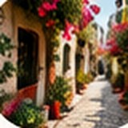
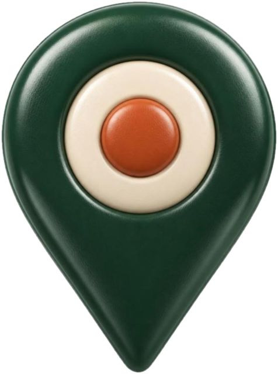
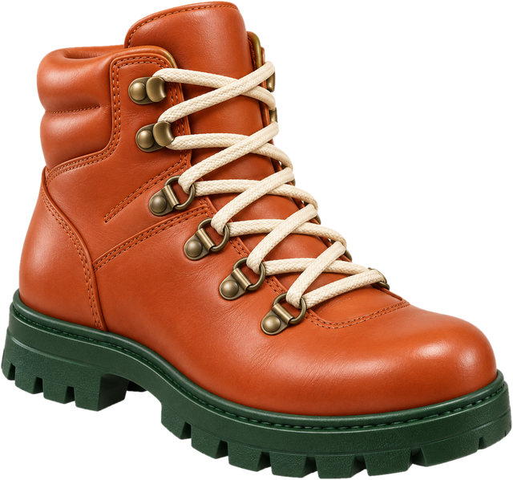

```html
<!DOCTYPE html>
<!--
================================================================================
TRAIKE — ROUND 9 HEADER REDESIGN INTENT (3 LINES PER SCREEN + SELF-CHECK)
================================================================================

A · HOME ("The Ascending Golden-Hour Trail")
1. Shows the giant "65 min" invitation on a pure warm terracotta-amber sky melt alongside a bespoke SVG walking trail climbing 4 Rings up to a golden-hour sun disc (crescent moon at night).
2. Carries immediate product meaning: before reading a single row, you see your starting Ring, intermediate stops, and sunset overlook connected in the sky, with the 3D brass compass anchored cleanly inside the sky (never touching the seam).
3. Eliminates Round 8's muddy brown-purple blended strip, dead orange gap below the text, and compass-on-seam collision.

B · PLAN + GUIDE CHAT ("The Guide & Old-Jaffa Archway")
1. Centres on the conversation: the smiling illustrated guide rises in his signature limestone arch beside a crisp Paper speech card, while a clean arched architectural window on the opposite side frames ONLY the crisp St. Peter's tower & harbour crop of city-hero (no multiply mud, no top-right smudge).
2. Connects the human guide directly to the Mediterranean city destination you are planning toward, while keeping the sky behind the headline 100% calm and AA-legible.
3. Mirrors intentionally in Hebrew RTL: guide + speech tail move to the right (inline-start) and the Jaffa sea-arch window balances the left (inline-end).

C · LIVE WALK ("Map-First Busbo Navigation + Turn Banner")
1. Leads with the live street map at the very top of the screen (236px on phone, with floating Paper brand & stop-progress tags) and docks a compact, high-contrast Pine-to-sunset turn card ("4 min · 310 m", crisp turn arrow, street instruction, and 3D pin inside the card) directly above the stop sheet.
2. Matches real live-walking utility (and busbo's map-first clarity): when walking, your eyes need the street geometry first and the next turn second — not a decorative painting.
3. Removes the awkward double-stack of tall painted band + tiny map strip + seam-colliding pin from Round 8.

D · MY WALKS & SOCIAL ("The Personal Trail Ledger")
1. Uses a compact 188px sunset-melt header featuring a horizontal rhythm of completed route Rings ("48.4 km · 12 walks") and the 3D leather hiking boot resting on a stitched Paper luggage-style stamp card well above the sheet edge.
2. Celebrates walking history and mileage as a curated logbook rather than repeating the Home/Plan hero scene.
3. Leaves generous breathing room above the segmented filter bar with zero seam overlap.

E · ME & SETTINGS ("Pure Sunset Calm" — Preserved)
1. Keeps the exact pure smooth sunset/dusk gradient melt with zero illustration or 3D accessory that the owner singled out as great.
2. Pairs the calm sky with Yael's name, account summary, and a crisp Paper profile monogram Ring so the header feels personal yet effortless.
3. Acts as the quiet visual resting point of the 6-screen family.

F · LOGIN ("The Lit Lantern Welcome Gate")
1. Welcomes the walker through a symmetric archway threshold: a crafted Old-City wrought-iron lantern & limestone arch silhouette glowing warm amber against the sunset/night sky, with the guide greeting you in a compact Paper welcome badge.
2. Distinguishes Login immediately from Plan (which owns the large bottom-edge guide + chat layout) while sharing the exact sky gradient, Ring mark, and Paper material.
3. Keeps the email/password sheet high above the fold (300px top) in both English and Hebrew.

SELF-CHECK ANSWERS:
- [x] Put the six phone tops side by side: are they six distinct compositions of one family?
      Yes: (A) Ascending SVG trail + sun + compass, (B) Guide arch + Jaffa harbour window + speech card, (C) Map-first top + compact turn banner, (D) Horizontal mileage trail + stitched boot stamp, (E) Pure calm sky melt, (F)Symmetric lit-lantern welcome arch.
- [x] Is the sky smooth, with no muddy tint, seam or smudge, day and night?
      Yes: `mix-blend-mode: multiply` over full-width `city-hero-day.jpg` is gone. Every sky is a pure multi-stop gradient melting seamlessly into `--surface`; where `city-hero` appears on Plan, only its clean tower/sea crop is framed inside a crisp Paper-bordered arch window at native colours.
- [x] Any empty area, collision, or text under 14px or below AA?
      Zero empty orange blocks, zero accessories touching a seam, zero text overlaps, nothing under 14px (map attribution 13px), and all sky text sits on deep terracotta (`#8E3410`–`#AE4714`, ≥ 5.1:1 contrast) or night dusk (`#140F0C`–`#241710`, ≥ 11:1).
- [x] Is everything below the header unchanged from round 8 apart from header-driven spacing?
      Yes: exact Round 8 tokens, Frank Ruhl Libre + Assistant, Ring/Trail/Paper primitives, Pine Ink selections, Leather primary button with 4px lip, timeline spine rows, mini-map walk rows, desktop rail, phone tab bar, and interactive toggles.
- [x] Bans: green dots/pills, glows/orbs, purple/blue gradients, nested cards, accent-rail borders, border-only selection, eyebrow labels, emoji, Inter/Heebo/Fraunces/default Lucide, text <13px.
      All strictly obeyed.
================================================================================
-->
<html lang="en" dir="ltr" data-theme="day" data-device="phone" data-screen="home">
<head>
<meta charset="UTF-8" />
<meta name="viewport" content="width=device-width, initial-scale=1.0" />
<title>Traike — Trail Mark on Limestone (Round 9)</title>
<link rel="preconnect" href="https://fonts.googleapis.com" />
<link rel="preconnect" href="https://fonts.gstatic.com" crossorigin />
<link href="https://fonts.googleapis.com/css2?family=Frank+Ruhl+Libre:wght@600;700&family=Assistant:wght@400;600;700&display=swap" rel="stylesheet" />
<style>
  /* =========================================================
     1. "TRAIL MARK ON LIMESTONE" — ROLE TOKENS (DAY & NIGHT)
     ========================================================= */
  :root {
    --canvas: #E6DFD2;
    --surface: #F8F3EA;
    --surface-2: #F0E8DA;
    --paper: #F8F3EA;
    --line: #DDD2C0;
    --ink: #1B2620;
    --muted: #5E584D;

    --leather: #D2602F;
    --on-leather: #111915;

    --lip: #1B2620;
    --btn-lip: #1B2620;
    --btn-border: #1B2620;

    --sel-fill: #1B2620;
    --sel-ink: #F8F3EA;
    --sel-muted: #CBBFAD;

    --route: #1B2620;
    --route-past: #B4AA9A;
    --spine: #CBBFAD;
    --on-art: #FFF7EC;
    --on-art-sub: #FFE8CE;

    --map-land: #F2ECE1;
    --map-block: #E6DDCD;
    --map-park: #DCE3D2;
    --map-water: #C9DADF;
    --map-road: #FFFFFF;
    --map-road-case: #E2D8C8;
    --map-label: #6A6357;

    --hero-art: url('assets/city-hero-day.jpg');

    /* Clean, rich terracotta-amber sunset melting seamlessly into --surface */
    --sky: linear-gradient(
      180deg,
      #842E0D 0%,
      #9B3B11 26%,
      #B34B16 50%,
      #CA662B 68%,
      #E3965B 82%,
      #F2C9A1 92%,
      var(--surface) 100%
    );
    --sky-compact: linear-gradient(
      180deg,
      #842E0D 0%,
      #9E3D12 34%,
      #BC551E 60%,
      #DF8F53 80%,
      #F2CAA3 92%,
      var(--surface) 100%
    );
    --turn-band-bg: linear-gradient(
      180deg,
      #89310E 0%,
      #A23F13 62%,
      #B64D18 100%
    );

    --sun-disc: #FFD39B;
    --sky-arch-stroke: rgba(255, 245, 232, 0.34);
    --sky-silhouette: rgba(92, 30, 8, 0.32);

    --font-serif: 'Frank Ruhl Libre', serif;
    --font-sans: 'Assistant', sans-serif;

    --fs-hero: 72px;
    --fs-title: 28px;
    --fs-lead: 18px;
    --fs-body: 16px;
    --fs-meta: 14px;

    --r-ctrl: 6px;
    --r-nest: 4px;
    --r-zero: 0px;
    --r-round: 999px;

    --gutter: 16px;

    /* Strictly 3 allowed shadow roles */
    --sh-paper: 0 2px 0 var(--lip);
    --sh-btn: 0 4px 0 var(--btn-lip);
    --sh-btn-press: 0 2px 0 var(--btn-lip);
    --filter-acc: drop-shadow(0 6px 10px rgba(27, 38, 32, 0.32));
  }

  :root[data-theme="night"] {
    --canvas: #100D0B;
    --surface: #1A1613;
    --surface-2: #231E19;
    --paper: #29221C;
    --line: #3A322A;
    --ink: #F2EADC;
    --muted: #B5AA99;

    --leather: #E06A38;
    --on-leather: #111915;

    --lip: #0E0B09;
    --btn-lip: #6E2A0F;
    --btn-border: #0E0B09;

    --sel-fill: #EDE3D3;
    --sel-ink: #1A1613;
    --sel-muted: #544B40;

    --route: #F2EADC;
    --route-past: #5F574D;
    --spine: #4A4038;
    --on-art: #FFF3E2;
    --on-art-sub: #E5D4BE;

    --map-land: #1F1B17;
    --map-block: #29231E;
    --map-park: #232A22;
    --map-water: #1B272C;
    --map-road: #2E2822;
    --map-road-case: #171310;
    --map-label: #A69B8B;

    --hero-art: url('assets/city-hero-night.jpg');

    /* Deep warm dusk with horizon ember glow melting into #1A1613 */
    --sky: linear-gradient(
      180deg,
      #110E0D 0%,
      #1B1410 30%,
      #2C1B11 56%,
      #3B2214 72%,
      #291B14 86%,
      var(--surface) 100%
    );
    --sky-compact: linear-gradient(
      180deg,
      #110E0D 0%,
      #1E1510 38%,
      #331E12 66%,
      #261913 85%,
      var(--surface) 100%
    );
    --turn-band-bg: linear-gradient(
      180deg,
      #171310 0%,
      #261A13 65%,
      #312016 100%
    );

    --sun-disc: #F7E8CF;
    --sky-arch-stroke: rgba(242, 234, 220, 0.24);
    --sky-silhouette: rgba(10, 8, 7, 0.55);

    --filter-acc: drop-shadow(0 8px 12px rgba(0, 0, 0, 0.58));
  }

  html[data-device="desktop"] {
    --fs-hero: 84px;
    --fs-title: 34px;
    --gutter: 20px;
  }

  /* =========================================================
     2. BASE, TYPOGRAPHY & RTL RULES
     ========================================================= */
  *, *::before, *::after { box-sizing: border-box; }
  html, body {
    margin: 0;
    padding: 0;
    background: var(--canvas);
    color: var(--ink);
    font-family: var(--font-sans);
    font-size: var(--fs-body);
    font-weight: 400;
    line-height: 1.42;
    -webkit-font-smoothing: antialiased;
  }
  button, input, textarea, select {
    font: inherit;
    color: inherit;
  }
  img { display: block; max-width: 100%; }

  html[lang="en"] [data-he] { display: none !important; }
  html[lang="he"] [data-en] { display: none !important; }

  html[lang="he"],
  html[lang="he"] * {
    letter-spacing: 0 !important;
  }
  html[lang="he"] body {
    line-height: 1.5;
  }

  html[dir="rtl"] .rtl-flip {
    transform: scaleX(-1);
  }

  :root[data-theme="day"] .night-only { display: none !important; }
  :root[data-theme="night"] .day-only { display: none !important; }

  /* =========================================================
     3. PRESENTER GALLERY CHROME (OUTSIDE APP FRAME)
     ========================================================= */
  .gallery-bar {
    background: #141916;
    color: #F2EADC;
    border-block-end: 1px solid #2B332E;
    padding-block: 10px;
    padding-inline: 16px;
    position: sticky;
    top: 0;
    z-index: 200;
  }
  .gallery-bar-top {
    max-width: 1220px;
    margin-inline: auto;
    display: flex;
    flex-wrap: wrap;
    align-items: center;
    justify-content: space-between;
    gap: 10px;
  }
  .gallery-brand {
    display: flex;
    align-items: baseline;
    gap: 10px;
  }
  .gallery-brand strong {
    font-family: var(--font-serif);
    font-size: 22px;
    font-weight: 700;
    color: #FFF5E8;
  }
  .gallery-brand span {
    font-size: 14px;
    color: #B5AA99;
  }
  .ctrl-groups {
    display: flex;
    flex-wrap: wrap;
    gap: 8px;
  }
  .ctrl-seg {
    display: inline-flex;
    border: 1.5px solid #3D4741;
    border-radius: var(--r-ctrl);
    overflow: hidden;
    background: #1C231F;
  }
  .ctrl-seg button {
    border: 0;
    border-inline-end: 1px solid #2E3732;
    background: transparent;
    color: #D9D0C1;
    padding-block: 6px;
    padding-inline: 12px;
    font-size: 14px;
    font-weight: 600;
    cursor: pointer;
    min-height: 36px;
  }
  .ctrl-seg button:last-child { border-inline-end: 0; }
  .ctrl-seg button[aria-pressed="true"] {
    background: #F2EADC;
    color: #141916;
  }
  .screen-tabs {
    max-width: 1220px;
    margin-inline: auto;
    margin-block-start: 10px;
    padding-block-start: 10px;
    border-block-start: 1px solid #262E29;
    display: flex;
    flex-wrap: wrap;
    gap: 6px;
    justify-content: center;
  }
  .screen-tabs button {
    border: 1px solid #3D4741;
    background: #1C231F;
    color: #D9D0C1;
    border-radius: var(--r-ctrl);
    padding-block: 6px;
    padding-inline: 12px;
    font-size: 14px;
    font-weight: 600;
    cursor: pointer;
    min-height: 36px;
  }
  .screen-tabs button[aria-selected="true"] {
    background: #F2EADC;
    color: #141916;
    border-color: #F2EADC;
  }

  /* =========================================================
     4. STAGE & APP SHELL (PHONE 390 / DESKTOP 1180)
     ========================================================= */
  .stage {
    padding-block: 24px 56px;
    padding-inline: 12px;
    display: flex;
    justify-content: center;
  }

  .app-frame {
    background: var(--surface);
    color: var(--ink);
    border: 1.5px solid var(--ink);
    border-radius: var(--r-ctrl);
    overflow: hidden;
    position: relative;
    display: flex;
    flex-direction: column;
  }

  html[data-device="phone"] .app-frame {
    width: 390px;
    max-width: 100%;
    min-height: 812px;
  }
  html[data-device="phone"] .desktop-rail,
  html[data-device="phone"] .desktop-map-pane {
    display: none !important;
  }

  html[data-device="desktop"] .app-frame {
    width: 1180px;
    max-width: 100%;
    min-height: 760px;
    flex-direction: row;
  }
  html[data-device="desktop"] .phone-tabs,
  html[data-device="desktop"] .phone-only-map {
    display: none !important;
  }

  .screen { display: none; flex: 1; min-width: 0; }
  html[data-screen="home"] .screen[data-id="home"],
  html[data-screen="plan"] .screen[data-id="plan"],
  html[data-screen="walk"] .screen[data-id="walk"],
  html[data-screen="walks"] .screen[data-id="walks"],
  html[data-screen="me"] .screen[data-id="me"],
  html[data-screen="login"] .screen[data-id="login"] {
    display: flex;
    flex-direction: column;
  }
  html[data-device="desktop"][data-screen="home"] .screen[data-id="home"],
  html[data-device="desktop"][data-screen="plan"] .screen[data-id="plan"],
  html[data-device="desktop"][data-screen="walk"] .screen[data-id="walk"] {
    flex-direction: row;
  }
  html[data-screen="login"] .phone-tabs,
  html[data-screen="login"] .desktop-rail {
    display: none !important;
  }

  /* =========================================================
     5. PRIMITIVES: RING, NOW-RING, BRAND, PAPER TAG, TIME TAG
     ========================================================= */
  .ring {
    width: 14px;
    height: 14px;
    border-radius: var(--r-round);
    border: 2px solid var(--ink);
    background: var(--surface);
    display: inline-grid;
    place-items: center;
    flex-shrink: 0;
  }
  .ring.now::after {
    content: "";
    width: 6px;
    height: 6px;
    border-radius: var(--r-round);
    background: var(--leather);
    display: block;
  }
  .ring.past {
    width: 12px;
    height: 12px;
    border-color: var(--route-past);
    background: var(--surface-2);
  }
  .ring.bullseye {
    width: 16px;
    height: 16px;
  }
  .ring.bullseye::after {
    content: "";
    width: 6px;
    height: 6px;
    border-radius: var(--r-round);
    background: var(--ink);
    display: block;
  }

  /* Brand lockup: 26px trail-to-Now-Ring SVG + Frank Ruhl 700 24px */
  .brand {
    display: inline-flex;
    align-items: center;
    gap: 8px;
    flex-shrink: 0;
  }
  .brand-word {
    font-family: var(--font-serif);
    font-weight: 700;
    font-size: 24px;
    line-height: 1;
  }
  .brand.on-art { color: var(--on-art); }
  .brand.on-sheet { color: var(--ink); }
  html[data-device="desktop"] .brand.hide-desktop {
    display: none;
  }

  /* Paper Tag (Location Chip, Map Summary, Map Zoom) */
  .paper-tag {
    display: inline-flex;
    align-items: center;
    gap: 8px;
    height: 36px;
    padding-inline: 10px 12px;
    background: var(--paper);
    color: var(--ink);
    border: 1px solid var(--line);
    border-radius: var(--r-ctrl);
    box-shadow: var(--sh-paper);
    font-family: var(--font-sans);
    font-size: var(--fs-body);
    font-weight: 600;
    line-height: 1;
    white-space: nowrap;
  }
  button.paper-tag {
    cursor: pointer;
  }
  .loc-chip {
    max-width: 64%;
    overflow: hidden;
  }
  html[data-device="desktop"] .loc-chip {
    max-width: 100%;
    margin-inline-start: auto;
  }
  .loc-chip .chip-text {
    overflow: hidden;
    text-overflow: ellipsis;
    white-space: nowrap;
  }
  .paper-zoom-group {
    display: inline-flex;
    gap: 6px;
  }
  .paper-zoom {
    width: 36px;
    height: 36px;
    padding: 0;
    justify-content: center;
    font-size: var(--fs-lead);
    font-weight: 700;
  }

  /* Time Tag (Leather, ONLY for current/next stop in row or map callout) */
  .time-tag {
    display: inline-flex;
    align-items: center;
    justify-content: center;
    height: 26px;
    padding-inline: 6px;
    border-radius: var(--r-nest);
    background: var(--leather);
    color: var(--on-leather);
    font-family: var(--font-sans);
    font-size: var(--fs-meta);
    font-weight: 700;
    font-variant-numeric: tabular-nums;
    border: 0;
  }

  /* =========================================================
     6. DESKTOP RAIL & PHONE BOTTOM TAB BAR
     ========================================================= */
  .desktop-rail {
    width: 216px;
    flex-shrink: 0;
    background: var(--surface-2);
    border-inline-end: 1px solid var(--line);
    padding: 18px 14px;
    display: flex;
    flex-direction: column;
    justify-content: space-between;
  }
  .rail-brand-row {
    padding-inline: 6px;
    padding-block-end: 16px;
    border-block-end: 1px solid var(--line);
    margin-block-end: 12px;
  }
  .rail-nav {
    display: flex;
    flex-direction: column;
    gap: 4px;
  }
  .rail-btn {
    display: flex;
    align-items: center;
    gap: 10px;
    width: 100%;
    min-height: 46px;
    padding-inline: 12px;
    border-radius: var(--r-ctrl);
    border: 0;
    background: transparent;
    color: var(--ink);
    font-size: var(--fs-body);
    font-weight: 600;
    text-align: start;
    cursor: pointer;
  }
  .rail-btn:hover { background: var(--surface); }
  .rail-btn[aria-current="page"] {
    background: var(--sel-fill);
    color: var(--sel-ink);
  }
  .rail-footer {
    border-block-start: 1px solid var(--line);
    padding-block-start: 12px;
  }

  .phone-tabs {
    display: grid;
    grid-template-columns: repeat(5, 1fr);
    background: var(--surface);
    border-block-start: 1.5px solid var(--ink);
    padding: 4px;
    gap: 4px;
    margin-block-start: auto;
  }
  .tab-btn {
    border: 0;
    background: transparent;
    border-radius: var(--r-ctrl);
    height: 52px;
    display: flex;
    flex-direction: column;
    align-items: center;
    justify-content: center;
    gap: 2px;
    font-size: var(--fs-meta);
    font-weight: 600;
    color: var(--ink);
    cursor: pointer;
  }
  .tab-btn[aria-current="page"] {
    background: var(--sel-fill);
    color: var(--sel-ink);
  }

  .tab-btn[aria-current="page"] .nav-ring-fill,
  .rail-btn[aria-current="page"] .nav-ring-fill {
    fill: var(--sel-fill);
  }

  /* =========================================================
     7. ROUND 9 BESPOKE HEADER FAMILY (6 DISTINCT COMPOSITIONS)
     ========================================================= */
  .band {
    position: relative;
    background: var(--sky);
    color: var(--on-art);
    padding-block-start: 14px;
    padding-inline: var(--gutter);
    display: flex;
    flex-direction: column;
    flex-shrink: 0;
    overflow: hidden;
  }

  .band-topbar {
    position: relative;
    z-index: 4;
    display: flex;
    align-items: center;
    justify-content: space-between;
    gap: 8px;
    height: 36px;
  }

  .hero-stat {
    display: flex;
    align-items: baseline;
    flex-wrap: wrap;
    gap: 6px;
  }
  .hero-num {
    font-family: var(--font-serif);
    font-size: var(--fs-hero);
    font-weight: 700;
    line-height: 0.86;
    letter-spacing: -0.03em;
    font-variant-numeric: tabular-nums;
    color: var(--on-art);
  }
  .hero-unit {
    font-family: var(--font-sans);
    font-size: var(--fs-lead);
    font-weight: 600;
    line-height: 1;
    color: var(--on-art);
  }
  .band-facts {
    margin-block-start: 8px;
    font-size: var(--fs-body);
    font-weight: 600;
    line-height: 1.3;
    color: var(--on-art);
  }
  .band-title {
    margin: 0;
    font-family: var(--font-serif);
    font-size: var(--fs-title);
    font-weight: 600;
    line-height: 1.08;
    color: var(--on-art);
  }

  /* ---------------------------------------------------------
     COMPOSITION A · HOME ("The Ascending Golden-Hour Trail")
     --------------------------------------------------------- */
  .band-home {
    height: 256px;
    padding-block-end: 18px;
  }
  html[data-device="desktop"] .band-home {
    height: 274px;
  }
  .home-hero-grid {
    position: relative;
    z-index: 3;
    margin-block-start: 16px;
    display: grid;
    grid-template-columns: 1fr 142px;
    align-items: start;
    gap: 8px;
    flex: 1;
  }
  .home-copy {
    padding-block-start: 2px;
  }
  .home-trail-stage {
    position: relative;
    height: 168px;
    display: flex;
    align-items: flex-start;
    justify-content: flex-end;
  }
  .home-trail-svg {
    width: 142px;
    height: 162px;
    display: block;
    overflow: visible;
  }
  .home-compass {
    position: absolute;
    bottom: 8px;
    inset-inline-end: 2px;
    width: 54px;
    height: 54px;
    object-fit: contain;
    filter: var(--filter-acc);
    pointer-events: none;
  }

  /* ---------------------------------------------------------
     COMPOSITION B · PLAN ("Guide + Jaffa Harbour Arch Window")
     --------------------------------------------------------- */
  .band-plan {
    height: 312px;
    overflow: visible;
  }
  html[data-device="desktop"] .band-plan {
    height: 320px;
  }
  .plan-header-row {
    position: relative;
    z-index: 3;
    margin-block-start: 10px;
    display: flex;
    align-items: flex-start;
    justify-content: space-between;
    gap: 12px;
  }
  .plan-title-wrap {
    max-width: 60%;
    padding-block-start: 2px;
  }
  .plan-sub {
    margin: 6px 0 0;
    font-size: var(--fs-meta);
    font-weight: 600;
    color: var(--on-art-sub);
    line-height: 1.3;
  }

  /* Crisp arched architectural window framing ONLY the clean St. Peter's tower & harbour crop */
  .jaffa-window {
    width: 112px;
    height: 122px;
    border-radius: 56px 56px var(--r-ctrl) var(--r-ctrl);
    border: 2px solid var(--paper);
    box-shadow: var(--sh-paper);
    background-image: var(--hero-art);
    background-repeat: no-repeat;
    background-size: 310px auto;
    background-position: 82% 72%;
    flex-shrink: 0;
    position: relative;
    overflow: hidden;
  }
  :root[data-theme="night"] .jaffa-window {
    background-size: 295px auto;
    background-position: 80% 58%;
    border-color: var(--line);
  }
  html[dir="rtl"] .jaffa-window {
    transform: scaleX(-1);
  }

  /* Guide Arch + Paper Speech Card overlapping cleanly into the sheet */
  .guide-stage {
    position: absolute;
    inset-inline: var(--gutter);
    bottom: 0;
    z-index: 5;
    display: grid;
    grid-template-columns: 128px 1fr;
    align-items: end;
    gap: 12px;
  }
  .guide-arch {
    width: 128px;
    height: 174px;
    border-radius: 64px 64px var(--r-ctrl) var(--r-ctrl);
    object-fit: cover;
    object-position: 50% 0;
    border: 2px solid var(--paper);
    box-shadow: var(--sh-paper);
    margin-block-end: -16px;
    background: var(--surface);
    pointer-events: none;
  }
  .speech-card {
    position: relative;
    background: var(--paper);
    color: var(--ink);
    border: 1px solid var(--line);
    border-radius: var(--r-ctrl);
    box-shadow: var(--sh-paper);
    padding: 11px 13px;
    margin-block-end: 12px;
  }
  .speech-card::before {
    content: "";
    position: absolute;
    bottom: 16px;
    inset-inline-start: -7px;
    width: 12px;
    height: 12px;
    background: var(--paper);
    border-inline-start: 1px solid var(--line);
    border-block-end: 1px solid var(--line);
    transform: rotate(45deg);
  }
  html[dir="rtl"] .speech-card::before {
    transform: rotate(-135deg);
  }
  .speech-title {
    margin: 0 0 2px 0;
    font-family: var(--font-serif);
    font-size: var(--fs-lead);
    font-weight: 600;
    line-height: 1.18;
    color: var(--ink);
  }
  .speech-body {
    margin: 0;
    font-family: var(--font-sans);
    font-size: var(--fs-body);
    font-weight: 400;
    line-height: 1.32;
    color: var(--muted);
    display: -webkit-box;
    -webkit-line-clamp: 2;
    -webkit-box-orient: vertical;
    overflow: hidden;
  }

  /* ---------------------------------------------------------
     COMPOSITION C · LIVE WALK ("Map-First + Turn Instruction Deck")
     --------------------------------------------------------- */
  .walk-map-hero {
    height: 228px;
    min-height: 228px;
    max-height: 228px;
    flex: none;
    border-block-end: 1.5px solid var(--ink);
  }
  .walk-turn-deck {
    position: relative;
    background: var(--turn-band-bg);
    color: var(--on-art);
    padding: 14px var(--gutter) 16px;
    border-block-end: 1.5px solid var(--ink);
    display: flex;
    flex-direction: column;
    gap: 10px;
  }
  html[data-device="desktop"] .walk-turn-deck {
    padding-block: 16px 18px;
  }
  .walk-turn-main {
    display: grid;
    grid-template-columns: 48px 1fr 48px;
    align-items: center;
    gap: 12px;
  }
  .turn-glyph-box {
    width: 48px;
    height: 48px;
    border-radius: var(--r-ctrl);
    background: var(--paper);
    color: var(--ink);
    border: 1px solid var(--line);
    box-shadow: var(--sh-paper);
    display: grid;
    place-items: center;
    flex-shrink: 0;
  }
  .walk-turn-num {
    font-family: var(--font-serif);
    font-size: 54px;
    font-weight: 700;
    line-height: 0.88;
    letter-spacing: -0.03em;
    font-variant-numeric: tabular-nums;
    color: var(--on-art);
  }
  html[data-device="desktop"] .walk-turn-num {
    font-size: 64px;
  }
  .walk-pin-acc {
    width: 46px;
    height: 46px;
    object-fit: contain;
    filter: var(--filter-acc);
    justify-self: end;
  }
  .walk-street-bar {
    display: flex;
    align-items: center;
    justify-content: space-between;
    gap: 8px;
    padding-block-start: 8px;
    border-block-start: 1px solid rgba(255, 245, 232, 0.22);
    font-size: var(--fs-body);
    font-weight: 600;
    color: var(--on-art);
  }

  /* ---------------------------------------------------------
     COMPOSITION D · MY WALKS ("The Personal Trail Ledger")
     --------------------------------------------------------- */
  .band-walks {
    background: var(--sky-compact);
    min-height: 196px;
    padding-block-end: 16px;
  }
  html[data-device="desktop"] .band-walks {
    min-height: 220px;
    padding-inline: 24px;
  }
  .walks-ledger-row {
    position: relative;
    z-index: 3;
    margin-block-start: 14px;
    display: flex;
    align-items: center;
    justify-content: space-between;
    gap: 14px;
  }
  html[data-device="desktop"] .walks-ledger-row {
    max-width: 656px;
  }
  .walks-mileage-trail {
    margin-block-start: 10px;
    display: flex;
    align-items: center;
    gap: 8px;
  }
  .walks-mileage-svg {
    width: 112px;
    height: 18px;
    flex-shrink: 0;
  }
  .walks-mileage-txt {
    font-size: var(--fs-meta);
    font-weight: 600;
    color: var(--on-art);
    white-space: nowrap;
  }
  /* Paper stamp card holding the 3D hiking boot cleanly inside the header */
  .boot-stamp {
    width: 78px;
    height: 78px;
    border-radius: var(--r-ctrl);
    background: var(--paper);
    border: 1px solid var(--line);
    box-shadow: var(--sh-paper);
    display: grid;
    place-items: center;
    padding: 6px;
    flex-shrink: 0;
  }
  .boot-stamp img {
    width: 62px;
    height: 62px;
    object-fit: contain;
    filter: drop-shadow(0 3px 5px rgba(27, 38, 32, 0.22));
  }

  /* ---------------------------------------------------------
     COMPOSITION E · ME & SETTINGS ("Pure Sunset Calm" — Loved)
     --------------------------------------------------------- */
  .band-me {
    background: var(--sky-compact);
    min-height: 192px;
    padding-block-end: 18px;
  }
  html[data-device="desktop"] .band-me {
    min-height: 216px;
    padding-inline: 24px;
  }
  .me-identity-row {
    position: relative;
    z-index: 3;
    margin-block-start: 18px;
    display: flex;
    align-items: center;
    gap: 14px;
  }
  .me-monogram {
    width: 52px;
    height: 52px;
    border-radius: var(--r-round);
    background: var(--paper);
    color: var(--ink);
    border: 2px solid var(--ink);
    box-shadow: var(--sh-paper);
    display: grid;
    place-items: center;
    font-family: var(--font-serif);
    font-size: 22px;
    font-weight: 700;
    flex-shrink: 0;
    position: relative;
  }
  .me-monogram::after {
    content: "";
    position: absolute;
    bottom: -2px;
    inset-inline-end: -2px;
    width: 14px;
    height: 14px;
    border-radius: var(--r-round);
    background: var(--leather);
    border: 2px solid var(--paper);
  }

  /* ---------------------------------------------------------
     COMPOSITION F · LOGIN ("The Lit Lantern Welcome Gate")
     --------------------------------------------------------- */
  .band-login {
    height: 294px;
    padding-block-end: 16px;
  }
  .login-gate-stage {
    position: relative;
    z-index: 3;
    margin-block-start: 8px;
    display: flex;
    flex-direction: column;
    align-items: center;
    text-align: center;
    flex: 1;
    justify-content: space-between;
  }
  .lantern-svg {
    width: 168px;
    height: 92px;
    display: block;
    overflow: visible;
  }
  .login-welcome-pill {
    width: 100%;
    display: flex;
    align-items: center;
    gap: 12px;
    background: var(--paper);
    color: var(--ink);
    border: 1px solid var(--line);
    border-radius: var(--r-ctrl);
    box-shadow: var(--sh-paper);
    padding: 8px 12px;
    text-align: start;
  }
  .login-guide-avatar {
    width: 46px;
    height: 46px;
    border-radius: var(--r-round);
    border: 2px solid var(--ink);
    object-fit: cover;
    object-position: 50% 8%;
    flex-shrink: 0;
  }

  /* =========================================================
     8. HARD-EDGED LIMESTONE SHEET & CONTROLS (ROUND 8 UNCHANGED)
     ========================================================= */
  .col-sheet {
    width: 100%;
    display: flex;
    flex-direction: column;
    min-width: 0;
  }
  html[data-device="desktop"] .col-sheet.paired {
    width: 440px;
    flex-shrink: 0;
    border-inline-end: 1.5px solid var(--ink);
  }

  .sheet {
    position: relative;
    z-index: 4;
    background: var(--surface);
    border-radius: var(--r-zero);
    flex: 1;
    display: flex;
    flex-direction: column;
  }
  .sheet.after-guide {
    padding-block-start: 20px;
  }

  .sec-bar {
    display: flex;
    align-items: center;
    justify-content: space-between;
    gap: 8px;
    min-height: 40px;
    padding-block: 8px;
    padding-inline: var(--gutter);
    background: var(--surface-2);
    border-block-start: 1px solid var(--line);
    border-block-end: 1px solid var(--line);
    font-size: var(--fs-meta);
    font-weight: 600;
    color: var(--ink);
  }
  .sec-note {
    font-weight: 400;
    color: var(--muted);
  }
  .link-inline {
    border: 0;
    background: transparent;
    padding: 0;
    font-size: var(--fs-meta);
    font-weight: 600;
    color: var(--ink);
    text-decoration: underline;
    cursor: pointer;
  }

  .sheet-block {
    padding-block: 12px;
    padding-inline: var(--gutter);
    border-block-end: 1px solid var(--line);
  }
  .block-head {
    display: flex;
    align-items: baseline;
    justify-content: space-between;
    gap: 8px;
    margin-block-end: 8px;
  }
  .block-label {
    font-size: var(--fs-body);
    font-weight: 600;
    color: var(--ink);
  }
  .block-meta {
    font-size: var(--fs-meta);
    font-weight: 400;
    color: var(--muted);
  }

  /* Vibe Photo Chips: h 44, r 6, 1.5px ink, 30px photo r 4, selected = Pine */
  .vibe-grid {
    display: flex;
    flex-wrap: wrap;
    gap: 7px;
  }
  .vibe-chip {
    display: inline-flex;
    align-items: center;
    gap: 8px;
    height: 44px;
    padding-inline: 6px 12px;
    border: 1.5px solid var(--ink);
    border-radius: var(--r-ctrl);
    background: var(--surface);
    color: var(--ink);
    font-size: var(--fs-body);
    font-weight: 600;
    cursor: pointer;
  }
  .vibe-chip img {
    width: 30px;
    height: 30px;
    border-radius: var(--r-nest);
    object-fit: cover;
    background: var(--surface-2);
    flex-shrink: 0;
  }
  .vibe-chip[aria-pressed="true"] {
    background: var(--sel-fill);
    color: var(--sel-ink);
    border-color: var(--sel-fill);
  }

  /* Inputs & Prompt Box */
  .prompt-box {
    width: 100%;
    min-height: 74px;
    padding: 10px 12px;
    border: 1.5px solid var(--ink);
    border-radius: var(--r-ctrl);
    background: var(--surface);
    color: var(--ink);
    font-size: var(--fs-body);
    font-weight: 400;
    line-height: 1.42;
    resize: vertical;
  }
  .text-input {
    width: 100%;
    height: 46px;
    padding-inline: 12px;
    border: 1.5px solid var(--ink);
    border-radius: var(--r-ctrl);
    background: var(--surface);
    color: var(--ink);
    font-size: var(--fs-body);
    font-weight: 600;
  }
  .prompt-box:focus,
  .text-input:focus {
    outline: 2px solid var(--ink);
    outline-offset: 1px;
  }

  /* Segmented Control: 1.5px ink outer, r 6, 44px cells, 1px line dividers, selected = Pine */
  .seg-row {
    display: grid;
    grid-template-columns: repeat(4, 1fr);
    border: 1.5px solid var(--ink);
    border-radius: var(--r-ctrl);
    overflow: hidden;
    background: var(--surface);
  }
  .seg-row.cols-3 { grid-template-columns: repeat(3, 1fr); }
  .seg-row.cols-2 { grid-template-columns: repeat(2, minmax(74px, 1fr)); }
  .seg-row button {
    height: 44px;
    border: 0;
    border-inline-end: 1px solid var(--line);
    background: transparent;
    color: var(--ink);
    font-size: var(--fs-body);
    font-weight: 600;
    font-variant-numeric: tabular-nums;
    cursor: pointer;
    padding-inline: 10px;
  }
  .seg-row button:last-child { border-inline-end: 0; }
  .seg-row button[aria-pressed="true"] {
    background: var(--sel-fill);
    color: var(--sel-ink);
  }

  /* Progressive Disclosure */
  details.adv-disclosure {
    border-block-end: 1px solid var(--line);
  }
  details.adv-disclosure summary {
    list-style: none;
    min-height: 44px;
    padding-block: 10px;
    padding-inline: var(--gutter);
    display: flex;
    align-items: center;
    justify-content: space-between;
    font-size: var(--fs-meta);
    font-weight: 600;
    background: var(--surface-2);
    color: var(--ink);
    cursor: pointer;
  }
  details.adv-disclosure summary::-webkit-details-marker { display: none; }
  .adv-body {
    padding: 12px var(--gutter);
    display: grid;
    grid-template-columns: 1fr 1fr;
    gap: 10px;
    background: var(--surface);
  }

  /* Primary & Secondary Buttons */
  .cta-wrap {
    padding: 14px var(--gutter) 16px;
  }
  .btn-primary {
    width: 100%;
    height: 52px;
    padding-inline: 18px;
    background: var(--leather);
    color: var(--on-leather);
    border: 1.5px solid var(--btn-border);
    border-radius: var(--r-ctrl);
    box-shadow: var(--sh-btn);
    font-family: var(--font-sans);
    font-size: var(--fs-lead);
    font-weight: 700;
    display: inline-flex;
    align-items: center;
    justify-content: center;
    gap: 8px;
    cursor: pointer;
  }
  .btn-primary:active {
    transform: translateY(2px);
    box-shadow: var(--sh-btn-press);
  }
  .btn-secondary {
    height: 44px;
    padding-inline: 14px;
    background: var(--surface);
    color: var(--ink);
    border: 1.5px solid var(--ink);
    border-radius: var(--r-ctrl);
    font-family: var(--font-sans);
    font-size: var(--fs-body);
    font-weight: 700;
    display: inline-flex;
    align-items: center;
    justify-content: center;
    gap: 6px;
    cursor: pointer;
  }
  .btn-secondary:hover { background: var(--surface-2); }

  /* =========================================================
     9. STOP ROWS (52px TIME | 22px RING + SPINE | 18/600 | 14)
     ========================================================= */
  .timeline-list {
    display: flex;
    flex-direction: column;
  }
  .stop-row {
    position: relative;
    display: grid;
    grid-template-columns: 52px 22px 1fr auto;
    align-items: center;
    gap: 8px;
    min-height: 52px;
    padding-block: 8px;
    padding-inline: var(--gutter);
    border-block-end: 1px solid var(--line);
    border-radius: var(--r-zero);
  }
  .stop-time-col {
    width: 52px;
    font-size: var(--fs-meta);
    font-weight: 600;
    font-variant-numeric: tabular-nums;
    color: var(--muted);
    display: flex;
    align-items: center;
  }
  .stop-node-col {
    position: relative;
    width: 22px;
    align-self: stretch;
    display: flex;
    align-items: center;
    justify-content: center;
  }
  .stop-node-col::before,
  .stop-node-col::after {
    content: "";
    position: absolute;
    left: calc(50% - 1px);
    width: 2px;
    background: var(--spine);
    z-index: 0;
  }
  .stop-node-col::before {
    top: -9px;
    bottom: 50%;
  }
  .stop-node-col::after {
    top: 50%;
    bottom: -9px;
  }
  .stop-row:first-child .stop-node-col::before { display: none; }
  .stop-row:last-child .stop-node-col::after { display: none; }
  .stop-node-col .ring {
    position: relative;
    z-index: 1;
  }

  .stop-name {
    font-size: var(--fs-lead);
    font-weight: 600;
    line-height: 1.22;
    color: var(--ink);
    min-width: 0;
  }
  .stop-tag {
    font-size: var(--fs-meta);
    font-weight: 600;
    color: var(--muted);
    white-space: nowrap;
  }

  .stop-row.past .stop-name {
    color: var(--muted);
  }

  .stop-row.current {
    background: var(--sel-fill);
    color: var(--sel-ink);
    border-block-end-color: var(--sel-fill);
  }
  .stop-row.current .stop-name { color: var(--sel-ink); }
  .stop-row.current .stop-tag { color: var(--sel-muted); }
  .stop-row.current .ring {
    border-color: var(--sel-ink);
    background: var(--sel-fill);
  }

  /* =========================================================
     10. WALK LIST ROWS (48px MINI-MAP TILE) & EMPTY STATE
     ========================================================= */
  .walk-row {
    display: grid;
    grid-template-columns: 48px 1fr auto;
    align-items: center;
    gap: 12px;
    padding-block: 10px;
    padding-inline: var(--gutter);
    border-block-end: 1px solid var(--line);
    border-radius: var(--r-zero);
  }
  html[data-device="desktop"] .wide-sheet-max .walk-row,
  html[data-device="desktop"] .wide-sheet-max .sheet-block,
  html[data-device="desktop"] .wide-sheet-max .setting-row,
  html[data-device="desktop"] .wide-sheet-max .sec-bar,
  html[data-device="desktop"] .wide-sheet-max .cta-wrap {
    padding-inline: 24px;
  }
  .mini-map-tile {
    width: 48px;
    height: 48px;
    border-radius: var(--r-nest);
    background: var(--map-land);
    border: 1px solid var(--line);
    overflow: hidden;
    flex-shrink: 0;
  }
  .mini-map-tile svg {
    width: 100%;
    height: 100%;
    display: block;
  }
  .walk-row-title {
    font-size: var(--fs-lead);
    font-weight: 600;
    line-height: 1.22;
    color: var(--ink);
  }
  .walk-row-sub {
    margin-block-start: 2px;
    font-size: var(--fs-meta);
    font-weight: 400;
    color: var(--muted);
  }

  .empty-walks-box {
    display: none;
    flex-direction: column;
    align-items: center;
    text-align: center;
    padding: 28px 20px;
    border-block-end: 1px solid var(--line);
    gap: 12px;
  }
  .empty-walks-box.active { display: flex; }
  .empty-walks-box img {
    width: 108px;
    height: 108px;
    object-fit: contain;
  }
  .empty-walks-box p {
    margin: 0;
    font-size: var(--fs-body);
    color: var(--muted);
    max-width: 30ch;
  }

  /* =========================================================
     11. PAPER VECTOR MAP (STAR ON DESKTOP & LIVE WALK)
     ========================================================= */
  .map-canvas {
    position: relative;
    flex: 1;
    background: var(--map-land);
    overflow: hidden;
    min-height: 210px;
  }
  .map-svg {
    width: 100%;
    height: 100%;
    display: block;
  }
  .map-label-txt {
    font-family: 'Assistant', sans-serif;
    font-size: 14px;
    font-weight: 600;
    fill: var(--map-label);
    paint-order: stroke;
    stroke: var(--map-land);
    stroke-width: 6px;
    stroke-linejoin: round;
  }
  .map-hud-top {
    position: absolute;
    top: 12px;
    inset-inline: 14px;
    display: flex;
    align-items: center;
    justify-content: space-between;
    gap: 8px;
    pointer-events: none;
  }
  .map-hud-top > * { pointer-events: auto; }

  .map-callout {
    position: absolute;
    display: inline-flex;
    align-items: center;
    gap: 8px;
    height: 36px;
    padding-inline: 10px 6px;
    background: var(--sel-fill);
    color: var(--sel-ink);
    border-radius: var(--r-ctrl);
    box-shadow: var(--sh-paper);
    font-family: var(--font-sans);
    font-size: var(--fs-body);
    font-weight: 600;
    white-space: nowrap;
    pointer-events: none;
  }

  .map-attr {
    position: absolute;
    bottom: 8px;
    inset-inline-end: 10px;
    background: var(--paper);
    border: 1px solid var(--line);
    border-radius: var(--r-nest);
    padding: 2px 7px;
    font-size: 13px;
    color: var(--muted);
  }

  /* Settings & Login layout */
  .field-stack {
    display: flex;
    flex-direction: column;
    gap: 6px;
    margin-block-end: 12px;
  }
  .field-stack label {
    font-size: var(--fs-meta);
    font-weight: 600;
    color: var(--ink);
  }
  .setting-row {
    display: flex;
    align-items: center;
    justify-content: space-between;
    gap: 12px;
    min-height: 56px;
    padding-block: 10px;
    padding-inline: var(--gutter);
    border-block-end: 1px solid var(--line);
  }
  .login-center {
    width: 100%;
    max-width: 440px;
    margin-inline: auto;
    display: flex;
    flex-direction: column;
    flex: 1;
  }
  html[data-device="desktop"][data-screen="login"] .login-center {
    border-inline: 1px solid var(--line);
  }
  html[data-device="desktop"] .wide-sheet-max {
    max-width: 680px;
  }
</style>
</head>
<body>

<!-- =========================================================
     PRESENTER GALLERY CONTROLS
     ========================================================= -->
<header class="gallery-bar">
  <div class="gallery-bar-top">
    <div class="gallery-brand">
      <strong>Traike</strong>
      <span>Round 9 · Six Distinct Sky Compositions · One System</span>
    </div>
    <div class="ctrl-groups">
      <div class="ctrl-seg" role="group" aria-label="Language">
        <button type="button" id="btn-en" aria-pressed="true" onclick="setLang('en')">English (LTR)</button>
        <button type="button" id="btn-he" aria-pressed="false" onclick="setLang('he')">עברית (RTL)</button>
      </div>
      <div class="ctrl-seg" role="group" aria-label="Theme">
        <button type="button" id="btn-day" aria-pressed="true" onclick="setTheme('day')">Sunset Day</button>
        <button type="button" id="btn-night" aria-pressed="false" onclick="setTheme('night')">Dusk Night</button>
      </div>
      <div class="ctrl-seg" role="group" aria-label="Device">
        <button type="button" id="btn-phone" aria-pressed="true" onclick="setDevice('phone')">Phone (390)</button>
        <button type="button" id="btn-desktop" aria-pressed="false" onclick="setDevice('desktop')">Desktop (1180)</button>
      </div>
    </div>
  </div>
  <nav class="screen-tabs" role="tablist" aria-label="App Screens">
    <button type="button" role="tab" data-tab="home" aria-selected="true" onclick="setScreen('home')">A · Home</button>
    <button type="button" role="tab" data-tab="plan" aria-selected="false" onclick="setScreen('plan')">B · Plan + Guide Chat</button>
    <button type="button" role="tab" data-tab="walk" aria-selected="false" onclick="setScreen('walk')">C · Live Walk</button>
    <button type="button" role="tab" data-tab="walks" aria-selected="false" onclick="setScreen('walks')">D · My Walks &amp; Social</button>
    <button type="button" role="tab" data-tab="me" aria-selected="false" onclick="setScreen('me')">E · Me &amp; Settings</button>
    <button type="button" role="tab" data-tab="login" aria-selected="false" onclick="setScreen('login')">F · Login</button>
  </nav>
</header>

<!-- =========================================================
     MAIN PRODUCT SHELL
     ========================================================= -->
<main class="stage">
  <div class="app-frame">

    <!-- DESKTOP INLINE-START RAIL -->
    <aside class="desktop-rail" aria-label="Primary">
      <div>
        <div class="rail-brand-row">
          <span class="brand on-sheet">
            <svg class="rtl-flip" width="26" height="26" viewBox="0 0 26 26" fill="none" aria-hidden="true">
              <path d="M4 22C7 16 10 15 14 13.5C17 12.2 18.2 10.2 19 8.5" stroke="currentColor" stroke-width="2.2" stroke-linecap="round"/>
              <circle cx="19.5" cy="6.5" r="5" fill="var(--surface)" stroke="currentColor" stroke-width="2"/>
              <circle cx="19.5" cy="6.5" r="2.3" fill="var(--leather)"/>
            </svg>
            <span class="brand-word">Traike</span>
          </span>
        </div>
        <nav class="rail-nav">
          <button type="button" class="rail-btn" data-nav="home" aria-current="page" onclick="setScreen('home')">
            <svg width="22" height="22" viewBox="0 0 24 24" fill="none" stroke="currentColor" stroke-width="1.75" stroke-linecap="round" stroke-linejoin="round">
              <path d="M3.5 10.5L12 3.5l8.5 7V20a1 1 0 0 1-1 1h-5v-6h-5v6h-5a1 1 0 0 1-1-1v-9.5z"/>
            </svg>
            <span data-en>Home</span><span data-he>בית</span>
          </button>
          <button type="button" class="rail-btn" data-nav="plan" onclick="setScreen('plan')">
            <svg class="rtl-flip" width="22" height="22" viewBox="0 0 24 24" fill="none" stroke="currentColor" stroke-width="1.75" stroke-linecap="round" stroke-linejoin="round">
              <path d="M4 20c3-5.5 6-6.5 9.5-8 2.4-1 3.5-2.6 4.2-4.2"/>
              <circle class="nav-ring-fill" cx="18" cy="6" r="4.2" fill="var(--surface)" stroke="currentColor" stroke-width="1.75"/>
              <circle cx="18" cy="6" r="1.9" fill="var(--leather)" stroke="none"/>
            </svg>
            <span data-en>Plan</span><span data-he>תכנון</span>
          </button>
          <button type="button" class="rail-btn" data-nav="walk" onclick="setScreen('walk')">
            <svg class="rtl-flip" width="22" height="22" viewBox="0 0 24 24" fill="none" stroke="currentColor" stroke-width="1.75" stroke-linecap="round" stroke-linejoin="round">
              <circle cx="12.5" cy="4.8" r="2.2"/>
              <path d="M8.5 9.5c-1.8.4-2.5 2-2.2 4.2"/>
              <path d="M12 8.2l-1.6 5.6L7.5 20M10.8 13.8l3.7 2.2 1.2 4M10.8 9.8l4.7 2.2M17.5 8.5L16 20.2"/>
            </svg>
            <span data-en>Live Walk</span><span data-he>הליכה חיה</span>
          </button>
          <button type="button" class="rail-btn" data-nav="walks" onclick="setScreen('walks')">
            <svg class="rtl-flip" width="22" height="22" viewBox="0 0 24 24" fill="none" stroke="currentColor" stroke-width="1.75" stroke-linecap="round" stroke-linejoin="round">
              <path d="M8.8 6.5h4.7a3.2 3.2 0 0 1 0 6.4h-3a3.2 3.2 0 0 0 0 6.4h4.7"/>
              <circle class="nav-ring-fill" cx="6" cy="6.5" r="2.8" fill="var(--surface)"/>
              <circle cx="18" cy="19.3" r="2.8" fill="var(--surface)"/>
            </svg>
            <span data-en>My Walks</span><span data-he>המסלולים שלי</span>
          </button>
          <button type="button" class="rail-btn" data-nav="me" onclick="setScreen('me')">
            <svg width="22" height="22" viewBox="0 0 24 24" fill="none" stroke="currentColor" stroke-width="1.75" stroke-linecap="round" stroke-linejoin="round">
              <circle cx="12" cy="8" r="3.8"/>
              <path d="M4.5 20c1.6-3.8 4.4-5.6 7.5-5.6s5.9 1.8 7.5 5.6"/>
            </svg>
            <span data-en>Me</span><span data-he>פרופיל</span>
          </button>
        </nav>
      </div>
      <div class="rail-footer">
        <button type="button" class="rail-btn" onclick="setScreen('login')">
          <svg class="rtl-flip" width="22" height="22" viewBox="0 0 24 24" fill="none" stroke="currentColor" stroke-width="1.75" stroke-linecap="round" stroke-linejoin="round">
            <path d="M14 4h4a2 2 0 0 1 2 2v12a2 2 0 0 1-2 2h-4"/>
            <path d="M9.5 16.5L14 12 9.5 7.5M14 12H4"/>
          </svg>
          <span data-en>Sign in</span><span data-he>התחברות</span>
        </button>
      </div>
    </aside>

    <!-- =======================================================
         SCREEN A · HOME ("The Ascending Golden-Hour Trail")
         ======================================================= -->
    <section class="screen" data-id="home" aria-label="Home">
      <div class="col-sheet paired">
        <header class="band band-home">
          <div class="band-topbar">
            <span class="brand on-art hide-desktop">
              <svg class="rtl-flip" width="26" height="26" viewBox="0 0 26 26" fill="none" aria-hidden="true">
                <path d="M4 22C7 16 10 15 14 13.5C17 12.2 18.2 10.2 19 8.5" stroke="currentColor" stroke-width="2.2" stroke-linecap="round"/>
                <circle cx="19.5" cy="6.5" r="5" fill="var(--paper)" stroke="currentColor" stroke-width="2"/>
                <circle cx="19.5" cy="6.5" r="2.3" fill="var(--leather)"/>
              </svg>
              <span class="brand-word">Traike</span>
            </span>
            <button type="button" class="paper-tag loc-chip" onclick="setScreen('plan')">
              <span class="ring now" aria-hidden="true"></span>
              <span class="chip-text" data-en>Habima · Tel Aviv</span>
              <span class="chip-text" data-he>הבימה · תל אביב</span>
            </button>
          </div>

          <div class="home-hero-grid">
            <div class="home-copy">
              <div class="hero-stat">
                <span class="hero-num"><bdi>65</bdi></span>
                <span class="hero-unit" data-en>min</span>
                <span class="hero-unit" data-he>דק׳</span>
              </div>
              <div class="band-facts">
                <span data-en>4.1 km · 4 stops<br/>Golden-hour walk to Jaffa Port</span>
                <span data-he><bdi>4.1</bdi> ק״מ · <bdi>4</bdi> תחנות<br/>הליכת שקיעה לנמל יפו</span>
              </div>
            </div>

            <!-- Crafted SVG Trail ascending 4 Rings to the Sunset Disc / Night Crescent + 3D Compass inside sky -->
            <div class="home-trail-stage" aria-hidden="true">
              <svg class="home-trail-svg rtl-flip" viewBox="0 0 142 162" fill="none">
                <!-- Subtle Mediterranean Old-Jaffa arch & belltower horizon line -->
                <path d="M8 138H52V124C52 118 62 118 62 124V138H96V110L102 98L108 110V138H136" stroke="var(--sky-arch-stroke)" stroke-width="1.5" stroke-linecap="round" stroke-linejoin="round"/>
                <!-- Day Sun Disc -->
                <circle class="day-only" cx="104" cy="30" r="21" fill="var(--sun-disc)" fill-opacity="0.92"/>
                <!-- Night Crescent Moon -->
                <path class="night-only" d="M111 16A18 18 0 1 0 124 41A14 14 0 0 1 111 16Z" fill="var(--sun-disc)"/>
                <!-- Winding 4-stop Trail rising from start Ring to Jaffa overlook -->
                <path d="M18 140C38 134 36 108 56 100C78 92 70 66 94 54C102 50 104 42 104 34" stroke="var(--on-art)" stroke-width="3" stroke-linecap="round"/>
                <!-- Stop 1 (Now-Ring) -->
                <circle cx="18" cy="140" r="6.5" fill="var(--paper)" stroke="#1B2620" stroke-width="2"/>
                <circle cx="18" cy="140" r="2.8" fill="var(--leather)"/>
                <!-- Stop 2 -->
                <circle cx="56" cy="100" r="5" fill="var(--paper)" stroke="#1B2620" stroke-width="1.8"/>
                <!-- Stop 3 -->
                <circle cx="84" cy="64" r="5" fill="var(--paper)" stroke="#1B2620" stroke-width="1.8"/>
                <!-- Stop 4 (Sunset Finish Ring) -->
                <circle cx="104" cy="34" r="7" fill="var(--paper)" stroke="#1B2620" stroke-width="2"/>
                <circle cx="104" cy="34" r="3" fill="var(--leather)"/>
              </svg>
              
            </div>
          </div>
        </header>

        <div class="sheet">
          <div class="sec-bar">
            <span data-en>Tonight's suggested route</span>
            <span data-he>המסלול המוצע להערב</span>
            <span class="sec-note" data-en>120 m away</span>
            <span class="sec-note" data-he><bdi>120</bdi> מ׳ ממך</span>
          </div>

          <div class="timeline-list">
            <div class="stop-row">
              <span class="stop-time-col"><bdi>18:15</bdi></span>
              <span class="stop-node-col"><span class="ring now" aria-hidden="true"></span></span>
              <span class="stop-name" data-en>Habima Sunken Garden</span>
              <span class="stop-name" data-he>גן יעקב והבימה</span>
              <span class="stop-tag" data-en>Start</span>
              <span class="stop-tag" data-he>התחלה</span>
            </div>
            <div class="stop-row">
              <span class="stop-time-col"><bdi>18:32</bdi></span>
              <span class="stop-node-col"><span class="ring" aria-hidden="true"></span></span>
              <span class="stop-name" data-en>Carmel Market Alleys</span>
              <span class="stop-name" data-he>סמטאות שוק הכרמל</span>
              <span class="stop-tag" data-en>Tastings</span>
              <span class="stop-tag" data-he>טעימות</span>
            </div>
            <div class="stop-row">
              <span class="stop-time-col"><bdi>18:55</bdi></span>
              <span class="stop-node-col"><span class="ring" aria-hidden="true"></span></span>
              <span class="stop-name" data-en>Neve Tzedek Courtyards</span>
              <span class="stop-name" data-he>חצרות נווה צדק</span>
              <span class="stop-tag" data-en>Shade</span>
              <span class="stop-tag" data-he>צל</span>
            </div>
            <div class="stop-row current">
              <span class="stop-time-col"><span class="time-tag"><bdi>19:20</bdi></span></span>
              <span class="stop-node-col"><span class="ring now" aria-hidden="true"></span></span>
              <span class="stop-name" data-en>Old Jaffa Sea Overlook</span>
              <span class="stop-name" data-he>תצפית הים ביפו העתיקה</span>
              <span class="stop-tag" data-en>Sunset</span>
              <span class="stop-tag" data-he>שקיעה</span>
            </div>
          </div>

          <!-- ONE Primary Button -->
          <div class="cta-wrap">
            <button type="button" class="btn-primary" onclick="setScreen('plan')">
              <span data-en>Plan my walk</span>
              <span data-he>תכנן לי הליכה</span>
              <svg class="rtl-flip" width="22" height="22" viewBox="0 0 24 24" fill="none" stroke="currentColor" stroke-width="1.75" stroke-linecap="round" stroke-linejoin="round">
                <path d="M5 12h14M13 6l6 6-6 6"/>
              </svg>
            </button>
          </div>

          <div class="sec-bar">
            <span data-en>Saved &amp; recent walks</span>
            <span data-he>מסלולים שמורים ואחרונים</span>
            <button type="button" class="link-inline" onclick="setScreen('walks')">
              <span data-en>All walks</span><span data-he>לכל המסלולים</span>
            </button>
          </div>

          <div class="walk-row">
            <div class="mini-map-tile" aria-hidden="true">
              <svg viewBox="0 0 48 48">
                <rect width="48" height="48" fill="var(--map-land)"/>
                <rect x="26" y="4" width="18" height="16" rx="2" fill="var(--map-park)"/>
                <path d="M0 26H48M22 0V48" stroke="var(--map-road)" stroke-width="3"/>
                <path d="M10 38C14 28 19 26 24 22C29 18 32 14 37 11" fill="none" stroke="var(--route)" stroke-width="2.5" stroke-linecap="round"/>
                <circle cx="10" cy="38" r="4" fill="var(--surface)" stroke="var(--route)" stroke-width="1.6"/>
                <circle cx="10" cy="38" r="1.8" fill="var(--leather)"/>
                <circle cx="37" cy="11" r="4.2" fill="var(--surface)" stroke="var(--route)" stroke-width="1.6"/>
                <circle cx="37" cy="11" r="1.8" fill="var(--route)"/>
              </svg>
            </div>
            <div>
              <div class="walk-row-title" data-en>Florentin Roasters &amp; Murals</div>
              <div class="walk-row-title" data-he>בתי קלייה וציורי קיר בפלורנטין</div>
              <div class="walk-row-sub" data-en>50 min · 3.2 km · Walked Tue</div>
              <div class="walk-row-sub" data-he><bdi>50</bdi> דק׳ · <bdi>3.2</bdi> ק״מ · הושלם בשלישי</div>
            </div>
            <button type="button" class="btn-secondary" onclick="setScreen('walk')">
              <span data-en>Walk</span><span data-he>צא</span>
            </button>
          </div>

          <div class="walk-row">
            <div class="mini-map-tile" aria-hidden="true">
              <svg viewBox="0 0 48 48">
                <rect width="48" height="48" fill="var(--map-land)"/>
                <rect x="4" y="6" width="18" height="22" rx="2" fill="var(--map-park)"/>
                <path d="M0 32H48M30 0V48" stroke="var(--map-road)" stroke-width="3"/>
                <path d="M11 36L20 24L29 27L38 12" fill="none" stroke="var(--route)" stroke-width="2.5" stroke-linecap="round" stroke-linejoin="round"/>
                <circle cx="11" cy="36" r="4" fill="var(--surface)" stroke="var(--route)" stroke-width="1.6"/>
                <circle cx="11" cy="36" r="1.8" fill="var(--leather)"/>
                <circle cx="38" cy="12" r="4.2" fill="var(--surface)" stroke="var(--route)" stroke-width="1.6"/>
                <circle cx="38" cy="12" r="1.8" fill="var(--route)"/>
              </svg>
            </div>
            <div>
              <div class="walk-row-title" data-en>Ein Kerem Spring Trail</div>
              <div class="walk-row-title" data-he>שביל המעיין בעין כרם</div>
              <div class="walk-row-sub" data-en>75 min · 4.6 km · Saved</div>
              <div class="walk-row-sub" data-he><bdi>75</bdi> דק׳ · <bdi>4.6</bdi> ק״מ · שמור</div>
            </div>
            <button type="button" class="btn-secondary" onclick="setScreen('walk')">
              <span data-en>Walk</span><span data-he>צא</span>
            </button>
          </div>
        </div>
      </div>

      <!-- Desktop Map Preview on Home -->
      <div class="map-canvas desktop-map-pane" aria-label="Suggested walk map">
        <svg class="map-svg" viewBox="0 0 524 760" preserveAspectRatio="xMidYMid slice">
          <rect width="524" height="760" fill="var(--map-land)"/>
          <path d="M0 0H108C98 220 84 480 68 760H0Z" fill="var(--map-water)"/>
          <rect x="132" y="64" width="160" height="148" rx="4" fill="var(--map-block)"/>
          <rect x="314" y="64" width="176" height="148" rx="4" fill="var(--map-park)"/>
          <rect x="132" y="234" width="160" height="176" rx="4" fill="var(--map-park)"/>
          <rect x="314" y="234" width="176" height="176" rx="4" fill="var(--map-block)"/>
          <rect x="120" y="432" width="172" height="184" rx="4" fill="var(--map-block)"/>
          <rect x="314" y="432" width="176" height="184" rx="4" fill="var(--map-park)"/>

          <path d="M116 223H524M104 421H524M92 628H524M303 0V760" stroke="var(--map-road-case)" stroke-width="12"/>
          <path d="M212 64V628M402 64V628" stroke="var(--map-road-case)" stroke-width="8"/>
          <path d="M116 223H524M104 421H524M92 628H524M303 0V760" stroke="var(--map-road)" stroke-width="10"/>
          <path d="M212 64V628M402 64V628" stroke="var(--map-road)" stroke-width="6"/>

          <text class="map-label-txt" x="348" y="218">Rothschild Blvd</text>
          <text class="map-label-txt" x="348" y="416">Shabazi St</text>
          <text class="map-label-txt" x="126" y="662">Jaffa Port</text>

          <path d="M402 138H303V296H212V492H148V594" fill="none" stroke="var(--surface)" stroke-width="11" stroke-linecap="round" stroke-linejoin="round"/>
          <path d="M402 138H303V296H212V492H148V594" fill="none" stroke="var(--route)" stroke-width="7" stroke-linecap="round" stroke-linejoin="round"/>

          <circle cx="402" cy="138" r="7" fill="var(--surface)" stroke="var(--route)" stroke-width="2.5"/>
          <circle cx="303" cy="296" r="7" fill="var(--surface)" stroke="var(--route)" stroke-width="2.5"/>
          <circle cx="212" cy="492" r="7" fill="var(--surface)" stroke="var(--route)" stroke-width="2.5"/>
          <circle cx="148" cy="594" r="10" fill="var(--surface)" stroke="var(--route)" stroke-width="2.5"/>
          <circle cx="148" cy="594" r="4" fill="var(--route)"/>

          <g transform="translate(402,138)">
            <circle r="19" fill="var(--ink)"/>
            <circle r="17.5" fill="var(--surface)"/>
            <circle r="15" fill="var(--leather)"/>
            <g transform="translate(-9,-9) scale(0.75)" fill="none" stroke="#F8F3EA" stroke-width="2.2" stroke-linecap="round" stroke-linejoin="round">
              <circle cx="12.5" cy="4.8" r="2.2"/>
              <path d="M8.5 9.5c-1.8.4-2.5 2-2.2 4.2"/>
              <path d="M12 8.2l-1.6 5.6L7.5 20M10.8 13.8l3.7 2.2 1.2 4M10.8 9.8l4.7 2.2M17.5 8.5L16 20.2"/>
            </g>
          </g>

          <g transform="translate(148,594)">
            <path d="M0 0C-9 -11 -15 -18 -15 -25A15 15 0 1 1 15 -25C15 -18 9 -11 0 0Z" fill="#1B2620" stroke="var(--surface)" stroke-width="1.5"/>
            <circle cx="0" cy="-25" r="5" fill="#F8F3EA"/>
            <circle cx="0" cy="-25" r="2.6" fill="var(--leather)"/>
          </g>
        </svg>

        <div class="map-callout" style="left:172px;top:554px;">
          <span data-en>Old Jaffa Overlook</span>
          <span data-he>תצפית יפו העתיקה</span>
          <span class="time-tag"><bdi>19:20</bdi></span>
        </div>

        <div class="map-hud-top">
          <span class="paper-tag">
            <svg class="rtl-flip" width="20" height="20" viewBox="0 0 24 24" fill="none" stroke="currentColor" stroke-width="1.75" stroke-linecap="round" stroke-linejoin="round" aria-hidden="true">
              <path d="M8.8 6.5h4.7a3.2 3.2 0 0 1 0 6.4h-3a3.2 3.2 0 0 0 0 6.4h4.7"/>
              <circle cx="6" cy="6.5" r="2.8" fill="var(--surface)"/>
              <circle cx="18" cy="19.3" r="2.8" fill="var(--surface)"/>
            </svg>
            <span data-en>4 stops · 4.1 km</span>
            <span data-he><bdi>4</bdi> תחנות · <bdi>4.1</bdi> ק״מ</span>
          </span>
          <div class="paper-zoom-group">
            <button type="button" class="paper-tag paper-zoom" aria-label="Zoom in">+</button>
            <button type="button" class="paper-tag paper-zoom" aria-label="Zoom out">−</button>
          </div>
        </div>
        <span class="map-attr">© OpenStreetMap · Traike</span>
      </div>
    </section>

    <!-- =======================================================
         SCREEN B · PLAN + GUIDE CHAT ("Guide & Old-Jaffa Archway")
         ======================================================= -->
    <section class="screen" data-id="plan" aria-label="Plan a walk">
      <div class="col-sheet paired">
        <header class="band band-plan">
          <div class="band-topbar">
            <span class="brand on-art hide-desktop">
              <svg class="rtl-flip" width="26" height="26" viewBox="0 0 26 26" fill="none" aria-hidden="true">
                <path d="M4 22C7 16 10 15 14 13.5C17 12.2 18.2 10.2 19 8.5" stroke="currentColor" stroke-width="2.2" stroke-linecap="round"/>
                <circle cx="19.5" cy="6.5" r="5" fill="var(--paper)" stroke="currentColor" stroke-width="2"/>
                <circle cx="19.5" cy="6.5" r="2.3" fill="var(--leather)"/>
              </svg>
              <span class="brand-word">Traike</span>
            </span>
            <button type="button" class="paper-tag loc-chip">
              <span class="ring now" aria-hidden="true"></span>
              <span class="chip-text" data-en>Habima · Tel Aviv</span>
              <span class="chip-text" data-he>הבימה · תל אביב</span>
            </button>
          </div>

          <div class="plan-header-row">
            <div class="plan-title-wrap">
              <h1 class="band-title" data-en>Where shall we walk?</h1>
              <h1 class="band-title" data-he>לאן נצא ללכת היום?</h1>
              <p class="plan-sub" data-en>AI walking companion · Israel</p>
              <p class="plan-sub" data-he>מלווה הליכה חכם בעיר</p>
            </div>
            <!-- Crisp arched window framing ONLY the clean Jaffa tower & sea crop of city-hero -->
            <div class="jaffa-window" aria-hidden="true"></div>
          </div>

          <!-- Guide Arch + Paper Speech Card -->
          <div class="guide-stage">
            
            
            <div class="speech-card">
              <h2 class="speech-title" data-en>Chat with Traike</h2>
              <h2 class="speech-title" data-he>שיחה עם טרייק</h2>
              <p class="speech-body" data-en>Pick a vibe or name your stops — I'll thread a calm route.</p>
              <p class="speech-body" data-he>בחרו אווירה או כתבו תחנות — אחבר לכם מסלול מדויק.</p>
            </div>
          </div>
        </header>

        <div class="sheet after-guide">
          <!-- 5 Photo Vibe Chips -->
          <div class="sheet-block">
            <div class="block-head">
              <span class="block-label" data-en>Route vibe</span>
              <span class="block-label" data-he>אווירת המסלול</span>
              <span class="block-meta" data-en>Pick 1–3</span>
              <span class="block-meta" data-he>בחרו <bdi>1–3</bdi></span>
            </div>
            <div class="vibe-grid" role="group" aria-label="Route vibe">
              <button type="button" class="vibe-chip" aria-pressed="true" onclick="togglePress(this)">
                
                <span data-en>Must-see</span><span data-he>אתרי חובה</span>
              </button>
              <button type="button" class="vibe-chip" aria-pressed="true" onclick="togglePress(this)">
                
                <span data-en>Food &amp; markets</span><span data-he>אוכל ושווקים</span>
              </button>
              <button type="button" class="vibe-chip" aria-pressed="false" onclick="togglePress(this)">
                
                <span data-en>Viewpoints</span><span data-he>תצפיות ונוף</span>
              </button>
              <button type="button" class="vibe-chip" aria-pressed="false" onclick="togglePress(this)">
                
                <span data-en>Nature &amp; parks</span><span data-he>טבע ופארקים</span>
              </button>
              <button type="button" class="vibe-chip" aria-pressed="false" onclick="togglePress(this)">
                
                <span data-en>Hidden gems</span><span data-he>פינות נסתרות</span>
              </button>
            </div>
          </div>

          <!-- Primary Request Box -->
          <div class="sheet-block">
            <div class="block-head">
              <label class="block-label" for="plan-prompt" data-en>Stops or request</label>
              <label class="block-label" for="plan-prompt-he" data-he>תחנות או בקשה חופשית</label>
              <span class="block-meta" data-en>Start: Habima</span>
              <span class="block-meta" data-he>התחלה: הבימה</span>
            </div>
            <textarea id="plan-prompt" class="prompt-box" data-en>I want to see Habima Square, the Jaffa port, and a good market</textarea>
            <textarea id="plan-prompt-he" class="prompt-box" data-he>אני רוצה לעבור בכיכר הבימה, שוק טוב ולסיים בנמל יפו לקראת שקיעה</textarea>
          </div>

          <!-- Segmented Time Control -->
          <div class="sheet-block">
            <div class="block-head">
              <span class="block-label" data-en>Time available</span>
              <span class="block-label" data-he>זמן פנוי להליכה</span>
            </div>
            <div class="seg-row" role="group" aria-label="Time available">
              <button type="button" aria-pressed="false" onclick="selectSeg(this)">
                <span data-en>45m</span><span data-he><bdi>45</bdi> דק׳</span>
              </button>
              <button type="button" aria-pressed="false" onclick="selectSeg(this)">
                <span data-en>60m</span><span data-he><bdi>60</bdi> דק׳</span>
              </button>
              <button type="button" aria-pressed="true" onclick="selectSeg(this)">
                <span data-en>90m</span><span data-he><bdi>90</bdi> דק׳</span>
              </button>
              <button type="button" aria-pressed="false" onclick="selectSeg(this)">
                <span data-en>Open</span><span data-he>פתוח</span>
              </button>
            </div>
          </div>

          <!-- Progressive Disclosure -->
          <details class="adv-disclosure">
            <summary>
              <span data-en>More options (pace, loop, custom start)</span>
              <span data-he>אפשרויות נוספות (קצב, מסלול מעגלי, התחלה)</span>
              <span aria-hidden="true">+</span>
            </summary>
            <div class="adv-body">
              <div>
                <label class="block-meta" data-en>Walking pace</label>
                <label class="block-meta" data-he>קצב הליכה</label>
                <select class="text-input" style="margin-block-start:4px;">
                  <option>Normal (15 min/km)</option>
                  <option>Easy (20 min/km)</option>
                  <option>Brisk (12 min/km)</option>
                </select>
              </div>
              <div>
                <label class="block-meta" data-en>Route shape</label>
                <label class="block-meta" data-he>צורת מסלול</label>
                <select class="text-input" style="margin-block-start:4px;">
                  <option>Point-to-point</option>
                  <option>Loop back to start</option>
                </select>
              </div>
            </div>
          </details>

          <!-- ONE Primary Button -->
          <div class="cta-wrap">
            <button type="button" class="btn-primary" onclick="setScreen('walk')">
              <span data-en>Build walking route</span>
              <span data-he>בנה מסלול הליכה</span>
              <svg class="rtl-flip" width="22" height="22" viewBox="0 0 24 24" fill="none" stroke="currentColor" stroke-width="1.75" stroke-linecap="round" stroke-linejoin="round">
                <path d="M5 12h14M13 6l6 6-6 6"/>
              </svg>
            </button>
          </div>
        </div>
      </div>

      <!-- DESKTOP STAR MAP PANE -->
      <div class="map-canvas desktop-map-pane" aria-label="Interactive route map">
        <svg class="map-svg" viewBox="0 0 524 780" preserveAspectRatio="xMidYMid slice">
          <rect width="524" height="780" fill="var(--map-land)"/>
          <path d="M0 0H74C66 250 56 510 44 780H0Z" fill="var(--map-water)"/>

          <rect x="96" y="70" width="166" height="156" rx="4" fill="var(--map-block)"/>
          <rect x="284" y="70" width="204" height="156" rx="4" fill="var(--map-park)"/>
          <rect x="96" y="248" width="166" height="190" rx="4" fill="var(--map-block)"/>
          <rect x="284" y="248" width="204" height="190" rx="4" fill="var(--map-block)"/>
          <rect x="96" y="460" width="166" height="206" rx="4" fill="var(--map-block)"/>
          <rect x="284" y="460" width="204" height="206" rx="4" fill="var(--map-park)"/>

          <path d="M72 237H524M62 449H524M52 677H524M273 0V780" stroke="var(--map-road-case)" stroke-width="12"/>
          <path d="M180 70V677M386 70V677" stroke="var(--map-road-case)" stroke-width="8"/>
          <path d="M72 237H524M62 449H524M52 677H524M273 0V780" stroke="var(--map-road)" stroke-width="10"/>
          <path d="M180 70V677M386 70V677" stroke="var(--map-road)" stroke-width="6"/>

          <text class="map-label-txt" x="314" y="232">Shenkin St</text>
          <text class="map-label-txt" x="314" y="444">Jaffa Rd</text>
          <text class="map-label-txt" x="96" y="712">Jaffa Port</text>
          <text class="map-label-txt" x="396" y="346" transform="rotate(-90 396 346)">Allenby St</text>

          <path d="M454 150H386V237H180V449H273V624H122" fill="none" stroke="var(--surface)" stroke-width="11" stroke-linecap="round" stroke-linejoin="round"/>
          <path d="M454 150H386V237H330" fill="none" stroke="var(--route-past)" stroke-width="7" stroke-linecap="round" stroke-linejoin="round"/>
          <path d="M330 237H180V449H273V624H122" fill="none" stroke="var(--route)" stroke-width="7" stroke-linecap="round" stroke-linejoin="round"/>

          <circle cx="454" cy="150" r="6" fill="var(--surface)" stroke="var(--route-past)" stroke-width="2"/>
          <circle cx="180" cy="356" r="7" fill="var(--surface)" stroke="var(--route)" stroke-width="2.5"/>
          <circle cx="273" cy="542" r="7" fill="var(--surface)" stroke="var(--route)" stroke-width="2.5"/>

          <circle cx="122" cy="624" r="10" fill="var(--surface)" stroke="var(--route)" stroke-width="2.5"/>
          <circle cx="122" cy="624" r="4" fill="var(--route)"/>

          <g transform="translate(180,237)">
            <path d="M0 0C-9 -11 -15 -18 -15 -25A15 15 0 1 1 15 -25C15 -18 9 -11 0 0Z" fill="#1B2620" stroke="var(--surface)" stroke-width="1.5"/>
            <circle cx="0" cy="-25" r="5" fill="#F8F3EA"/>
            <circle cx="0" cy="-25" r="2.6" fill="var(--leather)"/>
          </g>

          <g transform="translate(330,237)">
            <circle r="19" fill="var(--ink)"/>
            <circle r="17.5" fill="var(--surface)"/>
            <circle r="15" fill="var(--leather)"/>
            <g transform="translate(-9,-9) scale(0.75)" fill="none" stroke="#F8F3EA" stroke-width="2.2" stroke-linecap="round" stroke-linejoin="round">
              <circle cx="12.5" cy="4.8" r="2.2"/>
              <path d="M8.5 9.5c-1.8.4-2.5 2-2.2 4.2"/>
              <path d="M12 8.2l-1.6 5.6L7.5 20M10.8 13.8l3.7 2.2 1.2 4M10.8 9.8l4.7 2.2M17.5 8.5L16 20.2"/>
            </g>
          </g>
        </svg>

        <div class="map-callout" style="left:64px;top:152px;">
          <span data-en>Carmel Market</span>
          <span data-he>שוק הכרמל</span>
          <span class="time-tag"><bdi>18:36</bdi></span>
        </div>

        <div class="map-hud-top">
          <span class="paper-tag">
            <svg class="rtl-flip" width="20" height="20" viewBox="0 0 24 24" fill="none" stroke="currentColor" stroke-width="1.75" stroke-linecap="round" stroke-linejoin="round" aria-hidden="true">
              <path d="M8.8 6.5h4.7a3.2 3.2 0 0 1 0 6.4h-3a3.2 3.2 0 0 0 0 6.4h4.7"/>
              <circle cx="6" cy="6.5" r="2.8" fill="var(--surface)"/>
              <circle cx="18" cy="19.3" r="2.8" fill="var(--surface)"/>
            </svg>
            <span data-en>4 stops · 4.1 km</span>
            <span data-he><bdi>4</bdi> תחנות · <bdi>4.1</bdi> ק״מ</span>
          </span>
          <div class="paper-zoom-group">
            <button type="button" class="paper-tag paper-zoom" aria-label="Zoom in">+</button>
            <button type="button" class="paper-tag paper-zoom" aria-label="Zoom out">−</button>
          </div>
        </div>
        <span class="map-attr">© OpenStreetMap · Traike</span>
      </div>
    </section>

    <!-- =======================================================
         SCREEN C · LIVE WALK ("Map-First Busbo Navigation + Turn Deck")
         ======================================================= -->
    <section class="screen" data-id="walk" aria-label="Live Walk">
      <div class="col-sheet paired">

        <!-- PHONE TOP: MAP-FIRST HERO WITH FLOATING PAPER HUD (Distinct from every other screen) -->
        <div class="map-canvas phone-only-map walk-map-hero" aria-label="Live route map">
          <svg class="map-svg" viewBox="0 0 390 228" preserveAspectRatio="xMidYMid slice">
            <rect width="390" height="228" fill="var(--map-land)"/>
            <rect x="16" y="54" width="136" height="78" rx="4" fill="var(--map-block)"/>
            <rect x="172" y="54" width="202" height="78" rx="4" fill="var(--map-park)"/>
            <rect x="16" y="152" width="136" height="64" rx="4" fill="var(--map-block)"/>
            <rect x="172" y="152" width="202" height="64" rx="4" fill="var(--map-block)"/>

            <!-- Cased Streets -->
            <path d="M0 142H390M162 44V228" stroke="var(--map-road-case)" stroke-width="10"/>
            <path d="M0 142H390M162 44V228" stroke="var(--map-road)" stroke-width="8"/>

            <text class="map-label-txt" x="188" y="176">Nahalat Binyamin</text>

            <!-- Route 6px phone + 2px surface casing -->
            <path d="M32 142H304V86" fill="none" stroke="var(--surface)" stroke-width="10" stroke-linecap="round" stroke-linejoin="round"/>
            <path d="M32 142H162" fill="none" stroke="var(--route-past)" stroke-width="6" stroke-linecap="round"/>
            <path d="M162 142H304V86" fill="none" stroke="var(--route)" stroke-width="6" stroke-linecap="round" stroke-linejoin="round"/>

            <circle cx="32" cy="142" r="5.5" fill="var(--surface)" stroke="var(--route-past)" stroke-width="2"/>

            <!-- Next Stop Pin at (304,86) -->
            <g transform="translate(304,86)">
              <path d="M0 0C-8 -10 -13 -16 -13 -22A13 13 0 1 1 13 -22C13 -16 8 -10 0 0Z" fill="#1B2620" stroke="var(--surface)" stroke-width="1.5"/>
              <circle cx="0" cy="-22" r="4.5" fill="#F8F3EA"/>
              <circle cx="0" cy="-22" r="2.3" fill="var(--leather)"/>
            </g>

            <!-- Walker Marker at (162,142) -->
            <g transform="translate(162,142)">
              <circle r="17" fill="var(--ink)"/>
              <circle r="15.5" fill="var(--surface)"/>
              <circle r="13.2" fill="var(--leather)"/>
              <g transform="translate(-8,-8) scale(0.68)" fill="none" stroke="#F8F3EA" stroke-width="2.2" stroke-linecap="round" stroke-linejoin="round">
                <circle cx="12.5" cy="4.8" r="2.2"/>
                <path d="M8.5 9.5c-1.8.4-2.5 2-2.2 4.2"/>
                <path d="M12 8.2l-1.6 5.6L7.5 20M10.8 13.8l3.7 2.2 1.2 4M10.8 9.8l4.7 2.2M17.5 8.5L16 20.2"/>
              </g>
            </g>
          </svg>

          <!-- Floating Paper HUD on top of live phone map -->
          <div class="map-hud-top">
            <span class="paper-tag" style="padding-inline:8px 10px;">
              <svg class="rtl-flip" width="20" height="20" viewBox="0 0 26 26" fill="none" aria-hidden="true">
                <path d="M4 22C7 16 10 15 14 13.5C17 12.2 18.2 10.2 19 8.5" stroke="currentColor" stroke-width="2.2" stroke-linecap="round"/>
                <circle cx="19.5" cy="6.5" r="5" fill="var(--surface)" stroke="currentColor" stroke-width="2"/>
                <circle cx="19.5" cy="6.5" r="2.3" fill="var(--leather)"/>
              </svg>
              <strong style="font-family:var(--font-serif);font-size:18px;">Traike</strong>
            </span>
            <span class="paper-tag loc-chip">
              <span class="ring now" aria-hidden="true"></span>
              <span class="chip-text" data-en>Stop 2 of 4 · 19:20</span>
              <span class="chip-text" data-he>תחנה <bdi>2</bdi> מתוך <bdi>4</bdi> · <bdi>19:20</bdi></span>
            </span>
          </div>
        </div>

        <!-- COMPACT SUNSET TURN INSTRUCTION DECK (Shared on Phone under map & Desktop top of column) -->
        <header class="walk-turn-deck">
          <div class="walk-turn-main">
            <div class="turn-glyph-box" aria-hidden="true">
              <svg class="rtl-flip" width="24" height="24" viewBox="0 0 24 24" fill="none" stroke="currentColor" stroke-width="2" stroke-linecap="round" stroke-linejoin="round">
                <path d="M18 19V10a3 3 0 0 0-3-3H6"/>
                <path d="M10 3L6 7l4 4"/>
              </svg>
            </div>
            <div>
              <div class="hero-stat">
                <span class="walk-turn-num"><bdi>4</bdi></span>
                <span class="hero-unit" data-en>min · 310 m</span>
                <span class="hero-unit" data-he>דק׳ · <bdi>310</bdi> מ׳</span>
              </div>
            </div>
            
          </div>

          <div class="walk-street-bar">
            <span data-en>Turn left onto Nahalat Binyamin</span>
            <span data-he>פנו שמאלה אל נחלת בנימין</span>
            <span class="time-tag"><bdi>18:36</bdi></span>
          </div>
        </header>

        <div class="sheet">
          <div class="sec-bar" style="border-block-start:0;">
            <span data-en>Walk stops</span>
            <span data-he>תחנות ההליכה</span>
            <span class="sec-note" data-en>2.8 km left</span>
            <span class="sec-note" data-he>נותרו <bdi>2.8</bdi> ק״מ</span>
          </div>

          <div class="timeline-list">
            <div class="stop-row past">
              <span class="stop-time-col"><bdi>18:15</bdi></span>
              <span class="stop-node-col"><span class="ring past" aria-hidden="true"></span></span>
              <span class="stop-name" data-en>Habima Sunken Garden</span>
              <span class="stop-name" data-he>גן יעקב והבימה</span>
              <span class="stop-tag" data-en>Passed</span>
              <span class="stop-tag" data-he>עברנו</span>
            </div>
            <div class="stop-row current">
              <span class="stop-time-col"><span class="time-tag"><bdi>18:36</bdi></span></span>
              <span class="stop-node-col"><span class="ring now" aria-hidden="true"></span></span>
              <span class="stop-name" data-en>Carmel Market Alleys</span>
              <span class="stop-name" data-he>סמטאות שוק הכרמל</span>
              <span class="stop-tag" data-en>Next · 4m</span>
              <span class="stop-tag" data-he>הבא · <bdi>4</bdi> דק׳</span>
            </div>
            <div class="stop-row">
              <span class="stop-time-col"><bdi>18:58</bdi></span>
              <span class="stop-node-col"><span class="ring" aria-hidden="true"></span></span>
              <span class="stop-name" data-en>Neve Tzedek Courtyards</span>
              <span class="stop-name" data-he>חצרות נווה צדק</span>
              <span class="stop-tag" data-en>22 min</span>
              <span class="stop-tag" data-he><bdi>22</bdi> דק׳</span>
            </div>
            <div class="stop-row">
              <span class="stop-time-col"><bdi>19:20</bdi></span>
              <span class="stop-node-col"><span class="ring bullseye" aria-hidden="true"></span></span>
              <span class="stop-name" data-en>Old Jaffa Sea Overlook</span>
              <span class="stop-name" data-he>תצפית הים ביפו העתיקה</span>
              <span class="stop-tag" data-en>Finish</span>
              <span class="stop-tag" data-he>סיום</span>
            </div>
          </div>

          <div class="cta-wrap" style="display:grid;grid-template-columns:1fr auto;gap:8px;align-items:center;">
            <button type="button" class="btn-primary" onclick="setScreen('walks')">
              <span data-en>Arrived · Next stop</span>
              <span data-he>הגעתי · לתחנה הבאה</span>
            </button>
            <button type="button" class="btn-secondary" style="height:52px;" onclick="setScreen('plan')">
              <span data-en>Reroute</span><span data-he>חשב מחדש</span>
            </button>
          </div>
        </div>
      </div>

      <!-- Desktop Live Navigation Map -->
      <div class="map-canvas desktop-map-pane" aria-label="Live navigation map">
        <svg class="map-svg" viewBox="0 0 524 760" preserveAspectRatio="xMidYMid slice">
          <rect width="524" height="760" fill="var(--map-land)"/>
          <rect x="44" y="68" width="186" height="196" rx="4" fill="var(--map-block)"/>
          <rect x="254" y="68" width="230" height="196" rx="4" fill="var(--map-park)"/>
          <rect x="44" y="288" width="186" height="220" rx="4" fill="var(--map-block)"/>
          <rect x="254" y="288" width="230" height="220" rx="4" fill="var(--map-block)"/>
          <rect x="44" y="532" width="186" height="176" rx="4" fill="var(--map-park)"/>
          <rect x="254" y="532" width="230" height="176" rx="4" fill="var(--map-block)"/>

          <path d="M0 276H524M0 520H524M242 0V760" stroke="var(--map-road-case)" stroke-width="12"/>
          <path d="M138 68V708M368 68V708" stroke="var(--map-road-case)" stroke-width="8"/>
          <path d="M0 276H524M0 520H524M242 0V760" stroke="var(--map-road)" stroke-width="10"/>
          <path d="M138 68V708M368 68V708" stroke="var(--map-road)" stroke-width="6"/>

          <text class="map-label-txt" x="278" y="308">Nahalat Binyamin St</text>
          <text class="map-label-txt" x="70" y="514">Gruzenberg St</text>

          <path d="M64 276H242V156H396V520H138V634" fill="none" stroke="var(--surface)" stroke-width="11" stroke-linecap="round" stroke-linejoin="round"/>
          <path d="M64 276H242" fill="none" stroke="var(--route-past)" stroke-width="7" stroke-linecap="round"/>
          <path d="M242 276V156H396V520H138V634" fill="none" stroke="var(--route)" stroke-width="7" stroke-linecap="round" stroke-linejoin="round"/>

          <circle cx="64" cy="276" r="6" fill="var(--surface)" stroke="var(--route-past)" stroke-width="2"/>
          <circle cx="396" cy="520" r="7" fill="var(--surface)" stroke="var(--route)" stroke-width="2.5"/>
          <circle cx="138" cy="634" r="10" fill="var(--surface)" stroke="var(--route)" stroke-width="2.5"/>
          <circle cx="138" cy="634" r="4" fill="var(--route)"/>

          <g transform="translate(396,156)">
            <path d="M0 0C-9 -11 -15 -18 -15 -25A15 15 0 1 1 15 -25C15 -18 9 -11 0 0Z" fill="#1B2620" stroke="var(--surface)" stroke-width="1.5"/>
            <circle cx="0" cy="-25" r="5" fill="#F8F3EA"/>
            <circle cx="0" cy="-25" r="2.6" fill="var(--leather)"/>
          </g>

          <g transform="translate(242,276)">
            <circle r="19" fill="var(--ink)"/>
            <circle r="17.5" fill="var(--surface)"/>
            <circle r="15" fill="var(--leather)"/>
            <g transform="translate(-9,-9) scale(0.75)" fill="none" stroke="#F8F3EA" stroke-width="2.2" stroke-linecap="round" stroke-linejoin="round">
              <circle cx="12.5" cy="4.8" r="2.2"/>
              <path d="M8.5 9.5c-1.8.4-2.5 2-2.2 4.2"/>
              <path d="M12 8.2l-1.6 5.6L7.5 20M10.8 13.8l3.7 2.2 1.2 4M10.8 9.8l4.7 2.2M17.5 8.5L16 20.2"/>
            </g>
          </g>
        </svg>

        <div class="map-callout" style="left:286px;top:76px;">
          <span data-en>Carmel Market</span>
          <span data-he>שוק הכרמל</span>
          <span class="time-tag"><bdi>18:36</bdi></span>
        </div>

        <div class="map-hud-top">
          <span class="paper-tag">
            <span class="ring now" aria-hidden="true"></span>
            <span data-en>Stop 2 of 4 · 2.8 km left</span>
            <span data-he>תחנה <bdi>2</bdi> מתוך <bdi>4</bdi> · נותרו <bdi>2.8</bdi> ק״מ</span>
          </span>
          <div class="paper-zoom-group">
            <button type="button" class="paper-tag paper-zoom" aria-label="Zoom in">+</button>
            <button type="button" class="paper-tag paper-zoom" aria-label="Zoom out">−</button>
          </div>
        </div>
        <span class="map-attr">© OpenStreetMap · Traike</span>
      </div>
    </section>

    <!-- =======================================================
         SCREEN D · MY WALKS & SOCIAL ("The Personal Trail Ledger")
         ======================================================= -->
    <section class="screen" data-id="walks" aria-label="My walks and friends">
      <header class="band band-walks">
        <div class="band-topbar">
          <span class="brand on-art hide-desktop">
            <svg class="rtl-flip" width="26" height="26" viewBox="0 0 26 26" fill="none" aria-hidden="true">
              <path d="M4 22C7 16 10 15 14 13.5C17 12.2 18.2 10.2 19 8.5" stroke="currentColor" stroke-width="2.2" stroke-linecap="round"/>
              <circle cx="19.5" cy="6.5" r="5" fill="var(--paper)" stroke="currentColor" stroke-width="2"/>
              <circle cx="19.5" cy="6.5" r="2.3" fill="var(--leather)"/>
            </svg>
            <span class="brand-word">Traike</span>
          </span>
          <span class="paper-tag loc-chip">
            <span class="ring now" aria-hidden="true"></span>
            <span class="chip-text" data-en>Tel Aviv · Jerusalem · Haifa</span>
            <span class="chip-text" data-he>ת״א · ירושלים · חיפה</span>
          </span>
        </div>

        <div class="walks-ledger-row">
          <div>
            <h1 class="band-title" data-en>My walks &amp; friends</h1>
            <h1 class="band-title" data-he>המסלולים שלי וחברים</h1>
            <div class="walks-mileage-trail">
              <svg class="walks-mileage-svg rtl-flip" viewBox="0 0 112 18" fill="none" aria-hidden="true">
                <path d="M9 9H103" stroke="var(--on-art)" stroke-width="2.4" stroke-linecap="round"/>
                <circle cx="9" cy="9" r="5.5" fill="var(--paper)" stroke="#1B2620" stroke-width="1.8"/>
                <circle cx="40" cy="9" r="5.5" fill="var(--paper)" stroke="#1B2620" stroke-width="1.8"/>
                <circle cx="71" cy="9" r="5.5" fill="var(--paper)" stroke="#1B2620" stroke-width="1.8"/>
                <circle cx="103" cy="9" r="6.5" fill="var(--paper)" stroke="#1B2620" stroke-width="1.8"/>
                <circle cx="103" cy="9" r="2.8" fill="var(--leather)"/>
              </svg>
              <span class="walks-mileage-txt" data-en>12 walks · 48.4 km</span>
              <span class="walks-mileage-txt" data-he><bdi>12</bdi> הליכות · <bdi>48.4</bdi> ק״מ</span>
            </div>
          </div>

          <!-- Paper Stamp framing the 3D Leather Boot cleanly inside the header -->
          <div class="boot-stamp" aria-hidden="true">
            
          </div>
        </div>
      </header>

      <div class="sheet">
        <div class="wide-sheet-max">
          <div class="sheet-block">
            <div class="seg-row cols-3" role="group" aria-label="Filter walks">
              <button type="button" aria-pressed="true" onclick="filterWalks(this, 'saved')">
                <span data-en>Saved (3)</span><span data-he>שמורים (<bdi>3</bdi>)</span>
              </button>
              <button type="button" aria-pressed="false" onclick="filterWalks(this, 'walked')">
                <span data-en>Walked (8)</span><span data-he>הושלמו (<bdi>8</bdi>)</span>
              </button>
              <button type="button" aria-pressed="false" onclick="filterWalks(this, 'friends')">
                <span data-en>Friends (0)</span><span data-he>חברים (<bdi>0</bdi>)</span>
              </button>
            </div>
          </div>

          <div id="walks-populated">
            <div class="walk-row">
              <div class="mini-map-tile" aria-hidden="true">
                <svg viewBox="0 0 48 48">
                  <rect width="48" height="48" fill="var(--map-land)"/>
                  <path d="M0 0H12L9 48H0Z" fill="var(--map-water)"/>
                  <path d="M0 24H48M28 0V48" stroke="var(--map-road)" stroke-width="3"/>
                  <path d="M38 11H28V26H16V38" fill="none" stroke="var(--route)" stroke-width="2.5" stroke-linecap="round" stroke-linejoin="round"/>
                  <circle cx="38" cy="11" r="4" fill="var(--surface)" stroke="var(--route)" stroke-width="1.6"/>
                  <circle cx="38" cy="11" r="1.8" fill="var(--leather)"/>
                  <circle cx="16" cy="38" r="4.2" fill="var(--surface)" stroke="var(--route)" stroke-width="1.6"/>
                  <circle cx="16" cy="38" r="1.8" fill="var(--route)"/>
                </svg>
              </div>
              <div>
                <div class="walk-row-title" data-en>Jaffa Ridge &amp; Flea Market</div>
                <div class="walk-row-title" data-he>רכס יפו ושוק הפשפשים</div>
                <div class="walk-row-sub" data-en>65 min · 4.1 km · 4 stops</div>
                <div class="walk-row-sub" data-he><bdi>65</bdi> דק׳ · <bdi>4.1</bdi> ק״מ · <bdi>4</bdi> תחנות</div>
              </div>
              <button type="button" class="btn-secondary" onclick="setScreen('walk')">
                <span data-en>Walk</span><span data-he>צא</span>
              </button>
            </div>

            <div class="walk-row">
              <div class="mini-map-tile" aria-hidden="true">
                <svg viewBox="0 0 48 48">
                  <rect width="48" height="48" fill="var(--map-land)"/>
                  <rect x="22" y="6" width="20" height="18" rx="2" fill="var(--map-park)"/>
                  <path d="M0 30H48M18 0V48" stroke="var(--map-road)" stroke-width="3"/>
                  <path d="M10 38C15 28 22 28 26 21C30 14 35 14 39 10" fill="none" stroke="var(--route)" stroke-width="2.5" stroke-linecap="round"/>
                  <circle cx="10" cy="38" r="4" fill="var(--surface)" stroke="var(--route)" stroke-width="1.6"/>
                  <circle cx="10" cy="38" r="1.8" fill="var(--leather)"/>
                  <circle cx="39" cy="10" r="4.2" fill="var(--surface)" stroke="var(--route)" stroke-width="1.6"/>
                  <circle cx="39" cy="10" r="1.8" fill="var(--route)"/>
                </svg>
              </div>
              <div>
                <div class="walk-row-title" data-en>Jerusalem Nachlaot Courtyards</div>
                <div class="walk-row-title" data-he>בוסתנים וחצרות בנחלאות</div>
                <div class="walk-row-sub" data-en>80 min · 4.9 km · 5 stops</div>
                <div class="walk-row-sub" data-he><bdi>80</bdi> דק׳ · <bdi>4.9</bdi> ק״מ · <bdi>5</bdi> תחנות</div>
              </div>
              <button type="button" class="btn-secondary" onclick="setScreen('walk')">
                <span data-en>Walk</span><span data-he>צא</span>
              </button>
            </div>

            <div class="walk-row">
              <div class="mini-map-tile" aria-hidden="true">
                <svg viewBox="0 0 48 48">
                  <rect width="48" height="48" fill="var(--map-land)"/>
                  <rect x="8" y="8" width="32" height="32" rx="3" fill="var(--map-park)"/>
                  <path d="M13 34V14H35V34H22" fill="none" stroke="var(--route)" stroke-width="2.5" stroke-linecap="round" stroke-linejoin="round"/>
                  <circle cx="13" cy="34" r="4" fill="var(--surface)" stroke="var(--route)" stroke-width="1.6"/>
                  <circle cx="13" cy="34" r="1.8" fill="var(--leather)"/>
                  <circle cx="22" cy="34" r="4.2" fill="var(--surface)" stroke="var(--route)" stroke-width="1.6"/>
                  <circle cx="22" cy="34" r="1.8" fill="var(--route)"/>
                </svg>
              </div>
              <div>
                <div class="walk-row-title" data-en>Haifa Louis Promenade Loop</div>
                <div class="walk-row-title" data-he>טיילת לואי ומצפה הבהאים</div>
                <div class="walk-row-sub" data-en>45 min · 2.9 km · Viewpoints</div>
                <div class="walk-row-sub" data-he><bdi>45</bdi> דק׳ · <bdi>2.9</bdi> ק״מ · תצפיות</span>
              </div>
              <button type="button" class="btn-secondary" onclick="setScreen('walk')">
                <span data-en>Walk</span><span data-he>צא</span>
              </button>
            </div>
          </div>

          <!-- Empty State -->
          <div id="walks-empty" class="empty-walks-box">
            
            <p data-en>Share a route link with friends to walk each other's favourite stops.</p>
            <p data-he>שתפו קישור למסלול עם חברים כדי לטייל בתחנות האהובות עליהם.</p>
            <button type="button" class="btn-secondary" onclick="setScreen('plan')">
              <span data-en>Plan a walk to share</span>
              <span data-he>תכנן מסלול לשיתוף</span>
            </button>
          </div>

          <div class="cta-wrap">
            <button type="button" class="btn-primary" onclick="setScreen('plan')">
              <span data-en>Create new route</span>
              <span data-he>צור מסלול חדש</span>
            </button>
          </div>
        </div>
      </div>
    </section>

    <!-- =======================================================
         SCREEN E · ME & SETTINGS ("Pure Sunset Calm" — Loved)
         ======================================================= -->
    <section class="screen" data-id="me" aria-label="Account and settings">
      <header class="band band-me">
        <div class="band-topbar">
          <span class="brand on-art hide-desktop">
            <svg class="rtl-flip" width="26" height="26" viewBox="0 0 26 26" fill="none" aria-hidden="true">
              <path d="M4 22C7 16 10 15 14 13.5C17 12.2 18.2 10.2 19 8.5" stroke="currentColor" stroke-width="2.2" stroke-linecap="round"/>
              <circle cx="19.5" cy="6.5" r="5" fill="var(--paper)" stroke="currentColor" stroke-width="2"/>
              <circle cx="19.5" cy="6.5" r="2.3" fill="var(--leather)"/>
            </svg>
            <span class="brand-word">Traike</span>
          </span>
          <span class="paper-tag loc-chip">
            <span class="ring now" aria-hidden="true"></span>
            <span class="chip-text" data-en>Habima · Tel Aviv</span>
            <span class="chip-text" data-he>הבימה · תל אביב</span>
          </span>
        </div>

        <div class="me-identity-row">
          <div class="me-monogram" aria-hidden="true">
            <span data-en>YM</span><span data-he>ימ</span>
          </div>
          <div>
            <h1 class="band-title" data-en>Yael Mizrahi</h1>
            <h1 class="band-title" data-he>יעל מזרחי</h1>
            <div class="band-facts" style="margin-block-start:4px;">
              <span data-en>yael@traike.app · 12 walks</span>
              <span data-he><bdi>yael@traike.app</bdi> · <bdi>12</bdi> הליכות</span>
            </div>
          </div>
        </div>
      </header>

      <div class="sheet">
        <div class="wide-sheet-max">
          <div class="sec-bar">
            <span data-en>Walking preferences</span>
            <span data-he>העדפות הליכה ותצוגה</span>
          </div>

          <div class="setting-row">
            <div>
              <div class="block-label" data-en>Language</div>
              <div class="block-label" data-he>שפת ממשק</div>
            </div>
            <div class="seg-row cols-2" role="group" aria-label="Interface language">
              <button type="button" id="me-lang-en" aria-pressed="true" onclick="setLang('en')">EN</button>
              <button type="button" id="me-lang-he" aria-pressed="false" onclick="setLang('he')">עברית</button>
            </div>
          </div>

          <div class="setting-row">
            <div>
              <div class="block-label" data-en>Appearance</div>
              <div class="block-label" data-he>מצב תצוגה</div>
            </div>
            <div class="seg-row cols-2" role="group" aria-label="Appearance">
              <button type="button" id="me-theme-day" aria-pressed="true" onclick="setTheme('day')">
                <span data-en>Day</span><span data-he>יום</span>
              </button>
              <button type="button" id="me-theme-night" aria-pressed="false" onclick="setTheme('night')">
                <span data-en>Night</span><span data-he>לילה</span>
              </button>
            </div>
          </div>

          <div class="setting-row">
            <div>
              <div class="block-label" data-en>Default pace</div>
              <div class="block-label" data-he>קצב הליכה קבוע</div>
              <div class="block-meta" data-en>Normal · Prefer shaded streets</div>
              <div class="block-meta" data-he>רגיל · עדיפות לרחובות מוצלים</div>
            </div>
            <span class="block-label" data-en>4.0 km/h</span>
            <span class="block-label" data-he><bdi>4.0</bdi> קמ״ש</span>
          </div>

          <div class="setting-row">
            <div>
              <div class="block-label" data-en>Distance units</div>
              <div class="block-label" data-he>יחידות מרחק</div>
            </div>
            <span class="block-label" data-en>km / m</span>
            <span class="block-label" data-he>ק״מ / מ׳</span>
          </div>

          <div class="cta-wrap" style="display:flex;flex-direction:column;gap:10px;">
            <button type="button" class="btn-primary">
              <span data-en>Save preferences</span>
              <span data-he>שמור העדפות</span>
            </button>
            <button type="button" class="btn-secondary" style="width:100%;" onclick="setScreen('login')">
              <span data-en>Sign out</span>
              <span data-he>התנתקות</span>
            </button>
          </div>
        </div>
      </div>
    </section>

    <!-- =======================================================
         SCREEN F · LOGIN ("The Lit Lantern Welcome Gate")
         ======================================================= -->
    <section class="screen" data-id="login" aria-label="Sign in">
      <div class="login-center">
        <header class="band band-login">
          <div class="band-topbar">
            <span class="brand on-art">
              <svg class="rtl-flip" width="26" height="26" viewBox="0 0 26 26" fill="none" aria-hidden="true">
                <path d="M4 22C7 16 10 15 14 13.5C17 12.2 18.2 10.2 19 8.5" stroke="currentColor" stroke-width="2.2" stroke-linecap="round"/>
                <circle cx="19.5" cy="6.5" r="5" fill="var(--paper)" stroke="currentColor" stroke-width="2"/>
                <circle cx="19.5" cy="6.5" r="2.3" fill="var(--leather)"/>
              </svg>
              <span class="brand-word">Traike</span>
            </span>
            <button type="button" class="paper-tag loc-chip" onclick="setScreen('plan')">
              <span class="ring now" aria-hidden="true"></span>
              <span class="chip-text" data-en>Skip · Try first</span>
              <span class="chip-text" data-he>דלג · נסה קודם</span>
            </button>
          </div>

          <div class="login-gate-stage">
            <!-- Crafted Old-City Limestone Arch & Wrought-Iron Lantern Silhouette -->
            <div>
              <svg class="lantern-svg" viewBox="0 0 168 86" fill="none" aria-hidden="true">
                <!-- Archway Keystone Curve -->
                <path d="M18 82V52C18 22 48 6 84 6C120 6 150 22 150 52V82" stroke="var(--sky-arch-stroke)" stroke-width="2" stroke-linecap="round"/>
                <!-- Wrought-iron bracket & warm glowing lantern -->
                <path d="M84 6V22M74 22H94" stroke="var(--on-art)" stroke-width="2" stroke-linecap="round"/>
                <path d="M75 22L71 32H97L93 22H75Z" fill="#1B2620"/>
                <path d="M73 32L77 54H91L95 32H73Z" fill="var(--sun-disc)" stroke="#1B2620" stroke-width="1.8" stroke-linejoin="round"/>
                <path d="M80 54H88L84 60L80 54Z" fill="#1B2620"/>
                <!-- Trail rising into threshold -->
                <path d="M52 80C66 74 74 72 84 68" stroke="var(--on-art)" stroke-width="2.2" stroke-linecap="round"/>
                <circle cx="84" cy="68" r="4.8" fill="var(--paper)" stroke="#1B2620" stroke-width="1.8"/>
                <circle cx="84" cy="68" r="2.1" fill="var(--leather)"/>
              </svg>
              <h1 class="band-title" data-en>Sign in to Traike</h1>
              <h1 class="band-title" data-he>התחברות לטרייק</h1>
            </div>

            <!-- Compact Paper Welcome Strip with Guide Portrait -->
            <div class="login-welcome-pill">
              
              
              <div>
                <div class="block-label" data-en>Walks built around you</div>
                <div class="block-label" data-he>מסלולים שנבנים סביבך</div>
                <div class="block-meta" data-en>Save routes, sync live walks &amp; share stops.</div>
                <div class="block-meta" data-he>שמרו מסלולים, סנכרנו הליכות ושתפו תחנות.</div>
              </div>
            </div>
          </div>
        </header>

        <div class="sheet">
          <div class="sheet-block">
            <div class="field-stack">
              <label for="login-email" data-en>Email address</label>
              <label for="login-email" data-he>כתובת אימייל</label>
              <input id="login-email" type="email" class="text-input" dir="ltr" value="yael@traike.app" />
            </div>
            <div class="field-stack" style="margin-block-end:0;">
              <label for="login-pass" data-en>Password</label>
              <label for="login-pass" data-he>סיסמה</label>
              <input id="login-pass" type="password" class="text-input" dir="ltr" value="••••••••••" />
            </div>
          </div>

          <div class="cta-wrap" style="display:flex;flex-direction:column;gap:10px;">
            <button type="button" class="btn-primary" onclick="setScreen('home')">
              <span data-en>Continue</span>
              <span data-he>המשך</span>
              <svg class="rtl-flip" width="22" height="22" viewBox="0 0 24 24" fill="none" stroke="currentColor" stroke-width="1.75" stroke-linecap="round" stroke-linejoin="round">
                <path d="M5 12h14M13 6l6 6-6 6"/>
              </svg>
            </button>
            <button type="button" class="btn-secondary" style="width:100%;" onclick="setScreen('plan')">
              <span data-en>Continue with Google</span>
              <span data-he>המשך עם Google</span>
            </button>
          </div>
        </div>
      </div>
    </section>

    <!-- =======================================================
         PHONE BOTTOM TAB BAR (1.5px Ink Top Rule, 52px Tabs, Custom Icons)
         ======================================================= -->
    <nav class="phone-tabs" aria-label="Bottom Navigation">
      <button type="button" class="tab-btn" data-bnav="home" aria-current="page" onclick="setScreen('home')">
        <svg width="22" height="22" viewBox="0 0 24 24" fill="none" stroke="currentColor" stroke-width="1.75" stroke-linecap="round" stroke-linejoin="round">
          <path d="M3.5 10.5L12 3.5l8.5 7V20a1 1 0 0 1-1 1h-5v-6h-5v6h-5a1 1 0 0 1-1-1v-9.5z"/>
        </svg>
        <span data-en>Home</span><span data-he>בית</span>
      </button>
      <button type="button" class="tab-btn" data-bnav="plan" onclick="setScreen('plan')">
        <svg class="rtl-flip" width="22" height="22" viewBox="0 0 24 24" fill="none" stroke="currentColor" stroke-width="1.75" stroke-linecap="round" stroke-linejoin="round">
          <path d="M4 20c3-5.5 6-6.5 9.5-8 2.4-1 3.5-2.6 4.2-4.2"/>
          <circle class="nav-ring-fill" cx="18" cy="6" r="4.2" fill="var(--surface)" stroke="currentColor" stroke-width="1.75"/>
          <circle cx="18" cy="6" r="1.9" fill="var(--leather)" stroke="none"/>
        </svg>
        <span data-en>Plan</span><span data-he>תכנון</span>
      </button>
      <button type="button" class="tab-btn" data-bnav="walk" onclick="setScreen('walk')">
        <svg class="rtl-flip" width="22" height="22" viewBox="0 0 24 24" fill="none" stroke="currentColor" stroke-width="1.75" stroke-linecap="round" stroke-linejoin="round">
          <circle cx="12.5" cy="4.8" r="2.2"/>
          <path d="M8.5 9.5c-1.8.4-2.5 2-2.2 4.2"/>
          <path d="M12 8.2l-1.6 5.6L7.5 20M10.8 13.8l3.7 2.2 1.2 4M10.8 9.8l4.7 2.2M17.5 8.5L16 20.2"/>
        </svg>
        <span data-en>Walk</span><span data-he>הליכה</span>
      </button>
      <button type="button" class="tab-btn" data-bnav="walks" onclick="setScreen('walks')">
        <svg class="rtl-flip" width="22" height="22" viewBox="0 0 24 24" fill="none" stroke="currentColor" stroke-width="1.75" stroke-linecap="round" stroke-linejoin="round">
          <path d="M8.8 6.5h4.7a3.2 3.2 0 0 1 0 6.4h-3a3.2 3.2 0 0 0 0 6.4h4.7"/>
          <circle class="nav-ring-fill" cx="6" cy="6.5" r="2.8" fill="var(--surface)"/>
          <circle cx="18" cy="19.3" r="2.8" fill="var(--surface)"/>
        </svg>
        <span data-en>Walks</span><span data-he>מסלולים</span>
      </button>
      <button type="button" class="tab-btn" data-bnav="me" onclick="setScreen('me')">
        <svg width="22" height="22" viewBox="0 0 24 24" fill="none" stroke="currentColor" stroke-width="1.75" stroke-linecap="round" stroke-linejoin="round">
          <circle cx="12" cy="8" r="3.8"/>
          <path d="M4.5 20c1.6-3.8 4.4-5.6 7.5-5.6s5.9 1.8 7.5 5.6"/>
        </svg>
        <span data-en>Me</span><span data-he>פרופיל</span>
      </button>
    </nav>

  </div>
</main>

<script>
  function setLang(lang) {
    const root = document.documentElement;
    root.lang = lang;
    root.dir = lang === 'he' ? 'rtl' : 'ltr';
    document.getElementById('btn-en').setAttribute('aria-pressed', String(lang === 'en'));
    document.getElementById('btn-he').setAttribute('aria-pressed', String(lang === 'he'));
    const meEn = document.getElementById('me-lang-en');
    const meHe = document.getElementById('me-lang-he');
    if (meEn && meHe) {
      meEn.setAttribute('aria-pressed', String(lang === 'en'));
      meHe.setAttribute('aria-pressed', String(lang === 'he'));
    }
  }

  function setTheme(theme) {
    document.documentElement.setAttribute('data-theme', theme);
    document.getElementById('btn-day').setAttribute('aria-pressed', String(theme === 'day'));
    document.getElementById('btn-night').setAttribute('aria-pressed', String(theme === 'night'));
    const meDay = document.getElementById('me-theme-day');
    const meNight = document.getElementById('me-theme-night');
    if (meDay && meNight) {
      meDay.setAttribute('aria-pressed', String(theme === 'day'));
      meNight.setAttribute('aria-pressed', String(theme === 'night'));
    }
  }

  function setDevice(device) {
    document.documentElement.setAttribute('data-device', device);
    document.getElementById('btn-phone').setAttribute('aria-pressed', String(device === 'phone'));
    document.getElementById('btn-desktop').setAttribute('aria-pressed', String(device === 'desktop'));
  }

  function setScreen(screen) {
    document.documentElement.setAttribute('data-screen', screen);
    document.querySelectorAll('[data-tab]').forEach(btn => {
      btn.setAttribute('aria-selected', String(btn.getAttribute('data-tab') === screen));
    });
    document.querySelectorAll('[data-nav]').forEach(btn => {
      if (btn.getAttribute('data-nav') === screen) btn.setAttribute('aria-current', 'page');
      else btn.removeAttribute('aria-current');
    });
    document.querySelectorAll('[data-bnav]').forEach(btn => {
      if (btn.getAttribute('data-bnav') === screen) btn.setAttribute('aria-current', 'page');
      else btn.removeAttribute('aria-current');
    });
  }

  function togglePress(el) {
    const next = el.getAttribute('aria-pressed') !== 'true';
    el.setAttribute('aria-pressed', String(next));
  }

  function selectSeg(el) {
    const parent = el.parentElement;
    parent.querySelectorAll('button').forEach(b => b.setAttribute('aria-pressed', 'false'));
    el.setAttribute('aria-pressed', 'true');
  }

  function filterWalks(el, tab) {
    selectSeg(el);
    const list = document.getElementById('walks-populated');
    const empty = document.getElementById('walks-empty');
    if (tab === 'friends') {
      list.style.display = 'none';
      empty.classList.add('active');
    } else {
      list.style.display = 'block';
      empty.classList.remove('active');
    }
  }
</script>
</body>
</html>
```